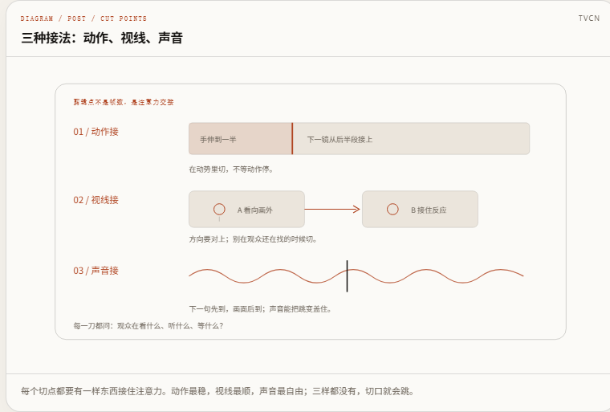

<!-- DIAGRAM_START -->
## 图解

<figure>
  
  <figcaption>每个切点都要有一样东西接住注意力。动作最稳，视线最顺，声音最自由；三样都没有，切口就会跳。</figcaption>
</figure>
<!-- DIAGRAM_END -->

剪不动，不一定是素材不够。很多时候，是两个镜头之间没有一个让人跟得上的切口。

## 动作接：在动势里切

手伸到一半、门推到一半、人转身到一半，这时候切。动作会把切口盖住，观众的眼睛正跟着那只手，不会注意到画面换了。

不要等动作做完再切。做完就停了，停了再切，会顿一下。剪辑点放在动作还在走的时候，下一镜从动作的后半段接上，观众看到的是一个连续的动作。

动作接最稳，也最便宜。没有动作，就制造一个：让他放下杯子、拉开门、把纸翻过来。手里有东西，切点就有地方藏。

## 视线接：让观众跟着眼睛走

A 看向画外，切到 B 的反应，观众会自然跟着视线走。这不是剪辑技巧，是人看东西的顺序：先看谁在看，再看他在看什么。

两个人的视线方向要对得上。A 看画面右边，B 就该从画面左边看回来；方向反了，观众会觉得两个人不在同一个空间。越轴的问题，多半出在这里。

不要在观众还在找的时候切。如果上一镜的视线没有落点，先给他一个目标：桌上的照片、门口的人、手里的手机。眼睛有了着落，切才成立。

## 声音接：让下一句先到

下一场的声音提前进来，画面后到，叫 J-cut；上一场的声音留到下一场，叫 L-cut。声音比画面自由，它能盖住跳变，也能提前建立新场景。

对白密集的片子，声音接最有用。上一句还没说完，下一张脸已经出现；观众不会觉得跳，因为耳朵还在跟着上一句走。不要用音乐硬盖，音乐一响，观众就知道你在遮。

剪辑点不是帧数，是注意力的交接。每一刀都问一句：观众这一刻在看什么、听什么、等什么。有一个答案，切口就稳；一个都没有，再准的帧数也救不了。

## 检查

- 每个切点能说出靠的是动作、视线还是声音。
- 动作切在动势里，不等动作停稳。
- 声音桥接不抢对白，也不靠音乐硬盖。

> 意图分工：本页负责「剪辑点：让注意力过去」的可执行细节；同集群先读 <a href="https://post.tvcn.org/article/fine-cut/">细剪：把粗剪的毛边修掉</a> 建立总判断，再回到本页。

<!-- INTENT_SCOPE -->

<!-- SOURCES_START -->
## 经验说明

经验说明：本页来自 4 次后期项目复盘，条件为4K 以内素材、常规平台交付；页面讨论的具体对象是「剪辑点：让注意力过去」；不含外部实验室测试，条件变化时结论可能失效。
<!-- SOURCES_END -->

