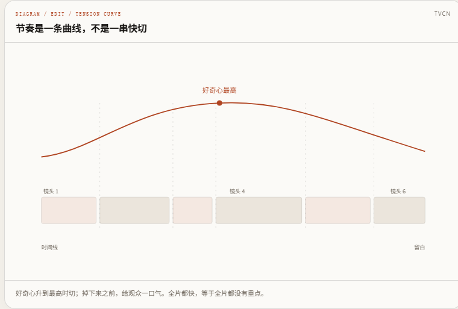

<!-- DIAGRAM_START -->
## 图解

<figure>
  
  <figcaption>好奇心升到最高时切；掉下来之前，给观众一口气。全片都快，等于全片都没有重点。</figcaption>
</figure>
<!-- DIAGRAM_END -->

## 先删掉解释

关掉旁白看一遍。如果动作还能读懂，旁白就是多余的。观众不需要你告诉他“他很伤心”，他需要看到他把筷子放下。

把一句解释删掉，通常会空出两秒。这两秒不要急着用音乐填，先让画面自己说话。

## 切在动作上，不要切在动作之后

手伸向门把、脚迈出画面、头转过去，都是切点。切晚了，观众会等；切早了，动作没完成。

对话可以提前进声音、延后出画面：下一句先听见，脸还在上一镜。观众会自己把两个空间接起来。

## 安静也是节奏

不是每个空隙都要铺音乐。两个人不说话的五秒，可能比一段鼓点更紧张。音乐进来之前，先让环境声撑住。

如果一段戏怎么看都拖，先查它有没有“新信息”。没有新信息，再短的镜头也拖；有新信息，长镜头也能看。

## 3 条验收

- 关掉旁白，故事还能看懂。
- 至少有三个切点落在动作上。
- 有一处安静没有被音乐填满。

<!-- DEEP_DIVE_START -->
## 深读

<strong>约 6 分钟。</strong> 节奏不是剪得快，是让观众在正确的时间想知道下一句。

### 节奏看信息缺口

一个镜头结束时，观众心里要留下一个小问题：他会不会进门？她有没有听见？下一个镜头就是回答。回答太快，观众不用等；回答太慢，观众已经走神。

用“问题—回答—新问题”连场，而不是靠加速。全片都快，等于没有节奏。

每场只留一个主问题；支线问题可以多，但不要在同一秒一起问。

### 长镜头和短镜头交替

三个同样长度的镜头连续出现，观众会感到平；把其中一个拉长两秒，另外两个缩短，呼吸就出来了。

动作场面可以用短镜头，但每三到四个短镜头要留一个稍长的反应，否则观众只剩晕。

长镜头不是慢，是让观众有时间看完一个动作；短镜头不是快，是让观众来不及想。两者要互相解释。

### 音乐点不是切点

不要把每个鼓点都切一遍；音乐是背景，画面有自己的因果。先按动作剪，再让音乐对齐；反过来会被音乐拖着走。

一场戏至少留一个无音乐的两秒，让观众听见房间；静下来，下一段才推得动。

如果一段画面必须靠音乐才成立，先问它是不是没有动作；音乐不能替人物做决定。

### 五分钟练习：一长两短

找一段 30 秒素材，先剪成三个同样长度的镜头，再重剪成两短一长；两版并排看，问哪一版更想让下一句出现。

不要加音乐，先只看画面；节奏不对，音乐只会盖住。第三版再删掉一个镜头，看故事是否还成立。

### 节奏检查，十项
<ul><li>先问这场戏要观众等什么</li><li>每个镜头留一个问题</li><li>回答不要提前给</li><li>长短镜头交替</li><li>每三四个短镜头留一个反应</li><li>先按动作剪再对音乐</li><li>不要每个鼓点都切</li><li>留一个无音乐的两秒</li><li>删掉重复信息</li><li>手机外放看一遍</li></ul>
节奏不是让画面更快，是让观众更想往下看。

<!-- DEEP_DIVE_END -->
