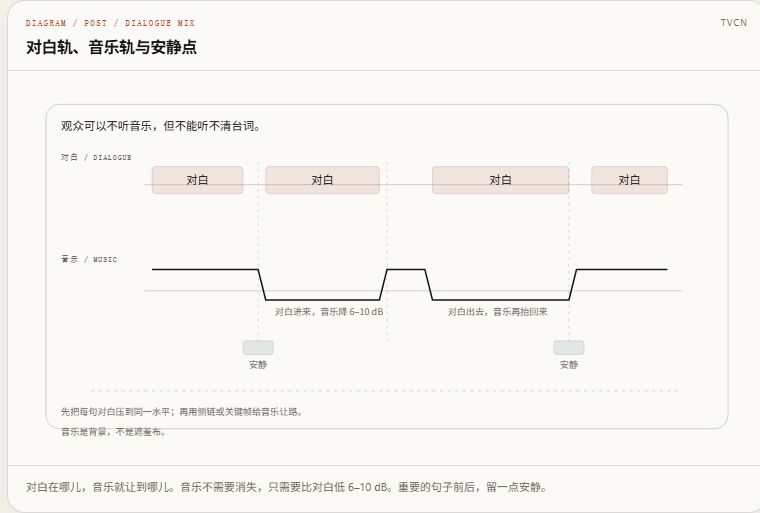

<!-- DIAGRAM_START -->
## 图解

<figure>
  
  <figcaption>对白在哪儿，音乐就让到哪儿。音乐不需要消失，只需要比对白低 6–10 dB。重要的句子前后，留一点安静。</figcaption>
</figure>
<!-- DIAGRAM_END -->

观众可以不听音乐，但不能听不清台词。先把对白压到同一水平，再把音乐推下去。音乐是背景，不是遮羞布。

## 先把对白压平

逐句听。修掉爆音、口水音、明显底噪；把不同镜头、不同麦克风的句子压到同一个水平。不要用一条总轨硬拉，哪句轻就拉总轨，下一句会炸。

对白轨先单独听一遍，不看画面。只听清楚，不听好听。听不清的词，记下来，回剪辑改字幕或换一条备用音。

## 音乐让路

音乐在对白下压 6–10 dB。不要从第一秒就满，也不要在整段对白下面一直顶。用侧链或手动关键帧，在对白进来的地方降，出去的地方再抬。

音乐进入要有理由：动作、转折、场景变化、时间跳。不要随便铺，观众会先听见“这里想让我感动”，而不是故事。

## 安静也是混音

不是每分钟都要有音乐。重要台词前后留半秒安静，让句子落地。环境音铺底，不要留成真空；空调声、远处车流，比全静更真。

结尾让音乐先走，画面后走。观众会记住最后那一点安静。

## 检查

- 每句对白都听得清，不靠字幕也能懂。
- 音乐在对白下明显让路，不是从头压到尾。
- 至少有一处主动留白，不靠音乐填满。

## 对白不是越干净越好

把对白修到绝对干净，观众反而像在看配音棚。保留一层低低的房间底噪，镜头切换时才不会“进真空”。

底噪要连续：同一场戏用同一条 room tone，不要每个镜头换一条。换一条，剪点就会露。

## 音乐让路的三种做法

第一，手动画音量线，在对白前后各留 0.3 秒过渡；第二，用侧链压缩，让音乐跟着人声降；第三，直接换编排，把音乐写成不抢中频的版本。

三种可以叠用，但不要只靠最后一步“整体调小”。整体调小会让音乐失去形状，观众只听到一条平线。

## 检查顺序

先关画面听一遍：对白是否清楚、音乐是否突然进出、环境是否断。再开画面听一遍：声音是否跟动作对得上。

最后把音量拉到平台标准附近再听：太安静的对白在手机上会消失，太响的音乐在耳机里会刺耳。

<!-- V11_DEEPEN -->

> 意图分工：本页负责「混音：先让对白站住，再加音乐」的可执行细节；同集群先读 <a href="https://post.tvcn.org/article/loudness/">响度：平台目标与真峰值</a> 建立总判断，再回到本页。

<!-- INTENT_SCOPE -->

<section><h2>边界</h2>
本页只解决「混音：先让对白站住，再加音乐」这一个问题；不替代 多语言字幕：别一行塞两种语言、配乐剪辑：让音乐跟着动作、构图：先让观众知道看哪里。如果现场问题属于后者，先读对应页，不要在本页继续加参数。
</section>
<!-- SOURCES_START -->
## 经验说明

经验说明：本页来自 5 个后期项目的操作复盘，条件为页面所列软件版本、素材格式与交付平台；只讨论「混音：先让对白站住，再加音乐」的操作顺序，不含外部实验室测试；不适用于未列版本、影院母版、广播级安全认证或法律意见。
<!-- SOURCES_END -->

