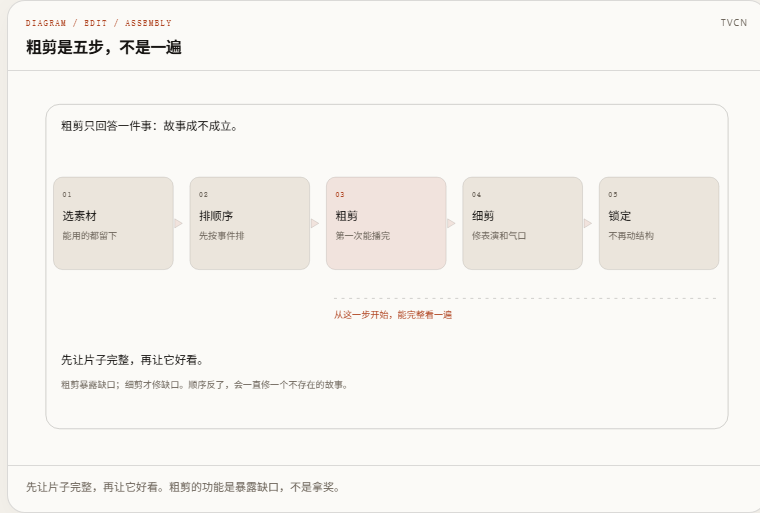

<!-- DIAGRAM_START -->
## 图解

<figure>
  
  <figcaption>先让片子完整，再让它好看。粗剪的功能是暴露缺口，不是拿奖。</figcaption>
</figure>
<!-- DIAGRAM_END -->

粗剪只做一件事：让陌生人看懂谁想要什么、被什么挡住。节奏、调色、配乐都往后放。

## 先结构，后节奏

把镜头按分镜顺序放上时间线，先定入点和出点。不要一边剪一边调色，也不要一边剪一边找音乐；那会把“结构问题”误当成“氛围问题”。

第一版只问：观众知不知道现在发生了什么？如果不知道，加镜头或删镜头，不要靠转场救。

## 删三类镜头

第一类，重复：第二个镜头没有带来新信息。第二类，装饰：很好看，但不推动动作。第三类，解释：角色用台词把画面已经说清楚的事再说一遍。

删的时候先标记，不要立刻删除。先把“可能删”的镜头放进废片轨，完整看一遍，再决定。

## 写 3 条修改清单

每次看完粗剪，只写 3 条，每条带时间点：00:12 观众不知道她为什么走；00:38 反应镜头太长；00:51 结尾没有代价。

不要写“感觉不对”。感觉不对不是问题，具体到哪一秒、哪一个信息缺失，才是可修改的问题。

## 3 条验收

- 陌生人看完能说出谁想要什么。
- 没有超过 3 秒的无意义空镜。
- 修改清单有 3 条，且每条带时间点。
<!-- SOURCES_START -->
<h2>参考与延伸阅读</h2>

经验来源：TVCN 现场手册与项目复盘；实测来源：页面标注的复核环境与可复现练习；参考来源：以下公开链接。

<ul><li>[S24] ACES 色彩管理</li><li>[S27] EBU R128 响度</li><li>[S28] Netflix 制作与交付帮助</li><li>[S30] DaVinci Resolve 产品与文档</li><li>[S34] Adobe Premiere Pro 用户指南</li><li>[S35] Avid 资源中心</li></ul>

<a href="../../about/">完整链接与用途见 SOURCES.md</a>

<!-- SOURCES_END -->
