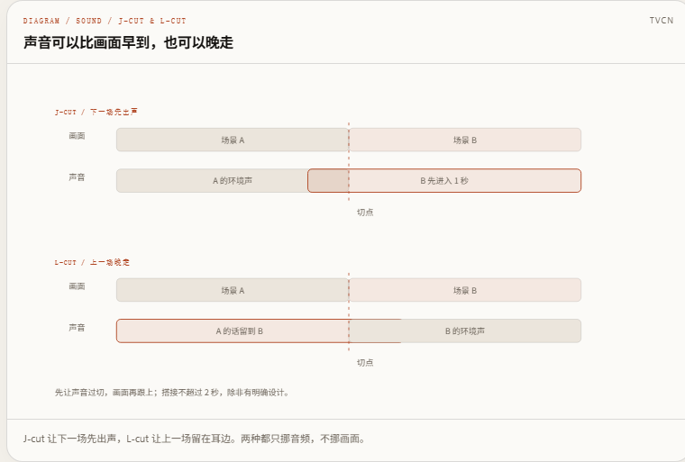

<!-- DIAGRAM_START -->
## 图解

<figure>
  
  <figcaption>J-cut 让下一场先出声，L-cut 让上一场留在耳边。两种都只挪音频，不挪画面。</figcaption>
</figure>
<!-- DIAGRAM_END -->

## 先决定观众该听谁

剪辑点不只是画面，也是注意力。切之前问一句：下一段观众先需要听见什么？如果下一场的声音能先把空间建起来，就让声音先过切。

声音比画面快半拍，观众不会觉得被推着走；声音和画面同时硬切，才像关了一扇门。

## J-cut：下一场先出声

画面还在上一场，下一场的环境声或台词已经进来。先听见市场吆喝，再看见市场；先听见电话那头，再切到接电话的人。观众会提前进入下一场，切画面时就不会断片。

做法：把下一场的音频块向左拖 12–24 帧，先试 1 秒。对白片可以再长一点，但别让上一场的人还在说话时被抢戏。

## L-cut：上一场留在耳边

画面已经切到听的人，上一场的声音还在继续。一个人刚说完狠话，画面切到另一个人的脸，声音还留在空气里。观众会在这段空白里想他刚才说了什么。

做法：把上一场的音频块向右拖，盖住新画面前 1–2 秒。同时给新画面一个能独立成立的动作，别让观众只看一张静止的脸。

## 不要用声音遮烂画面

J-cut 和 L-cut 是桥，不是创可贴。画面里的穿帮、跳轴、表演断裂，靠声音盖过去，观众还是会觉得不对。先把画面剪顺，再用声音让它更顺。

## 检查

- 每个 J-cut 或 L-cut 都能说出：观众先听见什么，后看见什么。
- 声音搭接不超过 2 秒，除非有明确的设计。
- 静音看一遍，画面本身也能成立。

<!-- SOURCES_START -->
## 经验说明

经验说明：本页来自 3 次后期项目复盘，条件为4K 以内素材、常规平台交付；页面讨论的具体对象是「声音先走：J-cut 与 L-cut」；不含外部实验室测试，条件变化时结论可能失效。
<!-- SOURCES_END -->

