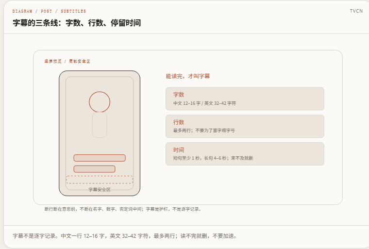

<!-- DIAGRAM_START -->
## 图解

<figure>
  
  <figcaption>字幕不是逐字记录。中文一行 12–16 字，英文 32–42 字符，最多两行；读不完就删，不要加速。</figcaption>
</figure>
<!-- DIAGRAM_END -->

字幕不是台词的复制件，是观众在来不及听清时的一根扶手。

## 先决定哪一句必须被读到

字幕不是把台词全打出来。口头语、重复、语气词可以删；人名、数字、否定词、转折不能丢。观众扫一眼就要抓到意思，抓不到就会退回去重读，戏就断了。

先把整段话压成一行能读懂的意思，再断行。不要为了字数把“不”和“同意”拆到两行，观众可能只看到一半。

字幕是给耳朵的护栏，不是逐字记录。听不清的地方，字幕要补；听得清的地方，字幕不要抢。

## 断行按意思断，不按字数断

中文一行 12–16 字，英文一行 32–42 个字符；最多两行，不要三行。数字和单位别拆行，人名和头衔别拆行，否定词和它修饰的词也别拆行。

一句话太长，先删，不要缩小字号。字号一变小，观众就得凑近看，画面也就输了。

断行断在从句和转折前，不要断在“的”“了”“and”“but”这种连接词后面。眼睛需要在行尾换气，不要让它掉下去。

## 时间和位置也是语法

字幕要跟着说话出现，不要提前抢跑，也不要晚到。短句至少留 1 秒，长句别超过 4–6 秒；来不及读，就合并或删，而不是加速。

竖屏把字幕放在底部安全区上方，别压住嘴和手。双人对话不要只靠颜色区分说话人，加名字或位置；颜色对色盲观众不成立。

字幕出现和消失都要留一点余量。太早出现会剧透，太晚消失会拖住下一句。

## 检查

- 中文每行不超过 16 字，英文不超过 42 个字符，最多两行。
- 数字、名字、否定词没有被拆行或删掉。
- 字幕不挡嘴和手，竖屏留在底部安全区。

<section><h2>边界</h2>
本页只解决「字幕：让观众读完，不是逐字抄」这一个问题；不替代 片头字：先读清，再谈酷、跟踪：点要贴在实处、构图：先让观众知道看哪里。如果现场问题属于后者，先读对应页，不要在本页继续加参数。
</section>
<!-- SOURCES_START -->
## 参考与延伸阅读

- [S68] [W3C：WebVTT](https://www.w3.org/TR/webvtt1/) — 2026-11-26 访问。用于核对「先决定哪一句必须被读到」一节的术语/方法/规则（WebVTT 字幕格式，不是平台审核规则）；不核对其中由本页经验得出的数字、型号与现场结论，也不替代测试。
- [S06] [W3C：字幕与说明指南](https://www.w3.org/WAI/media/av/captions/) — 2026-11-26 访问。用于核对「断行按意思断，不按字数断」一节的术语/方法/规则（W3C 字幕/说明指南，不是平台审核规则）；不核对其中由本页经验得出的数字、型号与现场结论，也不替代测试。
<!-- SOURCES_END -->

