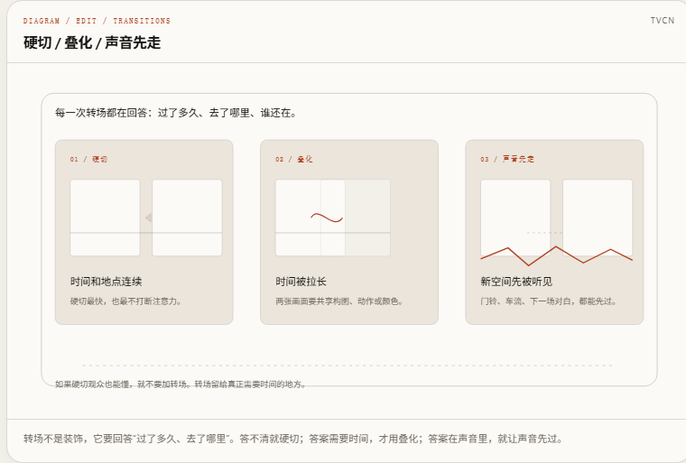

<!-- DIAGRAM_START -->
## 图解

<figure>
  
  <figcaption>转场不是装饰，它要回答“过了多久、去了哪里”。答不清就硬切；答案需要时间，才用叠化；答案在声音里，就让声音先过。</figcaption>
</figure>
<!-- DIAGRAM_END -->

叠化、黑场、划像不是装饰。每一次转场都在回答三个问题：过了多久、去了哪里、谁还在。答不清，就硬切。

## 硬切是默认

时间和地点连续，直接切。观众不需要被提醒“这里是另一个镜头”。硬切最快，也最不打断注意力。大部分片子百分之九十的镜头都该是硬切。

不要用花哨转场去补一个没拍清楚的场景。观众看见叠化，不会觉得时间过去了，只会觉得“这里在遮什么”。

## 叠化只在时间被拉长时用

叠化表示时间流逝、地点合并、状态变化。两个画面要共享构图、动作或颜色，否则看起来像操作失误。人物在同一个位置坐下，背景从白天变到黄昏，叠化才成立。

不要每个场景之间都叠化。第一次用，观众知道过了很久；第三次用，观众开始等下一张幻灯片。一场片子留一两次就够。

## 声音可以先转场

画面还在旧场景，声音已经进了新场景：门铃、车流、下一场的对白。这叫声音先走。观众先听见新空间，再看见它，转场就顺了。

反过来也可以：画面已经切到新场景，旧场景的声音再留半秒。用一个声音把两个空间缝在一起，比加一个特效便宜，也比特效可信。

## 检查

- 这个转场回答了“过了多久、去了哪里”吗？
- 如果换成硬切，观众会误解吗？不会，就硬切。
- 前后两个画面有共享的构图、动作或声音吗？
