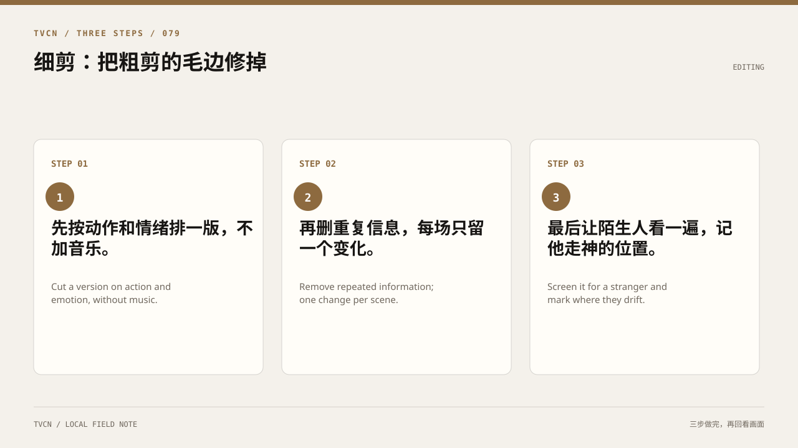

细剪只处理三件事：删掉每个镜头前后多余的半秒、把动作接点对准、把表演里不需要的反应拿掉。结构问题回粗剪解决，不要在这里靠转场遮。

<!-- DIAGRAM_START -->
<h2>图解</h2>
<figure>
  
  <figcaption>看“每场找三个毛边：切点早半帧、呼吸重叠…”和“只修这三类，不加新镜头”两处，判断剪掉一个镜头后，节奏是更快还是更乱。</figcaption>
</figure>
<!-- DIAGRAM_END -->
<section><h2 id="section-1">细剪修毛边，不重写结构</h2>
每改一刀就问：观众少知道了什么？如果删掉后因果关系还在，这一刀成立；如果必须加字幕解释，退回粗剪。
<h2 id="section-2">边界</h2>
细剪不是越短越好。把呼吸和停顿全删掉，人物会变成机器；留住能说明关系的停顿。
</section><section><h2 id="section-3">现场</h2>
每场找三个毛边：切点早半帧、呼吸重叠、空镜多一秒；修完让陌生人看，记他看手机的位置。
</section><section><h2 id="section-4">怎么做</h2><ol><li>每场找三个毛边：切点早半帧、呼吸重叠、空镜多一秒。</li><li>只修这三类，不加新镜头。</li><li>让陌生人看一遍，记他看手机的位置，再修那一秒。</li></ol></section><section><h2 id="section-5">别踩</h2>
别用花哨转场掩盖结构问题；转场救不了拖。
</section><section><h2>判断</h2>
这一页的判断只看三条可观察的验收，不靠口号：
<ul><li><strong>1.</strong> 每场至少修掉三个具体毛边，切点不再“咬”一下。</li><li><strong>2.</strong> 呼吸和停顿接得上，没有一句被切半截。</li><li><strong>3.</strong> 陌生人看片时看手机的位置减少，或能说出为什么还在拖。</li></ul></section><section><h2>失败</h2>
下面任一条出现，先停，不要靠后期补：
<ul><li><strong>1.</strong> 只做到“每场至少修掉三个具体毛边，切点不再“咬”一下”的形式，换一个机位或场景就重现不了。</li><li><strong>2.</strong> 把“呼吸和停顿接得上，没有一句被切半截”留到后期或口头解释，现场没有留下能复查的记录。</li><li><strong>3.</strong> 别用花哨转场掩盖结构问题；转场救不了拖。</li></ul></section><section><h2>延伸</h2>
<strong>10 分钟练习：</strong>拿一段 30 秒素材做 A/B，只改“每场找三个毛边：切点早半帧、呼吸重叠…”；记下一个时间码和一处差异，再决定是否保留。
</section>
<h2>验收</h2><ul><li>每场至少修掉三个具体毛边，切点不再“咬”一下。</li><li>呼吸和停顿接得上，没有一句被切半截。</li><li>陌生人看片时看手机的位置减少，或能说出为什么还在拖。</li></ul>

<!-- DEEP_DIVE_START -->
## 深读

<strong>约 5 分钟。</strong> 粗剪解决“讲没讲清”，细剪解决“顺不顺、疼不疼、有没有多”。

### 细剪先修四种接点

动作接点：在手伸到一半时切；视线接点：看与被看之间切；声音接点：用一句台词的尾音盖住画面；形状接点：让门框、桌沿、肩膀在画面里对齐。

四种接点不是炫技，是让观众不察觉剪辑。一个接点修三遍还别扭，通常不是剪辑问题，是素材少了一条。

### 删掉三样东西

删重复信息、删人物进出门的完整过程、删没有变化的反应镜头。观众不需要看人从沙发走到门口，直接让他已经在门口。

每删一场，问一次“删了之后人物损失了什么”。没有损失，这场就只是填充。

### 节奏不是快，是变化

连续三个同样长度的镜头，观众就会走神；连续三个越来越短的镜头，情绪会往上走。节奏是长短交替，不是全部剪快。

一场戏至少留一个停两秒的镜头，让观众喘气。没有停顿，后面的爆发就没有对比。

### 把一场戏剪短一半

拿一场三分钟的戏，只保留人物进入、发生转折、做出决定三个点，其他全删。你会发现观众仍然看得懂，甚至更清楚。

删完再补回一个必要反应。这个练习做三次，你会知道哪些镜头是习惯，不是故事。

### 细剪一遍，先修这十处
<ul><li>动作切在手伸到一半的位置</li><li>视线切在看与被看之间</li><li>用一句台词的尾音盖住画面变化</li><li>让门框、桌沿、肩膀跨镜对齐</li><li>删掉重复交代的信息</li><li>删掉人物从沙发走到门口的完整过程</li><li>删掉没有变化的反应镜头</li><li>每场至少留一个两秒停顿</li><li>连续三个同长度镜头就打散</li><li>每删一场问人物损失了什么</li></ul>
细剪不是把画面修漂亮，是把“还差一点”的地方找出来。找十次，你会开始信任自己的不舒服。每改一刀就播放切点前后各五秒，不要只盯着切点本身，节奏在前后关系里。

<!-- DEEP_DIVE_END -->

<!-- SOURCES_START -->
## 参考与延伸阅读

- [S30] [DaVinci Resolve 产品与文档](https://www.blackmagicdesign.com/products/davinciresolve) — 2026-11-26 访问。用于核对首段“细剪不是加特效，是把每个切换、每句呼吸、每个多余半秒修顺。”中的术语与公开背景（剪辑、调色、Fusion 与交付的官方产品入口）；不替代现场测试。
- [S34] [Adobe Premiere Pro 用户指南](https://helpx.adobe.com/premiere-pro/user-guide.html) — 2026-11-26 访问。用于核对首段“细剪不是加特效，是把每个切换、每句呼吸、每个多余半秒修顺。”中的术语与公开背景（剪辑、代理、色彩与导出的官方文档）；不替代现场测试。
<!-- SOURCES_END -->

