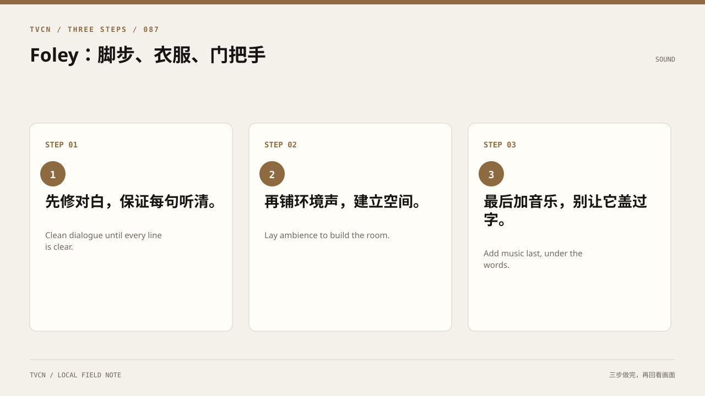

Foley 的第一关是同步：脚步落地的帧、衣服摩擦的帧、杯子放下的帧。先把动作对上，再加重量和材质；不同步的 Foley 比没有更假。

<!-- DIAGRAM_START -->
<h2>图解</h2>
<figure>
  
  <figcaption>看“拍完先录脚步、衣服摩擦、门把手三样”和“静音对画面，确认每一下都落在动作上”两处，判断剪掉一个镜头后，节奏是更快还是更乱。</figcaption>
</figure>
<!-- DIAGRAM_END -->
<section><h2 id="section-1">先对动作，再谈创意</h2>
分层做：接触声、运动声、环境声分开录，剪辑时分别调；不要一条音轨包办。
<h2 id="section-2">边界</h2>
Foley 不是“加声音就丰富”。画面没有的动作，不要硬加；观众会感到声画分离。
<h2>Foley 三件套：脚、衣、物</h2>

Foley 不是“加音效”，是把画面里的动作做出可听的重量。先做脚步，再做衣服摩擦，最后做道具接触；三者分开录，后期才能调。

<ol><li>脚步按地面材质分：木、水泥、地毯；每只脚单独录，不要两只一起。</li><li>衣服摩擦只在动作明显时加，不要全程铺；音量比对白低 12–18dB。</li><li>门把手、杯子、纸张用近场话筒，录干声；不要加混响，混响留给混音。</li></ol>

验收：关掉音乐，只听 Foley 和对白，能判断人物体重和空间材质；听不出，先补脚步。
</section><section><h2 id="section-3">现场</h2>
拍完先录脚步、衣服摩擦、门把手三样；静音下对画面，再混进环境声，别盖对白。
</section><section><h2 id="section-4">怎么做</h2><ol><li>拍完先录脚步、衣服摩擦、门把手三样。</li><li>静音对画面，确认每一下都落在动作上。</li><li>混进环境声和对白，Foley 不能盖住字。</li></ol></section><section><h2 id="section-5">别踩</h2>
别用 Foley 填满安静段；动作有声音，安静也有重量。
</section><section><h2>判断</h2>
这一页的判断只看三条可观察的验收，不靠口号：
<ul><li><strong>1.</strong> 脚步、衣服、门把手三类声音都能对上具体动作。</li><li><strong>2.</strong> 静音看画面时，每一下都有声，且没有早半帧。</li><li><strong>3.</strong> 混进对白后，字仍然清楚，Foley 没有抢中频。</li></ul></section><section><h2>失败</h2>
下面任一条出现，先停，不要靠后期补：
<ul><li><strong>1.</strong> 只做到“脚步、衣服、门把手三类声音都能对上具体动作”的形式，换一个机位或场景就重现不了。</li><li><strong>2.</strong> 把“静音看画面时，每一下都有声，且没有早半帧”留到后期或口头解释，现场没有留下能复查的记录。</li><li><strong>3.</strong> 别用 Foley 填满安静段；动作有声音，安静也有重量。</li></ul></section><section><h2>延伸</h2>
<strong>10 分钟练习：</strong>拿一段 30 秒素材做 A/B，只改“拍完先录脚步、衣服摩擦、门把手三样”；记下一个时间码和一处差异，再决定是否保留。
</section>
<h2>验收</h2><ul><li>脚步、衣服、门把手三类声音都能对上具体动作。</li><li>静音看画面时，每一下都有声，且没有早半帧。</li><li>混进对白后，字仍然清楚，Foley 没有抢中频。</li></ul>

<!-- DEEP_DIVE_START -->
## 深读

<strong>约 6 分钟。</strong> Foley 不是补脚步声，是让画面有重量。观众听见的往往不是动作，是动作落在什么上面。

### 先铺房间声

每场先录三十秒空房间，把对白的底填平。没有房间声，剪点会像真空，观众会觉得画面在跳。

房间声要跟场景一致，厨房和卧室不能共用。空间大小、墙面软硬、远处噪声都要对。

### 脚步和衣服

脚步分鞋底、地面、节奏三层。木地板、水泥、地毯声音不同，先看画面再选。

衣服摩擦用小布块在话筒前揉，别用成品音效硬贴。成品音效一听就是别人的衣服。

### 同步不是对齐一帧

先对动作的起点，再听重心。差两帧，观众觉得轻；差五帧，觉得假。数字对齐不等于感觉对齐。

录的时候看画面，不要只看波形；Foley 是表演。表演对了，波形自然会跟上。

### Foley 的录法

话筒离声源二十到三十厘米，太近会爆，太远像资料库。

每一条录三遍：正常、轻、重。剪辑需要重量变化。

### 环境声和 Foley 的分工

环境声铺底，Foley 做点。底太厚，点就听不见；底太薄，点像贴在画面上。

先铺底，再加点，每加一层 solo 一次。

### Foley 录完，十项检查
<ul><li>先录三十秒房间声</li><li>脚步分鞋底、地面、节奏</li><li>衣服摩擦单独录</li><li>道具声单独录</li><li>录音时看画面表演</li><li>对齐动作起点</li><li>误差控制在两帧内</li><li>不同场景换声底</li><li>不要全用成品音效</li><li>混音前 solo 检查</li></ul>
Foley 做得好，观众不会注意到声音；做得差，他们会觉得演员在空气里走路。

### 只剩五分钟时
<ul><li>先录房间声</li><li>脚步分鞋底、地面、节奏</li><li>衣服摩擦单独录</li><li>录的时候看画面</li><li>动作起点对齐</li><li>混音前 solo 检查</li></ul>
Foley 不是音效库，是演员不在场时，身体留下的那点重量。先让脚步落在地上，再让声音变好听。脚步先落地。

<!-- DEEP_DIVE_END -->

<!-- SOURCES_START -->
## 参考与延伸阅读

- [S30] [DaVinci Resolve 产品与文档](https://www.blackmagicdesign.com/products/davinciresolve) — 2026-11-26 访问。用于核对首段“Foley 不是配背景音，它把画面里的动作重新做成声音：脚步、衣服、门把手。”中的术语与公开背景（剪辑、调色、Fusion 与交付的官方产品入口）；不替代现场测试。
- [S27] [ITU-R：BS.1770 音频响度与真峰值测量](https://www.itu.int/rec/R-REC-BS.1770/en) — 2026-11-27 访问。用于核对首段“Foley 不是配背景音，它把画面里的动作重新做成声音：脚步、衣服、门把手。”中的术语与公开背景（响度测量、真峰值与 EBU R128 所依据的 ITU 算法标准）；不替代现场测试。
- [S67] [IETF：RFC 8216：HTTP Live Streaming](https://datatracker.ietf.org/doc/html/rfc8216) — 2026-11-26 访问。用于核对首段“Foley 不是配背景音，它把画面里的动作重新做成声音：脚步、衣服、门把手。”中的术语与公开背景（HLS 分片、清单与播放）；不替代现场测试。
<!-- SOURCES_END -->

