<!-- DIAGRAM_START -->
<h2>图解</h2>
<figure>
  
  <figcaption>示意：HDR 的每一段都要有亮度锚点；只在最后把母版拉亮，会把高光和肤色一起毁掉。</figcaption>
</figure>
<!-- DIAGRAM_END -->
<h2>先判断：这条片子真的需要 HDR 吗</h2>
需要 HDR 的片子通常有可用的高光层次：窗外、霓虹、火光、金属反光；并且主要交付平台支持 HDR。没有高光信息、主要在手机小屏观看的片子，做 HDR 往往只得到更亮的中间调。

先问交付：平台要 PQ 还是 HLG，是否同时要 SDR 版本，母版走哪个标准。答不出，就不要在调色里先做 HDR；后面转 SDR 会多一遍活血。
<h2>拍摄与监看：先保住高光，再谈亮度</h2>
拍 Log 或 RAW，按高光保护曝光；不要为了监看好看把白电平压到 SDR。现场监视器要能加载 HDR 转换 LUT，但 LUT 只用于构图和曝光判断，不用于最终调色。

用一张 18% 灰卡和一张白卡做锚点：灰卡决定中间调，白卡决定高光余量。每换一个场景拍一次，后期才知道每段该从哪里起步。
<h2>调色：先做 HDR，再做 SDR trim</h2>
HDR 调色先定白点：SDR 白在 HDR 里不是 100%，通常要落在较低的位置；然后定高光滚降，让窗外和灯有层次，不直接切到峰值。肤色用示波器看，不要用“亮不亮”判断。

HDR 母版锁定后再做 SDR trim：不要直接压缩曲线，先看每个场景的中间调关系，再单独提高光。SDR 不是 HDR 的缩小版，它需要另一套对比判断。
<h2>交付：平台、母版、字幕与 QC</h2>
交付前写一张表：HDR 母版用 PQ 还是 HLG、峰值多少、SDR 版本用 Rec.709、字幕亮度、平台转码要求。HDR 字幕不要用纯白 100%，否则在暗场会刺眼；SDR 字幕也要单独检查。

QC 至少看三遍：HDR 参考监视器、SDR 参考监视器、普通手机。三遍都要检查高光是否死白、肤色是否偏、暗部是否有细节、字幕是否可读。
<h2>失败案例：把 SDR 拉亮当成 HDR</h2>
一条城市夜景，前期按 SDR 拍，窗外全白。后期把整体拉亮、加对比，声称 HDR。结果霓虹没有颜色，天空没有层次，人脸却过亮。平台转码后高光直接裁掉，HDR 版本和 SDR 看起来一样。

补救只能回到素材：没有高光信息，就没有 HDR。真正该做的是重拍窗外，或在 SDR 里把对比做好，不要用 HDR 标签掩盖拍摄不足。
<h2>成本与验收</h2>
低成本：HDR 监看借用 + 一次 HDR 调色 + 一次 SDR trim，¥5,000–15,000。中成本：HDR 调色棚 2–3 天、SDR 版本、QC，¥15,000–40,000。高成本：多版本平台交付、杜比视界/HLG 双母版，¥40,000–100,000+。
<h2>验收</h2><ul><li>交付平台和 HDR 标准已写清。</li><li>拍摄保留高光，灰卡/白卡每场景都有。</li><li>HDR 调色先定白点，再做高光滚降。</li><li>HDR 母版锁定后才做 SDR trim。</li><li>HDR 与 SDR 字幕分别检查。</li><li>三种监视器各看一遍 QC。</li></ul>
<!-- SOURCES_START -->
<h2>参考与延伸阅读</h2>

经验来源：TVCN 现场手册与项目复盘；实测来源：页面标注的复核环境与可复现练习；参考来源：以下公开链接。

<ul><li>[S24] ACES 色彩管理</li><li>[S26] ITU-R BT.2020</li><li>[S28] Netflix 制作与交付帮助</li></ul>

<a href="../../SOURCES.md">完整链接与用途见 SOURCES.md</a>

<!-- SOURCES_END -->
