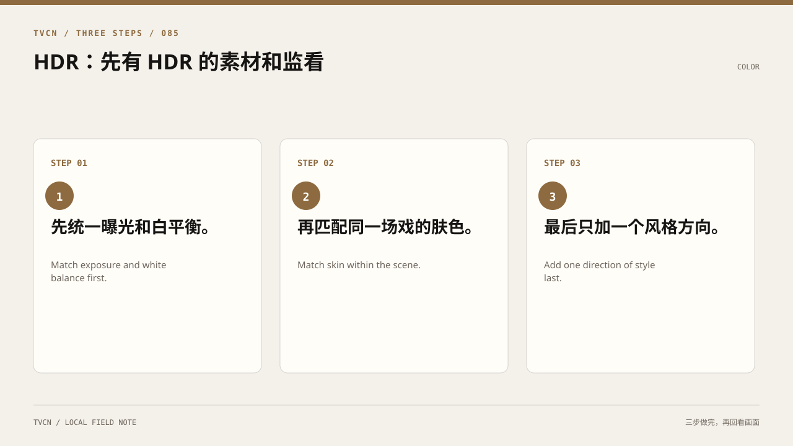

HDR 不是把暗部无限拉亮，而是保留从窗到暗角的信息。曝光时让高光刚好不贴顶，用假色或波形确认；暗部留噪声空间，后期再决定压多少。

<!-- DIAGRAM_START -->
<h2>图解</h2>
<figure>
  
  <figcaption>看“确认监看支持 HDR，素材有 10-…”和“交付 HDR10 或 HLG 时单独…”两处，判断剪掉一个镜头后，节奏是更快还是更乱。</figcaption>
</figure>
<!-- DIAGRAM_END -->
<section><h2 id="section-1">HDR 先保高光，再谈“亮”</h2>
交付前用目标屏幕看一遍：HDR 母版在普通屏上可能发灰，需要单独做 SDR 版本，不要一版通投。
<h2 id="section-2">边界</h2>
HDR 不是风格滤镜。没有 HDR 屏幕和正确元数据，观众看到的可能比 SDR 更差；先确认交付链，再决定拍不拍。
<h2 id="section-3">HDR 先有监看，再谈交付</h2>

没有 HDR 监视器就做 HDR，等于闭眼调色。先确认监看链路：摄影机 log → HDR 监视器 → 交付 PQ/HLG；任何一段是 SDR，都只能做“猜”。

<ol><li>监看亮度按交付标准设置，不要用电视默认“鲜艳”模式；环境光保持低。 </li><li>先在 PQ 里调高光，再做 SDR trim；不要用 SDR 版本反推 HDR。</li><li>交付前在普通 SDR 电视上看一遍，确认高光不刺眼、暗部不死黑。</li></ol>

验收：HDR 和 SDR 两版都看，肤色一致、高光有细节；只有一版能看，说明转换不是可逆的。
</section><section><h2 id="section-4">现场</h2>
先确认监看支持 HDR、素材有 10-bit 和 Log；交付 HDR10 或 HLG 时单独做一版，不要从 SDR 拉。
</section><section><h2 id="section-5">怎么做</h2><ol><li>确认监看支持 HDR，素材有 10-bit 和 Log。</li><li>交付 HDR10 或 HLG 时单独做一版。</li><li>不要从 SDR 版本拉亮，保留 HDR 的高光和暗部。</li></ol></section><section><h2 id="section-6">别踩</h2>
别把 SDR 拉亮当 HDR；高光是假的，暗部也没有信息。
</section><section><h2>判断</h2>
这一页的判断只看三条可观察的验收，不靠口号：
<ul><li><strong>1.</strong> 素材是 10-bit Log，监看链路真的支持 HDR。</li><li><strong>2.</strong> HDR 版是单独做的，不是从 SDR 拉亮。</li><li><strong>3.</strong> HDR 和 SDR 两版都看一遍，高光与暗部都能各自成立。</li></ul></section><section><h2>失败</h2>
下面任一条出现，先停，不要靠后期补：
<ul><li><strong>1.</strong> 只做到“素材是 10-bit Log，监看链路真的支持 HDR”的形式，换一个机位或场景就重现不了。</li><li><strong>2.</strong> 把“HDR 版是单独做的，不是从 SDR 拉亮”留到后期或口头解释，现场没有留下能复查的记录。</li><li><strong>3.</strong> 别把 SDR 拉亮当 HDR；高光是假的，暗部也没有信息。</li></ul></section><section><h2>延伸</h2>
<strong>10 分钟练习：</strong>拿一段 30 秒素材做 A/B，只改“确认监看支持 HDR，素材有 10-…”；记下一个时间码和一处差异，再决定是否保留。
</section>
<h2>验收</h2><ul><li>素材是 10-bit Log，监看链路真的支持 HDR。</li><li>HDR 版是单独做的，不是从 SDR 拉亮。</li><li>HDR 和 SDR 两版都看一遍，高光与暗部都能各自成立。</li></ul>

<!-- SOURCES_START -->
## 参考与延伸阅读

- [S24] [ACESCentral：ACES 色彩规范](https://acescentral.com/) — 2026-11-26 访问。用于核对「HDR 先保高光，再谈“亮”」一节的术语/方法/规则（ACES 色彩规范，不是调色教程）；不核对其中由本页经验得出的数字、型号与现场结论，也不替代测试。
- [S25] [ITU-R BT.709](https://www.itu.int/rec/R-REC-BT.709/en) — 2026-11-26 访问。用于核对「HDR 先有监看，再谈交付」一节的术语/方法/规则（BT.709 高清电视参数，不是现场曝光建议）；不核对其中由本页经验得出的数字、型号与现场结论，也不替代测试。
- [S30] [DaVinci Resolve：官方文档](https://www.blackmagicdesign.com/products/davinciresolve) — 2026-11-26 访问。用于核对「现场」一节的术语/方法/规则（Resolve 官方产品/文档入口，不是第三方教程）；不核对其中由本页经验得出的数字、型号与现场结论，也不替代测试。
<!-- SOURCES_END -->

