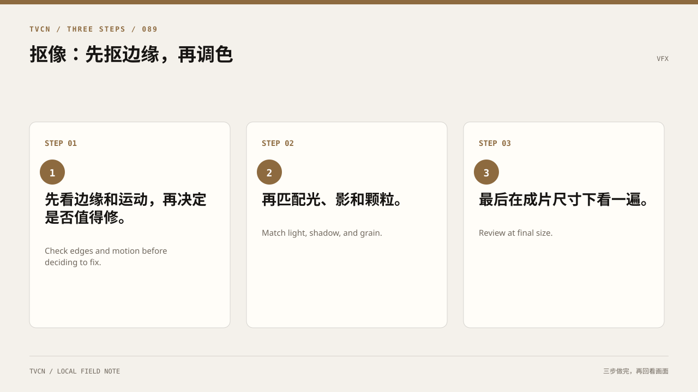

别在 400% 下修观众看不到的瑕疵；成片尺寸才是判断标准。

<!-- DIAGRAM_START -->
<h2>图解</h2>
<figure>
  
  <figcaption>看“先看头发、手指、透明杯三类边缘”和“先粗后细抠两遍，边缘加 1 到 2 …”两处，判断剪掉一个镜头后，节奏是更快还是更乱。</figcaption>
</figure>
<!-- DIAGRAM_END -->
<section><h2 id="section-1">现场</h2>
先看边缘：头发、手指、透明杯；先粗后细抠两遍，边缘加 1 到 2 像素羽化，再处理溢色。
</section><section><h2 id="section-2">怎么做</h2>
把这件事拆成现场能检查的动作。
<ol><li>先看头发、手指、透明杯三类边缘。</li><li>先粗后细抠两遍，边缘加 1 到 2 像素羽化。</li><li>处理溢色，在成片尺寸看一遍，不在 400% 找瑕疵。</li></ol></section><section><h2 id="section-3">别踩</h2></section><section><h2 id="section-4">拍摄端先做对</h2>
绿幕要均匀，人物离幕 1.5–2 米，别让影子投在幕上。先打背景光，再打人物；人物边缘加一点背光/轮廓光，把头发和肩膀从绿幕里分开。

快门不要太高，1/50 保留自然运动模糊；抠像很重的镜头可以升到 1/100 减少边缘拖尾，但运动模糊会变硬。先试一条再定，不要全片一个设置。
</section><section><h2 id="section-5">抠像节点顺序</h2><ol><li>先做一级校正，把绿幕的亮度和色偏拉平；不要带着严重欠曝去抠。</li><li>Keyer 先粗后细：先出大块遮罩，再修边缘、头发、透明物。</li><li>边缘加 1–2 像素羽化，再做溢色抑制；最后加 light wrap，让背景光回到人物边缘。</li></ol>
透明杯、纱、烟不要用同一个 keyer 硬抠；分图层，能留实拍就留实拍。
</section><section><h2 id="section-6">边缘失败</h2><ol><li>头发被抠成硬块：先提高 matte 细节，不要一味降容差；发丝需要单独 roto 补。</li><li>运动边缘抖动：检查快门和运动模糊，逐帧修边缘，不要整体模糊遮丑。</li><li>绿色溢到脸上：先降背景亮度，再做溢色抑制；不要用整体降饱和。</li><li>透明物消失：分图层，保留折射和边缘高光。</li></ol></section><section><h2 id="section-7">抠像验收记录</h2><ul><li>成片尺寸下，头发、手指、透明物边缘没有硬切、锯齿或黑边。</li><li>人物运动时边缘跟得上，没有一帧跳、一帧黏。</li><li>脸和肩膀没有绿色反光；白衬衫领口不染绿。</li><li>记录 keyer、节点顺序、羽化值、溢色抑制强度；换镜头或换幕布后重做。</li></ul></section><section><h2 id="section-8">拍摄记录</h2>
绿幕镜头单独记：幕布型号、人物离幕距离、快门、ISO、边缘光位置、keyer 与羽化值。换幕布或换镜头后，先拍 10 秒测试再进正片。
</section><section><h2>判断</h2>
这一页的判断只看三条可观察的验收，不靠口号：
<ul><li><strong>1.</strong> 头发、手指和透明物边缘没有硬切或锯齿。</li><li><strong>2.</strong> 运动镜头里边缘跟得上，没有抖动或漂移。</li><li><strong>3.</strong> 成片尺寸下看不到绿色溢色或黑边。</li></ul></section><section><h2>失败</h2>
下面任一条出现，先停，不要靠后期补：
<ul><li><strong>1.</strong> 只做到“头发、手指和透明物边缘没有硬切或锯齿”的形式，换一个机位或场景就重现不了。</li><li><strong>2.</strong> 把“运动镜头里边缘跟得上，没有抖动或漂移”留到后期或口头解释，现场没有留下能复查的记录。</li><li><strong>3.</strong> 第 3 条验收“成片尺寸下看不到绿色溢色或黑边”没人复核，交片时才发现。</li></ul></section><section><h2>延伸</h2>
<strong>10 分钟练习：</strong>拿一段 30 秒素材做 A/B，只改“先看头发、手指、透明杯三类边缘”；记下一个时间码和一处差异，再决定是否保留。
</section>
<h2>验收</h2><ul><li>头发、手指和透明物边缘没有硬切或锯齿。</li><li>运动镜头里边缘跟得上，没有抖动或漂移。</li><li>成片尺寸下看不到绿色溢色或黑边。</li></ul>

> 意图分工：本页负责「抠像：先抠边缘，再调色」的可执行细节；同集群先读 <a href="https://post.tvcn.org/article/tracking/">跟踪：点要贴在实处</a> 建立总判断，再回到本页。

<!-- INTENT_SCOPE -->

<!-- SOURCES_START -->
## 经验说明

经验说明：本页来自 6 次后期项目复盘，条件为4K 以内素材、常规平台交付；页面讨论的具体对象是「抠像：先抠边缘，再调色」；不含外部实验室测试，条件变化时结论可能失效。
<!-- SOURCES_END -->

