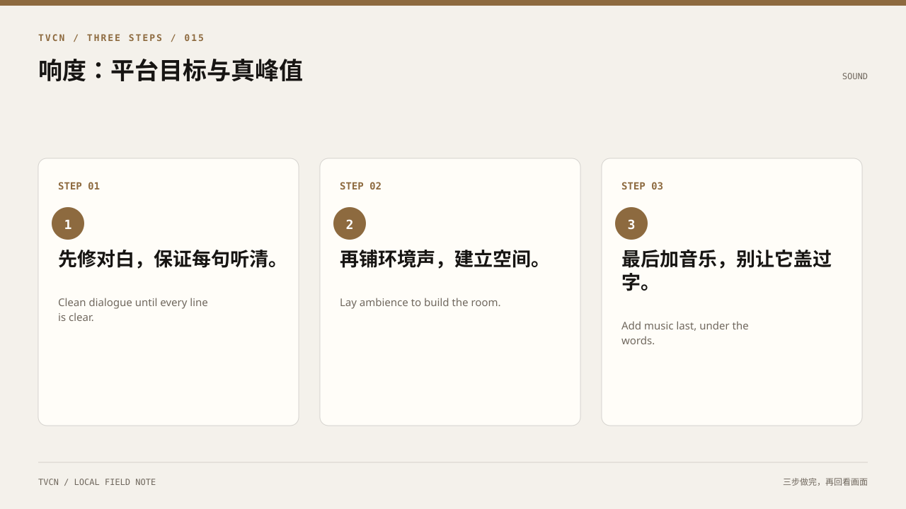

响度按平台目标交付，真峰值留余量；声音大不等于声音好。

<!-- DIAGRAM_START -->
<h2>图解</h2>
<figure>
  
  <figcaption>把三步按顺序做完，再回看画面或文件。</figcaption>
</figure>
<!-- DIAGRAM_END -->
<h2>现场</h2>

平台常用 -14 LUFS、真峰值 -1 dB；先混到目标，再留 0.5 到 1 dB 余量，别靠压限器硬顶。

<h2>怎么做</h2>

响度按平台目标交付，真峰值留余量；声音大不等于声音好。
<ol><li>先混到平台目标，常用 -14 LUFS。</li><li>真峰值压到 -1 dB，再留 0.5 到 1 dB 余量。</li><li>不要靠压限器硬顶，回到对白和动态检查。</li></ol>
<h2>别踩</h2>

别把响度当竞争力；压限器压扁了，对白会更累。

<h2>验收</h2>
<ul><li>整片积分响度落在平台目标附近，不是凭耳朵猜。</li><li>真峰值不超过 -1 dB，没有连续红区。</li><li>对白仍然清楚，音乐和环境没有把动态压死。</li></ul>

<!-- DEEP_DIVE_START -->
## 深读

<strong>约 5 分钟。</strong> 响度不是把音量拧大，而是让对白在平台、耳机和外放上都站得住。

### LUFS 不是音量旋钮

LUFS 是整条片的平均响度，不是某一秒的音量。平台常用 -14 到 -16 LUFS，真峰值控制在 -1 dB 左右；具体以平台最新说明为准。

先让对白站住，再加音乐和环境。音乐一进来就把对白推高，最后整条片会又吵又听不清。

### 检查顺序

先 solo 对白听一遍，加音乐听一遍，加环境再听一遍；然后手机外放、耳机、笔记本各播一次。响度表只告诉你数字，听不懂的句子还是要回剪。

把最安静的一句和对最吵的一句各记一个时间码，交付前直接跳过去听。两个极端都成立，中间通常不会太差。

### 手机外放是最终考场

把片子放到手机上，音量开到一半，走到两米外听。听不清的句子，不是观众的问题，是混音的问题。

手机外放会砍掉低频，音乐里的低频越多，对白越糊。先保中频，再谈氛围。

### 音乐和环境声的比例

对白场里，音乐只做底，环境声填房间；没有对白的段落，音乐才可以走到前面。不要用音乐从头铺到尾，观众会累。

每加一层声音， Solo 一次对白，确认它还站得住。站不住就降新加的那层，不要推对白。

### 交付前，用这十步听一遍
<ul><li>先 solo 对白，确认每句都能听懂</li><li>加音乐再听一遍</li><li>加环境再听一遍</li><li>手机外放，音量一半，站到两米外</li><li>耳机听一遍，注意齿音和爆音</li><li>笔记本外放再听一遍</li><li>记下最安静那句的时间码</li><li>记下最吵那句的时间码</li><li>交付前直接跳到这两个点复查</li><li>确认真峰值没有超过负一</li></ul>
响度表只能证明数字对，不能证明观众听懂。最后一遍一定要用耳朵，不是眼睛。最后让一个没看过片子的人听一遍，问他哪一句没听清，那通常就是你要修的地方。

<!-- DEEP_DIVE_END -->
<!-- SOURCES_START -->
<h2>参考与延伸阅读</h2>

经验来源：TVCN 现场手册与项目复盘；实测来源：页面标注的复核环境与可复现练习；参考来源：以下公开链接。

<ul><li>[S24] ACES 色彩管理</li><li>[S27] EBU R128 响度</li><li>[S28] Netflix 制作与交付帮助</li><li>[S30] DaVinci Resolve 产品与文档</li><li>[S34] Adobe Premiere Pro 用户指南</li><li>[S35] Avid 资源中心</li></ul>

<a href="../../SOURCES.md">完整链接与用途见 SOURCES.md</a>

<!-- SOURCES_END -->
