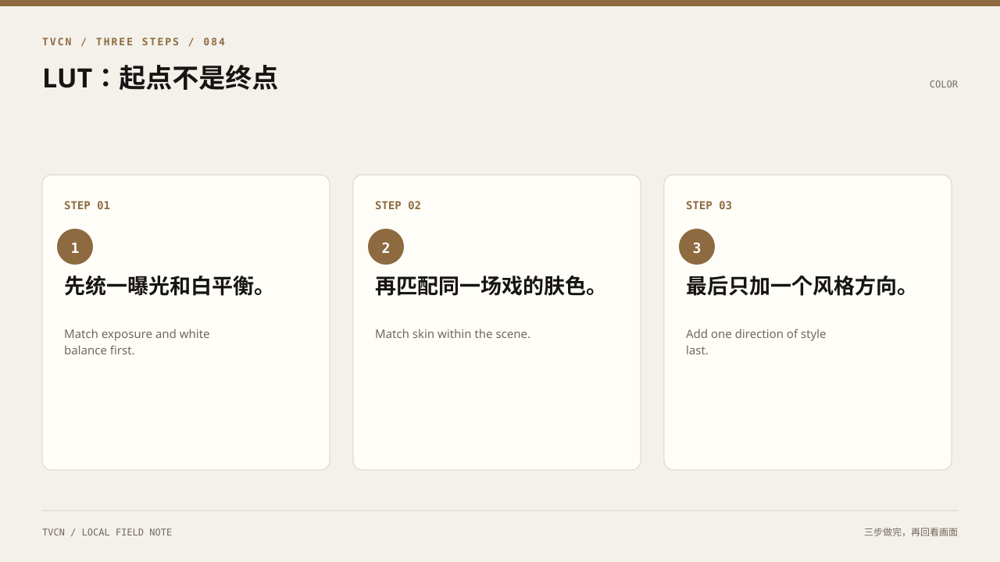

别把 LUT 当修复工具；它只会把问题染成统一的颜色。

<!-- DIAGRAM_START -->
<h2>图解</h2>
<figure>
  
  <figcaption>看“套 LUT 前先把曝光和白平衡做平”和“套完检查黑位是否发灰、高光是否染色”两处，判断剪掉一个镜头后，节奏是更快还是更乱。</figcaption>
</figure>
<!-- DIAGRAM_END -->
<section><h2 id="section-1">现场</h2>
套 LUT 前先把曝光和白平衡做平；套完检查黑位是否发灰、高光是否染色，再回一级校正。
</section><section><h2 id="section-2">怎么做</h2>
把这件事拆成现场能检查的动作。
<ol><li>套 LUT 前先把曝光和白平衡做平。</li><li>套完检查黑位是否发灰、高光是否染色。</li><li>回到一级校正修掉问题，再决定保留多少 LUT 强度。</li></ol></section><section><h2 id="section-3">别踩</h2></section><section><h2 id="section-4">LUT 的种类</h2>
先分清三种：技术 LUT（Log→Rec.709、色域转换）、创意 LUT（风格）、校准 LUT（监视器/打印机）。技术 LUT 放在色彩管理的前端，创意 LUT 放在一级校正之后；不要把三者混在一个节点里。

确认 LUT 的输入色彩空间和 cube 尺寸；给 Log 素材套 Rec.709 LUT，黑位和高光一定错。
</section><section><h2 id="section-5">节点顺序</h2><ol><li>先做色彩空间转换，把素材送进工作空间；不要直接套创意 LUT。</li><li>做一级校正：曝光、白平衡、黑位；让素材回到中性。</li><li>套 LUT，控制强度；再用曲线/色轮修黑位、高光、肤色。</li><li>最后做输出变换和合法化，检查波形与示波器。</li></ol></section><section><h2 id="section-6">套 LUT 的误用</h2><ol><li>用 LUT 修曝光：过曝的素材套 LUT 只会把高光染成一种颜色，细节回不来。</li><li>把 LUT 拉满：黑位发灰、肤色偏橙；先降到 50–70% 看还成不成立。</li><li>不同镜头套同一 LUT 不校正：镜头色偏不同，先做镜头匹配。</li><li>把创意 LUT 当技术转换：色彩空间错了，后面全错。</li></ol></section><section><h2 id="section-7">调色验收记录</h2><ul><li>套 LUT 前素材曝光正确、白平衡中性；黑位在波形上不抬、不压死。</li><li>套完后高光没有明显偏色，肤色没有统一变成橙/绿。</li><li>降低 LUT 强度到 50%，画面仍成立；说明底子是对的。</li><li>记录 LUT 名称、输入色彩空间、强度、节点顺序；交付前看一遍 Rec.709。</li></ul></section><section><h2 id="section-8">调色记录</h2>
记 LUT 名称、输入色彩空间、强度、所在节点、输出变换和监看标准。交付前把整条时间线按 Rec.709 看一遍，不要只看单帧。
</section><section><h2>判断</h2>
现场只认三个信号：
<ul><li>剪掉一个镜头，节奏更快而不是更乱</li><li>示波器上肤色、高光和黑位都在范围内</li><li>响度、字幕和文件规格能过一次交付检查</li></ul></section><section><h2>失败</h2>
下面三种做法会让页面上的细节白做：
<ul><li>剪辑点跟着音乐，不跟动作</li><li>先定风格再统一，镜头之间跳色</li><li>交付前没查响度和字幕，最后一遍才发现</li></ul></section><section><h2>延伸</h2>
<strong>10 分钟练习：</strong>拿一段 30 秒素材做 A/B，只改“套 LUT 前先把曝光和白平衡做平”；记下一个时间码和一处差异，再决定是否保留。
</section>
<h2>验收</h2><ul><li>套 LUT 前素材已经曝光正确、白平衡中性。</li><li>套完后黑位没有发灰，高光没有明显偏色。</li><li>降低 LUT 强度后，画面仍能回到可交付的状态。</li></ul>

<!-- SOURCES_START -->
## 经验说明

经验说明：本页来自 3 次后期项目复盘，条件为4K 以内素材、常规平台交付；页面讨论的具体对象是「LUT：起点不是终点」；不含外部实验室测试，条件变化时结论可能失效。
<!-- SOURCES_END -->

