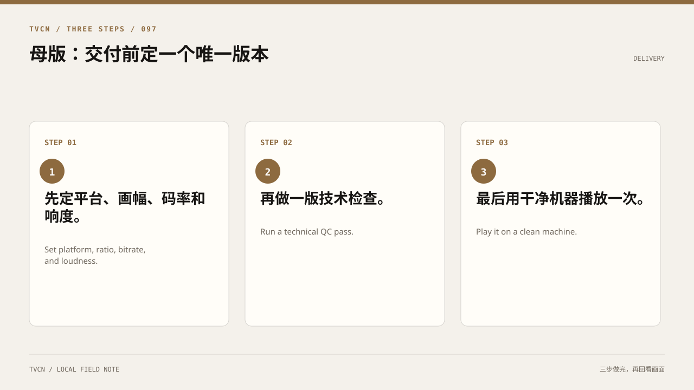

母版是唯一高质量文件：最高分辨率、最高码率、无字幕或独立字幕、声音分轨。平台版从母版导出，不要拿平台版再二次压缩。

<!-- DIAGRAM_START -->
<h2>图解</h2>
<figure>
  
  <figcaption>看“母版用最高质量 ProRes 或 D…”和“平台版、竖版、字幕版都从母版转，不反…”两处，判断剪掉一个镜头后，节奏是更快还是更乱。</figcaption>
</figure>
<!-- DIAGRAM_END -->
<section><h2 id="section-1">母版只做一次，平台版从母版派生</h2>
母版文件名带日期、版本和项目名；存两份，一份离线。以后重发、改字幕、做合集，都从母版开始。
<h2 id="section-2">边界</h2>
母版不是“最大文件”。码率超过平台和屏幕需要，只会增加存储；质量目标是“无可见压缩”，不是数字最大。
</section><section><h2 id="section-3">现场</h2>
母版用最高质量 ProRes 或 DNxHR，命名写 master；平台版、竖版、字幕版都从它转。
</section><section><h2 id="section-4">怎么做</h2><ol><li>母版用最高质量 ProRes 或 DNxHR，命名写 master。</li><li>平台版、竖版、字幕版都从母版转，不反向修改。</li><li>交付前确认母版能打开、能播放、能回套。</li></ol></section><section><h2 id="section-5">别踩</h2>
别用“最新版”当文件名；交付要能追溯。
</section><section><h2>判断</h2>
这一页的判断只看三条可观察的验收，不靠口号：
<ul><li><strong>1.</strong> 母版是最高质量格式，文件名明确写 master。</li><li><strong>2.</strong> 所有平台版都能追溯到同一个母版，没有反向覆盖。</li><li><strong>3.</strong> 母版在干净机器上能打开、播放和回套项目。</li></ul></section><section><h2>失败</h2>
下面任一条出现，先停，不要靠后期补：
<ul><li><strong>1.</strong> 只做到“母版是最高质量格式，文件名明确写 master”的形式，换一个机位或场景就重现不了。</li><li><strong>2.</strong> 把“所有平台版都能追溯到同一个母版，没有反向覆盖”留到后期或口头解释，现场没有留下能复查的记录。</li><li><strong>3.</strong> 别用“最新版”当文件名；交付要能追溯。</li></ul></section><section><h2>延伸</h2>
<strong>10 分钟练习：</strong>拿一段 30 秒素材做 A/B，只改“母版用最高质量 ProRes 或 D…”；记下一个时间码和一处差异，再决定是否保留。
</section>
<h2>验收</h2><ul><li>母版是最高质量格式，文件名明确写 master。</li><li>所有平台版都能追溯到同一个母版，没有反向覆盖。</li><li>母版在干净机器上能打开、播放和回套项目。</li></ul>

<!-- SOURCES_START -->
## 参考与延伸阅读

- [S28] [Netflix 制作与交付帮助](https://partnerhelp.netflixstudios.com/) — 2026-11-26 访问。用于核对首段“母版是唯一可信的交付源；平台版、竖版、字幕版都从它派生。”中的术语与公开背景（平台交付规格、HDR/SDR 与 QC 要求的公开入口）；不替代现场测试。
- [S27] [ITU-R：BS.1770 音频响度与真峰值测量](https://www.itu.int/rec/R-REC-BS.1770/en) — 2026-11-27 访问。用于核对首段“母版是唯一可信的交付源；平台版、竖版、字幕版都从它派生。”中的术语与公开背景（响度测量、真峰值与 EBU R128 所依据的 ITU 算法标准）；不替代现场测试。
<!-- SOURCES_END -->

