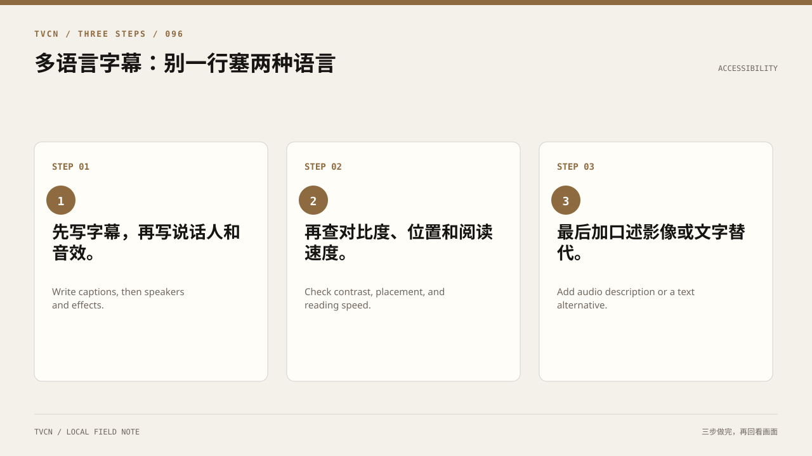

多语言字幕分轨交付：每条轨只放一种语言，时间码对齐，样式分开。不要把中英叠在同一行；移动端会挤成一团，也无法单独关闭。

<!-- DIAGRAM_START -->
<h2>图解</h2>
<figure>
  
  <figcaption>看“一行只放一种语言”和“用字幕轨切换，或出两个独立版本”两处，判断剪掉一个镜头后，节奏是更快还是更乱。</figcaption>
</figure>
<!-- DIAGRAM_END -->
<section><h2 id="section-1">一种语言一条轨，不要混在一条里</h2>
每条轨单独做换行和字符数检查：中文每行不超过 16–18 字，英文不超过 42 字符；两种语言的行长不同，不能共用断句。
<h2 id="section-2">边界</h2>
翻译不是逐字替换。地名、术语和语气要找目标语言的习惯；字幕错一个字，观众会怀疑整条片。
</section><section><h2 id="section-3">现场</h2>
一行只放一种语言；用字幕轨切换，或出两个版本，别把双语压成两行小字。
</section><section><h2 id="section-4">怎么做</h2><ol><li>一行只放一种语言。</li><li>用字幕轨切换，或出两个独立版本。</li><li>检查字号和行数，别把双语压成两行小字。</li></ol></section><section><h2 id="section-5">别踩</h2>
别把双语压成两行小字；观众两种都读不清。
</section><section><h2>判断</h2>
这一页的判断只看三条可观察的验收，不靠口号：
<ul><li><strong>1.</strong> 每一行只有一种语言，没有中英叠在一起。</li><li><strong>2.</strong> 字幕轨能独立切换，或两个版本各自完整。</li><li><strong>3.</strong> 字号和行数在手机上可读，没有为了塞双语缩小。</li></ul></section><section><h2>失败</h2>
下面任一条出现，先停，不要靠后期补：
<ul><li><strong>1.</strong> 只做到“每一行只有一种语言，没有中英叠在一起”的形式，换一个机位或场景就重现不了。</li><li><strong>2.</strong> 把“字幕轨能独立切换，或两个版本各自完整”留到后期或口头解释，现场没有留下能复查的记录。</li><li><strong>3.</strong> 别把双语压成两行小字；观众两种都读不清。</li></ul></section><section><h2>延伸</h2>
<strong>10 分钟练习：</strong>拿一段 30 秒素材做 A/B，只改“一行只放一种语言”；记下一个时间码和一处差异，再决定是否保留。
</section>
<h2>验收</h2><ul><li>每一行只有一种语言，没有中英叠在一起。</li><li>字幕轨能独立切换，或两个版本各自完整。</li><li>字号和行数在手机上可读，没有为了塞双语缩小。</li></ul>

<!-- SOURCES_START -->
## 参考与延伸阅读

- [S68] [W3C：WebVTT](https://www.w3.org/TR/webvtt1/) — 2026-11-26 访问。用于核对「一种语言一条轨，不要混在一条里」一节的术语/方法/规则（WebVTT 字幕格式，不是平台审核规则）；不核对其中由本页经验得出的数字、型号与现场结论，也不替代测试。
- [S06] [W3C：字幕与说明指南](https://www.w3.org/WAI/media/av/captions/) — 2026-11-26 访问。用于核对「现场」一节的术语/方法/规则（W3C 字幕/说明指南，不是平台审核规则）；不核对其中由本页经验得出的数字、型号与现场结论，也不替代测试。
<!-- SOURCES_END -->

