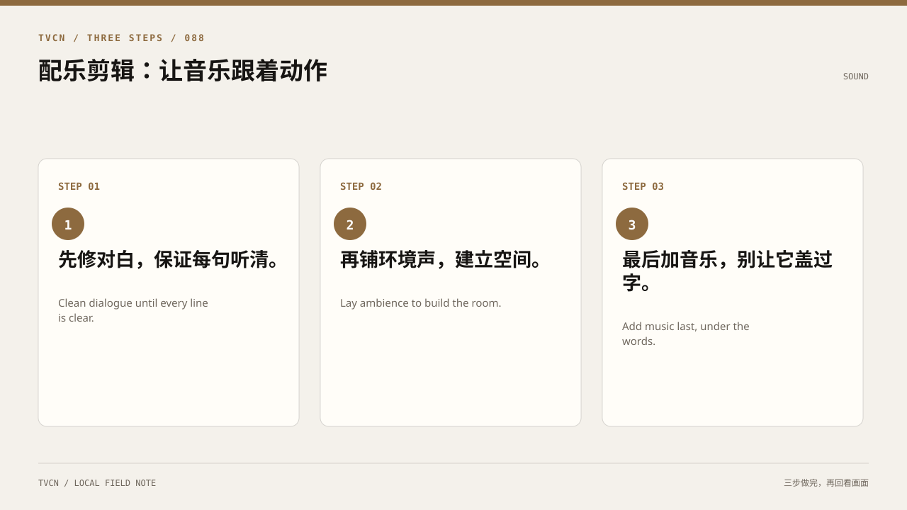

不要一开始就按节拍切画面。先把故事剪到成立，再把音乐铺上去；需要时移动音乐段落，而不是把画面切碎去凑拍子。

<!-- DIAGRAM_START -->
<h2>图解</h2>
<figure>
  
  <figcaption>看“先标动作点：开门、转身、落座”和“音乐在第一个动作点进，第二个点变，第…”两处，判断剪掉一个镜头后，节奏是更快还是更乱。</figcaption>
</figure>
<!-- DIAGRAM_END -->
<section><h2 id="section-1">先剪故事，再对音乐</h2>
用音乐的分句和留白做转场：副歌前留半拍、桥段前收音乐；不要每一拍都切。
<h2 id="section-2">边界</h2>
音乐不是情绪的万能胶。画面没有变化，加再大的音乐也只是吵；先让动作成立。
</section><section><h2 id="section-3">现场</h2>
先标动作点：开门、转身、落座；音乐在第一个动作点进，第二个点变，第三个点出。
</section><section><h2 id="section-4">怎么做</h2><ol><li>先标动作点：开门、转身、落座。</li><li>音乐在第一个动作点进，第二个点变，第三个点出。</li><li>留一段没有音乐的呼吸，让环境声接管。</li></ol></section><section><h2 id="section-5">别踩</h2>
别用音乐填满所有空白；没有退出，进入就没有力量。
</section><section><h2>判断</h2>
这一页的判断只看三条可观察的验收，不靠口号：
<ul><li><strong>1.</strong> 音乐至少有一次明确的进入、变化和退出。</li><li><strong>2.</strong> 三个动作点与音乐变化对得上，不是随意卡点。</li><li><strong>3.</strong> 留白段的环境声能独立成立，观众不会觉得断音。</li></ul></section><section><h2>失败</h2>
下面任一条出现，先停，不要靠后期补：
<ul><li><strong>1.</strong> 只做到“音乐至少有一次明确的进入、变化和退出”的形式，换一个机位或场景就重现不了。</li><li><strong>2.</strong> 把“三个动作点与音乐变化对得上，不是随意卡点”留到后期或口头解释，现场没有留下能复查的记录。</li><li><strong>3.</strong> 别用音乐填满所有空白；没有退出，进入就没有力量。</li></ul></section><section><h2>延伸</h2>
<strong>10 分钟练习：</strong>拿一段 30 秒素材做 A/B，只改“先标动作点：开门、转身、落座”；记下一个时间码和一处差异，再决定是否保留。
</section>
<h2>验收</h2><ul><li>音乐至少有一次明确的进入、变化和退出。</li><li>三个动作点与音乐变化对得上，不是随意卡点。</li><li>留白段的环境声能独立成立，观众不会觉得断音。</li></ul>

<!-- DEEP_DIVE_START -->
## 深读

<strong>约 5 分钟。</strong> 配乐不是铺满，是在动作上换气。音乐进来和出去的时间，比音乐本身更重要。

### 先找重音

把音乐放在时间线，先标出鼓点、停顿、副歌。画面的大动作要落在重音上，观众才会觉得“对上了”。

没有重音的音乐不适合硬切，改用环境声或留白。不是每段音乐都要服务剪辑，有些只需要存在。

### 对白优先

对白一进来，音乐就降。不是降一点，是让台词清楚；听不清台词的配乐，再贵也没用。

不要把音乐推到对白上面再拉回来，观众会听出打架。宁可让音乐少两小节，也不要让一句话糊掉。

### 结尾和留白

最后一句台词后留两秒，再让音乐走。观众需要时间反应，音乐走得太快，情绪会被掐断。

该静就静。静音不是没声音，是把注意力还给画面；一直有音乐，观众会累。

### 临时轨和最终曲

粗剪用临时轨找节奏，锁定后换最终曲。不要把临时轨当交付。

换曲时保留重音位置，否则整段剪辑要重做。

### 版权和替换

上线前确认授权范围：平台、地区、期限。只买“视频内使用”不一定能投广告。

替换音乐时先导出无音乐版，再贴新轨，别在旧轨上叠。

### 配乐混完，十项检查
<ul><li>先标出音乐重音</li><li>大动作落在重音上</li><li>对白进来音乐降</li><li>不要用音乐填满全片</li><li>转场留一个气口</li><li>结尾留两秒</li><li>该静就静</li><li>检查低频不掩对白</li><li>手机外放听一遍</li><li>交付前 solo 对白</li></ul>
配乐的任务不是让片子显得高级，是让观众在该呼吸的时候呼吸。

### 只剩五分钟时
<ul><li>先标出音乐重音</li><li>对白进来音乐降</li><li>转场留一个气口</li><li>结尾留两秒</li><li>该静就静</li><li>手机外放听一遍</li></ul>
音乐进来是为了推一把，出去是为了让观众自己走一步。音乐不是填满空白，是决定哪里该有空白。留白也是配乐的一部分，让最后那一拍落在画面上，再走。

<!-- DEEP_DIVE_END -->

<!-- SOURCES_START -->
## 参考与延伸阅读

- [S27] [ITU-R BS.1770：响度与真峰值测量](https://www.itu.int/rec/R-REC-BS.1770/en) — 2026-11-26 访问。用于核对「先剪故事，再对音乐」一节的术语/方法/规则（BS.1770 响度测量方法，不是话筒选购）；不核对其中由本页经验得出的数字、型号与现场结论，也不替代测试。
- [S35] [Avid：资源中心](https://www.avid.com/resource-center) — 2026-11-26 访问。用于核对「现场」一节的术语/方法/规则（Avid 资源中心，不是独立评测）；不核对其中由本页经验得出的数字、型号与现场结论，也不替代测试。
<!-- SOURCES_END -->

