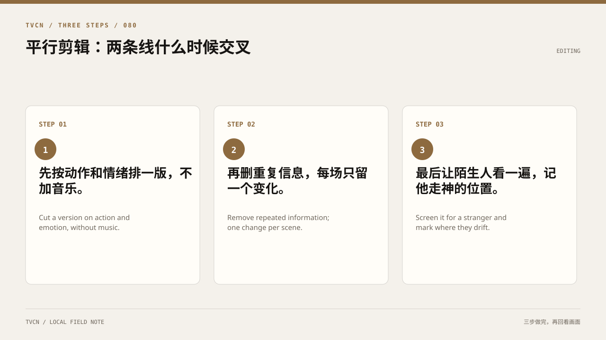

平行剪辑不是来回切，它要让两条线在观众心里产生一个问题：什么时候撞上。

<!-- DIAGRAM_START -->
<h2>图解</h2>
<figure>
  
  <figcaption>把三步按顺序做完，再回看画面或文件。</figcaption>
</figure>
<!-- DIAGRAM_END -->
<h2>现场</h2>

两条线各写一个倒计时：A 还剩十分钟，B 还剩三分钟；在观众开始算时间时交叉。

<h2>怎么做</h2>

平行剪辑不是来回切，它要让两条线在观众心里产生一个问题：什么时候撞上。
<ol><li>两条线各写一个倒计时：A 还剩十分钟，B 还剩三分钟。</li><li>在观众开始算时间时交叉，不要每十秒切一次。</li><li>交叉后让两条线共享一个物件、声音或动作。</li></ol>
<h2>别踩</h2>

别为了炫技来回切；没有倒计时，交叉就没有压力。

<h2>验收</h2>
<ul><li>两条线各有一个可读的倒计时，观众能算出谁先到。</li><li>交叉点发生在压力上升时，不是平均间隔。</li><li>交叉后两条线有一个共享元素，不是各演各的。</li></ul>
