<!-- DIAGRAM_START -->
<h2>图解</h2>
<figure>
  
  <figcaption>示意：每个平台单独一行；母版不直接上传，平台版从母版派生并记录版本。</figcaption>
</figure>
<!-- DIAGRAM_END -->
<h2>先定母版，再定平台</h2>
母版只有一个：最高分辨率、最高码率、无字幕、无片头、无平台压缩。平台版从母版派生，不直接改母版。母版文件名写项目、日期、版本、状态，禁止 final/final2。

平台清单先写：主平台一个、分发平台两个、官网/私域一个。每个平台写画幅、时长、码率、字幕、封面、响度。没有清单，就会在上传当天才发现画幅不对。
<h2>画幅与安全区：不是裁一刀</h2>
16:9 转 9:16 不是把两边裁掉。人物眼睛、手、产品、字幕都要重新排。每个平台单独看一遍安全区，尤其竖版顶部和底部的平台按钮。横版的关键动作如果只在画面边缘，竖版就会丢。

拍的时候就要留两套构图：横版全景、竖版中景。后期再裁，只能救一部分；现场没有留，后期只能放大，画质和构图一起损失。
<h2>字幕：硬字幕、软字幕、开放字幕</h2>
硬字幕烧进画面，平台无法关；软字幕单独文件，平台可能不显示；开放字幕是给无障碍和静音观看的版本。三种都要试播，不要只检查文件存在。

字幕安全区、字号、行数、CPS 按平台定。竖版字幕不要压到人物嘴部；横版字幕不要超出 90% 安全区。中英双语不要同时挤两行小字，宁可分版本。
<h2>响度与 QC：平台会再压一次</h2>
母版按平台响度交付，不要指望平台替你修。对白为主通常 -16 LUFS，音乐/广告按平台要求；短剧和信息流可以略高，但不要高到平台自动压。上传后自己完整看一遍，检查黑帧、静帧、断音、字幕错位。

QC 表每个平台一行：文件、画幅、时长、响度、字幕、封面、标题、链接。打勾不是形式，是出问题能查到哪一版。
<h2>失败案例：竖版把产品裁没了</h2>
一条产品广告先剪 16:9，产品在画面右下。转 9:16 时直接中心裁，产品只剩一半，字幕又压在手上。平台上传后前 3 秒看不出卖什么，完播率掉了一半。

补救是重新构图，不是加一个“产品特写”贴片。拍摄时留竖版中景，后期才有东西可裁；没有留，重拍比修补便宜。
<h2>成本与验收</h2>
低成本：母版 + 2 个平台版，¥1,000–3,000。中成本：4 个平台、字幕、封面、QC，¥3,000–10,000。高成本：8+ 平台、双语、多版本、HDR/SDR，¥10,000–30,000+。
<h2>验收</h2><ul><li>母版唯一，平台版可追溯。</li><li>每个平台有画幅、时长、字幕、响度规格。</li><li>竖版重新构图，不是中心裁。</li><li>三种字幕都试播。</li><li>每个平台完整 QC 一遍。</li><li>文件名含平台和版本。</li></ul>

<!-- SOURCES_START -->
## 参考与延伸阅读

- [S24] [ACESCentral：ACES：Academy Color Encoding System](https://acescentral.com/) — 2026-11-27 访问。用于核对首段“一版通投是最贵的省事。母版只有一个，平台版按画幅、时长、字幕、响度和封面分别派生；每个版本都能回到母版。”中的术语与公开背景（ACES 色彩编码、ACEScg 与交付/归档工作流）；不替代现场测试。
- [S27] [ITU-R：BS.1770 音频响度与真峰值测量](https://www.itu.int/rec/R-REC-BS.1770/en) — 2026-11-27 访问。用于核对首段“一版通投是最贵的省事。母版只有一个，平台版按画幅、时长、字幕、响度和封面分别派生；每个版本都能回到母版。”中的术语与公开背景（响度测量、真峰值与 EBU R128 所依据的 ITU 算法标准）；不替代现场测试。
- [S28] [Netflix 制作与交付帮助](https://partnerhelp.netflixstudios.com/) — 2026-11-26 访问。用于核对首段“一版通投是最贵的省事。母版只有一个，平台版按画幅、时长、字幕、响度和封面分别派生；每个版本都能回到母版。”中的术语与公开背景（平台交付规格、HDR/SDR 与 QC 要求的公开入口）；不替代现场测试。
- [S30] [DaVinci Resolve 产品与文档](https://www.blackmagicdesign.com/products/davinciresolve) — 2026-11-26 访问。用于核对首段“一版通投是最贵的省事。母版只有一个，平台版按画幅、时长、字幕、响度和封面分别派生；每个版本都能回到母版。”中的术语与公开背景（剪辑、调色、Fusion 与交付的官方产品入口）；不替代现场测试。
- [S34] [Adobe Premiere Pro 用户指南](https://helpx.adobe.com/premiere-pro/user-guide.html) — 2026-11-26 访问。用于核对首段“一版通投是最贵的省事。母版只有一个，平台版按画幅、时长、字幕、响度和封面分别派生；每个版本都能回到母版。”中的术语与公开背景（剪辑、代理、色彩与导出的官方文档）；不替代现场测试。
<!-- SOURCES_END -->

