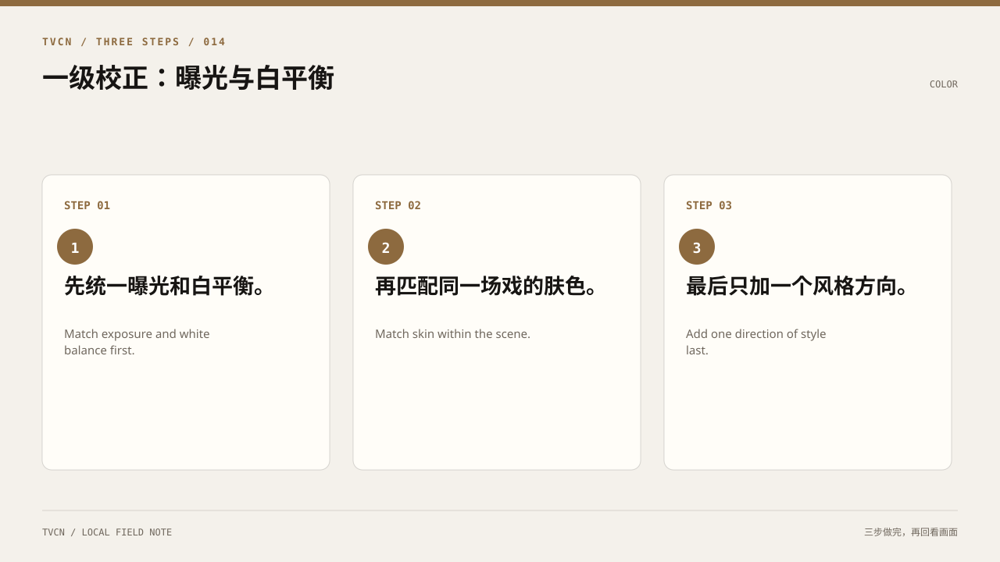

一级校正只做曝光、白平衡和对比度的统一：先把每个镜头的黑位、白位和肤色对齐，再谈风格。用示波器看，不靠眼睛在暗房里猜。

<!-- DIAGRAM_START -->
<h2>图解</h2>
<figure>
  
  <figcaption>看“先拍灰卡或色卡，黑位压到 0 到 5…”和“同场镜头逐条对齐曝光和白平衡，再看肤…”两处，判断剪掉一个镜头后，节奏是更快还是更乱。</figcaption>
</figure>
<!-- DIAGRAM_END -->
<section><h2 id="section-1">先把所有镜头拉回同一条起跑线</h2>
顺序：曝光归一 → 白平衡归一 → 对比度归一 → 镜头之间跳切检查。任何一步没统一，二级校正只会把偏色锁死。
<h2 id="section-2">边界</h2>
一级校正不是“每个镜头都调成一样亮”。不同景别、不同光位允许有差异；统一的是基准，不是画面情绪。
</section><section><h2 id="section-3">现场</h2>
先拍一张灰卡或色卡：黑位压到 0 到 5，白位不超过 100；同场镜头逐条对齐，再看肤色线。
</section><section><h2 id="section-4">怎么做</h2><ol><li>先拍灰卡或色卡，黑位压到 0 到 5，白位不超过 100。</li><li>同场镜头逐条对齐曝光和白平衡，再看肤色线。</li><li>技术问题清零后，才加对比和风格。</li></ol></section><section><h2 id="section-5">别踩</h2>
别用 LUT 掩盖技术问题；它会把问题染得更好看。
</section><section><h2>判断</h2>
现场只认三个信号：
<ul><li>剪掉一个镜头，节奏更快而不是更乱</li><li>示波器上肤色、高光和黑位都在范围内</li><li>响度、字幕和文件规格能过一次交付检查</li></ul></section><section><h2>失败</h2>
下面三种做法会让页面上的细节白做：
<ul><li>剪辑点跟着音乐，不跟动作</li><li>先定风格再统一，镜头之间跳色</li><li>交付前没查响度和字幕，最后一遍才发现</li></ul></section><section><h2>延伸</h2>
<strong>10 分钟练习：</strong>拿一段 30 秒素材做 A/B，只改“先拍灰卡或色卡，黑位压到 0 到 5…”；记下一个时间码和一处差异，再决定是否保留。
</section>
<h2>验收</h2><ul><li>同场镜头的黑位和白位对齐，切点不跳。</li><li>肤色线落在同一区域，没有一条偏绿一条偏红。</li><li>关掉风格 LUT 后，画面技术仍然成立。</li></ul>

<!-- DEEP_DIVE_START -->
## 深读

<strong>约 6 分钟。</strong> 一级校正只做三件事：曝光对齐、白平衡统一、对比还原。别在这一步做风格。

### 先对齐，再谈好看

同一场戏先找最准的一条做参考，其他镜头向它靠。看波形，不靠眼睛；眼睛会被前后镜头骗。

户内户外分开调，不要把窗和外景拉成同一个亮度。观众知道窗外更亮，压平反而假。

### 白平衡用中性灰

白墙会偏色，灰卡更准。没有灰卡，用白纸但别过曝；过曝的白纸已经不是白。

混合光里没有绝对正确，选一个主光源，让其他颜色保留。把所有颜色拉成白色，房间就死了。

### 对比不要压死

提黑位会发灰，压黑位会丢细节。先看示波器，再决定；黑位不是越黑越高级。

LUT 放在一级之后，别用 LUT 掩盖曝光问题。一级错了，后面所有节点都在给错误打补丁。

### 镜头匹配的顺序

先曝光，再白平衡，再对比，最后肤色。顺序反了，每调一项都会推翻前一项。

一场戏调完，切到下一场前先回放三个镜头，确认没有跳。

### 肤色和记忆色

天空、草地、肤色是记忆色，偏一点观众就知道。先保肤色，再保天空。

不要把肤色调到一样白。不同人的肤色本来不同，统一会假。

### 一级校正，十项过一遍
<ul><li>每场选一条参考镜头</li><li>先对曝光</li><li>再对白平衡</li><li>再对肤色</li><li>再看黑位</li><li>再看高光</li><li>混合光保留环境颜色</li><li>LUT 放在一级之后</li><li>用示波器检查</li><li>整场连续回放</li></ul>
一级校正的目标不是“好看”，是“看不出镜头之间的接缝”。

### 只剩五分钟时
<ul><li>每场选一条参考镜头</li><li>先对曝光</li><li>再对白平衡</li><li>再对肤色</li><li>看黑位和高光</li><li>LUT 放在一级之后</li></ul>
一级校正做对了，后面的风格才有地基；地基歪了，越调越假。先让一场戏里的脸看起来是同一个人，再谈风格。这场戏的脸，要像同一个人，不是两个色温的人。

<!-- DEEP_DIVE_END -->

<!-- SOURCES_START -->
## 参考与延伸阅读

- [S24] [ACES 色彩管理](https://www.oscars.org/science-technology/aces) — 2026-11-26 访问。用于核对首段“一级校正先解决曝光和白平衡，别用风格掩盖技术问题。”中的术语与公开背景（ACES 色彩管线的官方说明与规范）；不替代现场测试。
- [S27] [EBU R128 响度](https://tech.ebu.ch/publications/r128) — 2026-11-26 访问。用于核对首段“一级校正先解决曝光和白平衡，别用风格掩盖技术问题。”中的术语与公开背景（广播响度目标、真峰值与测量方法）；不替代现场测试。
- [S28] [Netflix 制作与交付帮助](https://partnerhelp.netflixstudios.com/) — 2026-11-26 访问。用于核对首段“一级校正先解决曝光和白平衡，别用风格掩盖技术问题。”中的术语与公开背景（平台交付规格、HDR/SDR 与 QC 要求的公开入口）；不替代现场测试。
- [S30] [DaVinci Resolve 产品与文档](https://www.blackmagicdesign.com/products/davinciresolve) — 2026-11-26 访问。用于核对首段“一级校正先解决曝光和白平衡，别用风格掩盖技术问题。”中的术语与公开背景（剪辑、调色、Fusion 与交付的官方产品入口）；不替代现场测试。
- [S34] [Adobe Premiere Pro 用户指南](https://helpx.adobe.com/premiere-pro/user-guide.html) — 2026-11-26 访问。用于核对首段“一级校正先解决曝光和白平衡，别用风格掩盖技术问题。”中的术语与公开背景（剪辑、代理、色彩与导出的官方文档）；不替代现场测试。
<!-- SOURCES_END -->

