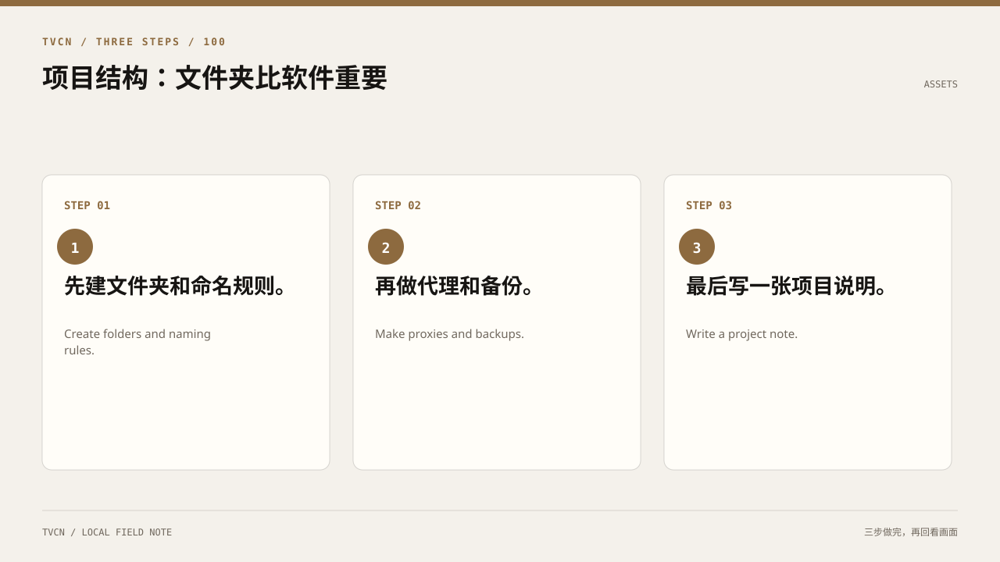

项目根下只放三样：01_素材、02_工程、03_交付。素材按日期和场景分，工程按剪辑/调色/声音分，交付按平台和日期分。任何文件都能从路径判断它属于哪一步。

<!-- DIAGRAM_START -->
<h2>图解</h2>
<figure>
  
  <figcaption>看“根目录建 01_media、02_p…”和“文件名用日期_场次_机位，别用“最终…”两处，判断剪掉一个镜头后，节奏是更快还是更乱。</figcaption>
</figure>
<!-- DIAGRAM_END -->
<section><h2 id="section-1">先建三层文件夹，再谈命名</h2>
文件名用“日期_场景_镜号_版本”，不要用“最终”“修改后”。版本号只增不减，回收站里也能看出先后。
<h2 id="section-2">边界</h2>
结构不是给人看的装饰。别人拿到硬盘，能否在五分钟内找到原素材和最新工程，才是验收标准。
</section><section><h2 id="section-3">现场</h2>
根目录建 01_media、02_project、03_exports、04_docs；文件名用日期_场次_机位，别用最终版。
</section><section><h2 id="section-4">怎么做</h2><ol><li>根目录建 01_media、02_project、03_exports、04_docs。</li><li>文件名用日期_场次_机位，别用“最终版”。</li><li>代理和原始分开放，备份当天做。</li></ol></section><section><h2 id="section-5">别踩</h2>
别把素材放在桌面；系统重装就没了。
</section><section><h2>判断</h2>
这一页的判断只看三条可观察的验收，不靠口号：
<ul><li><strong>1.</strong> 四个根文件夹存在，媒体、项目、导出、文档各归其位。</li><li><strong>2.</strong> 文件名包含日期、场次和机位，能直接排序。</li><li><strong>3.</strong> 换一台机器或换软件后，仍能按路径找到原始素材。</li></ul></section><section><h2>失败</h2>
下面任一条出现，先停，不要靠后期补：
<ul><li><strong>1.</strong> 只做到“四个根文件夹存在，媒体、项目、导出、文档各归其位”的形式，换一个机位或场景就重现不了。</li><li><strong>2.</strong> 把“文件名包含日期、场次和机位，能直接排序”留到后期或口头解释，现场没有留下能复查的记录。</li><li><strong>3.</strong> 别把素材放在桌面；系统重装就没了。</li></ul></section><section><h2>延伸</h2>
<strong>10 分钟练习：</strong>拿一段 30 秒素材做 A/B，只改“根目录建 01_media、02_p…”；记下一个时间码和一处差异，再决定是否保留。
</section>
<h2>验收</h2><ul><li>四个根文件夹存在，媒体、项目、导出、文档各归其位。</li><li>文件名包含日期、场次和机位，能直接排序。</li><li>换一台机器或换软件后，仍能按路径找到原始素材。</li></ul>

<!-- SOURCES_START -->
## 参考与延伸阅读

- [S70] [FFmpeg：文档](https://ffmpeg.org/documentation.html) — 2026-11-26 访问。用于核对「先建三层文件夹，再谈命名」一节的术语/方法/规则（FFmpeg 编解码/封装文档，不是交付规范）；不核对其中由本页经验得出的数字、型号与现场结论，也不替代测试。
- [S35] [Avid：资源中心](https://www.avid.com/resource-center) — 2026-11-26 访问。用于核对「现场」一节的术语/方法/规则（Avid 资源中心，不是独立评测）；不核对其中由本页经验得出的数字、型号与现场结论，也不替代测试。
- [S29] [YouTube：上传编码建议](https://support.google.com/youtube/answer/1722171) — 2026-11-26 访问。用于核对「怎么做」一节的术语/方法/规则（YouTube 上传编码建议，不是创作标准）；不核对其中由本页经验得出的数字、型号与现场结论，也不替代测试。
<!-- SOURCES_END -->

