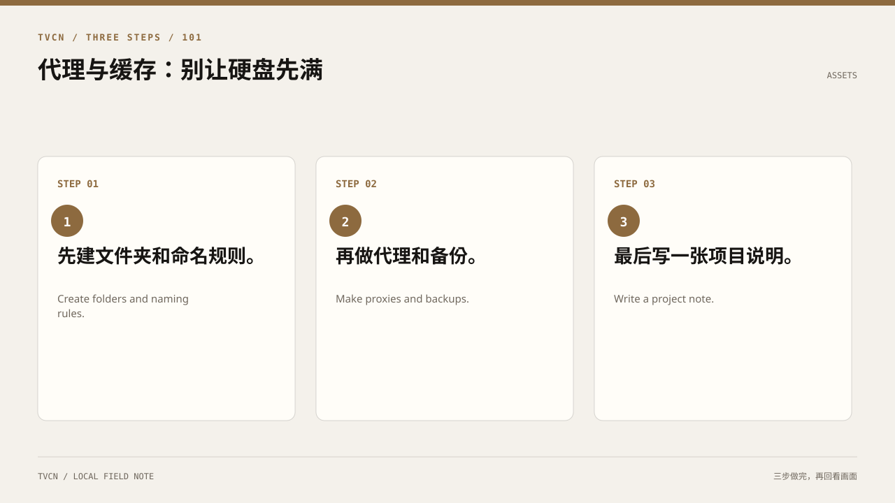

代理和缓存要放在独立盘，别让剪辑盘先满；满了就会掉帧。

<!-- DIAGRAM_START -->
<h2>图解</h2>
<figure>
  
  <figcaption>把三步按顺序做完，再回看画面或文件。</figcaption>
</figure>
<!-- DIAGRAM_END -->
<h2>现场</h2>

代理和缓存放第二块 SSD；系统盘留 20% 空间；剪辑盘满了先清缓存，不要删原始。

<h2>怎么做</h2>

代理和缓存要放在独立盘，别让剪辑盘先满；满了就会掉帧。
<ol><li>代理和缓存放第二块 SSD。</li><li>系统盘留 20% 空间，剪辑盘不要红。</li><li>盘满先清缓存，不要删原始素材。</li></ol>
<h2>别踩</h2>

别删原始素材换空间；缓存可以重建，素材不能。

<h2>验收</h2>
<ul><li>代理和缓存在第二块盘，剪辑盘仍有可用空间。</li><li>系统盘保留至少 20%，没有红色警告。</li><li>清缓存后项目能重建，原始素材一条没少。</li></ul>
