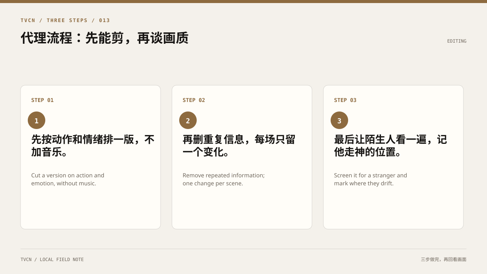

代理不是降低成片质量，是让剪辑先跑起来；原始素材永远留在旁边。

<!-- DIAGRAM_START -->
<h2>图解</h2>
<figure>
  
  <figcaption>把三步按顺序做完，再回看画面或文件。</figcaption>
</figure>
<!-- DIAGRAM_END -->
<h2>现场</h2>

代理用 ProRes Proxy 或四分之一分辨率，放独立 SSD；原始素材设只读，剪辑只碰代理，交付前回套。

<h2>怎么做</h2>

代理不是降低成片质量，是让剪辑先跑起来；原始素材永远留在旁边。
<ol><li>用 ProRes Proxy 或四分之一分辨率生成代理，放在独立 SSD。</li><li>把原始素材设为只读，剪辑只碰代理。</li><li>交付前回套原始，逐条确认没有误用代理。</li></ol>
<h2>别踩</h2>

别把代理当母版；回套前交付，画质会露馅。

<h2>验收</h2>
<ul><li>代理和原始分盘存放，原始文件夹是只读的。</li><li>时间线只引用代理，文件名和路径能一一对应。</li><li>回套原始后随机抽三个镜头，分辨率和细节回到原档。</li></ul>

<!-- DEEP_DIVE_START -->
## 深读

<strong>约 5 分钟。</strong> 代理不是画质降级，是让剪辑先跑起来。原素材不动，代理只负责响应速度。

### 什么时候需要代理

4K 以上、多机位、老机器，剪起来卡就做代理。1080 单轨流畅就不必，别为了流程而流程。

代理分辨率按时间线定，别做比时间线还大的代理。时间线 1080，代理也 1080 足够。

### 代理怎么生成

保持文件名、时间码、卷号一致，放在独立 Proxy 文件夹。不要覆盖原素材，也不要改原素材的目录结构。

生成后先抽三个镜头检查，确认声音和色彩没有丢。代理可以糊，但不能没有声。

### 回套和输出

剪完先锁定剪辑，再回套原素材。回套后检查变速、字幕和转场，代理和原素材的时长可能差一帧。

交付一定用原素材输出，代理只留在工程里。把代理当母版，画质会在最需要的时候掉下去。

### 代理的命名和目录

原素材在 Camera，代理在 Proxy，工程在 Project。三个文件夹不混。

代理文件名加 _proxy，回套时一眼能认。不要改原文件名。

### 多机位代理

多机位先做同一分辨率和帧率的代理，否则时间线会拒绝。

代理生成后先合一次板，确认声音和机位没问题，再开始剪。

### 代理流程，十项确认
<ul><li>只在高分辨率或多机位时做</li><li>代理文件名与原素材一致</li><li>代理放在独立文件夹</li><li>不覆盖原素材</li><li>保留时间码和卷号</li><li>生成后抽查三条</li><li>剪辑用代理</li><li>回套前锁定剪辑</li><li>回套后查变速字幕</li><li>交付用原素材</li></ul>
代理是脚手架，不是房子。剪完要拆，交付不能住在里面。

### 只剩五分钟时
<ul><li>只在高分辨率或多机位做</li><li>代理文件名与原素材一致</li><li>代理放独立文件夹</li><li>生成后抽查三条</li><li>锁定剪辑再回套</li><li>交付用原素材</li></ul>
代理让剪辑先跑起来，原素材让片子最后站得住。代理坏了可以重做，原素材丢了没有第二次。

<!-- DEEP_DIVE_END -->
