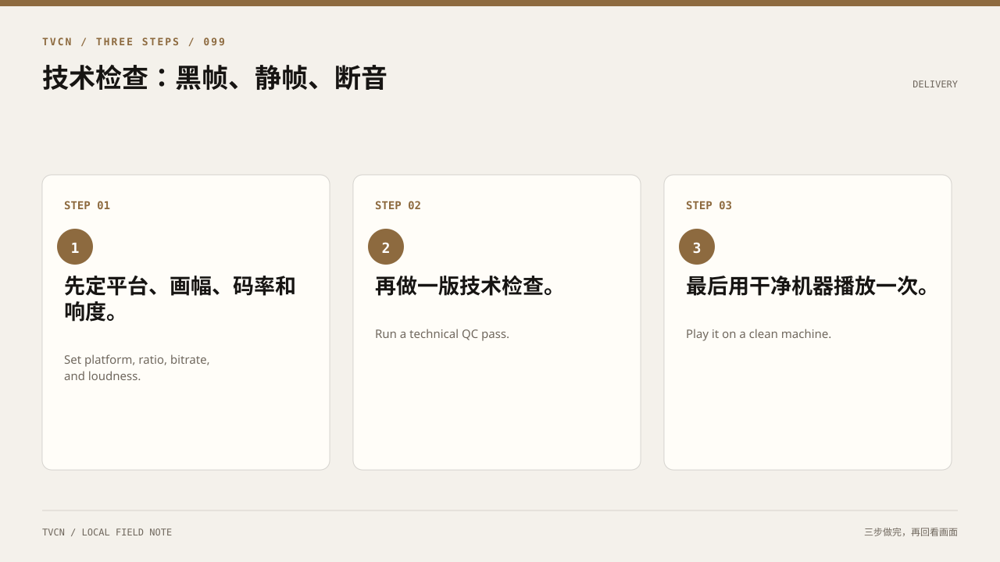

技术检查按清单看：黑帧、静帧、断音、字幕越界、声道错位。

<!-- DIAGRAM_START -->
<h2>图解</h2>
<figure>
  
  <figcaption>把三步按顺序做完，再回看画面或文件。</figcaption>
</figure>
<!-- DIAGRAM_END -->
<h2>现场</h2>

按清单过：黑帧、静帧、断音、字幕出画、声道左右；用校准监视器看，不用笔记本喇叭判断。

<h2>怎么做</h2>

技术检查按清单看：黑帧、静帧、断音、字幕越界、声道错位。
<ol><li>按清单过：黑帧、静帧、断音、字幕出画、声道左右。</li><li>用校准监视器和耳机看听，不用笔记本喇叭判断。</li><li>发现问题标时间码，回到母版修，不在平台版上补。</li></ol>
<h2>别踩</h2>

别用笔记本喇叭判断声音；低频和断音你都听不到。

<h2>验收</h2>
<ul><li>黑帧、静帧和断音都按时间码标出并修掉。</li><li>字幕没有出画，声道左右正确。</li><li>用校准监视器和耳机复查，笔记本喇叭不作为依据。</li></ul>
