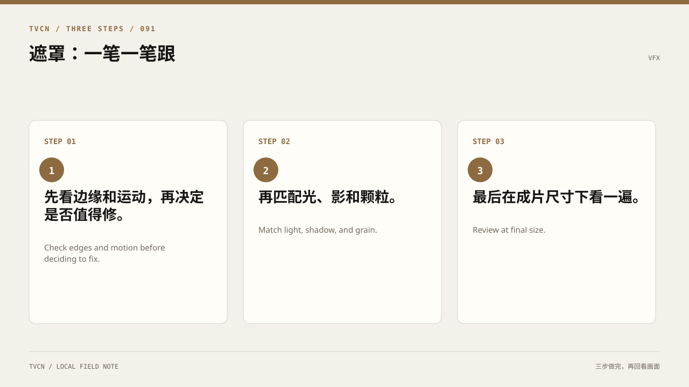

转描不是描边。先标关节位置和运动方向，再画外轮廓；关节对了，轮廓才有体积。每 5–10 帧检查一次，漂移就修关键帧。

<!-- DIAGRAM_START -->
<h2>图解</h2>
<figure>
  
  <figcaption>看“先做 5 帧测试：头发、手指、透明物…”和“每帧检查边缘，确认遮罩没有吃进主体”两处，判断剪掉一个镜头后，节奏是更快还是更乱。</figcaption>
</figure>
<!-- DIAGRAM_END -->
<section><h2 id="section-1">先画“关节”，再画轮廓</h2>
边缘要根据画面决定软硬：实拍有运动模糊，转描也要保留一点；全硬边会像剪纸。
<h2 id="section-2">边界</h2>
转描不能替代表演。演员动作不清楚，描得再准也只是复制模糊；先拍清楚动作。
</section><section><h2 id="section-3">现场</h2>
先做 5 帧测试：头发、手指、透明物各一；每帧检查边缘，别等 200 帧后才发现漂。
</section><section><h2 id="section-4">怎么做</h2><ol><li>先做 5 帧测试：头发、手指、透明物各一。</li><li>每帧检查边缘，确认遮罩没有吃进主体。</li><li>通过后再铺满整段，别等 200 帧后才发现漂。</li></ol></section><section><h2 id="section-5">别踩</h2>
别用一张遮罩盖完整段；边缘一穿，后面每帧都要重做。
</section><section><h2>判断</h2>
这一页的判断只看三条可观察的验收，不靠口号：
<ul><li><strong>1.</strong> 五帧测试里头发、手指和透明物边缘都干净。</li><li><strong>2.</strong> 遮罩没有吃进主体，也没有把背景留在边缘。</li><li><strong>3.</strong> 铺满整段后抽三帧复看，没有突然的形变或漂移。</li></ul></section><section><h2>失败</h2>
下面任一条出现，先停，不要靠后期补：
<ul><li><strong>1.</strong> 只做到“五帧测试里头发、手指和透明物边缘都干净”的形式，换一个机位或场景就重现不了。</li><li><strong>2.</strong> 把“遮罩没有吃进主体，也没有把背景留在边缘”留到后期或口头解释，现场没有留下能复查的记录。</li><li><strong>3.</strong> 别用一张遮罩盖完整段；边缘一穿，后面每帧都要重做。</li></ul></section><section><h2>延伸</h2>
<strong>10 分钟练习：</strong>拿一段 30 秒素材做 A/B，只改“先做 5 帧测试：头发、手指、透明物…”；记下一个时间码和一处差异，再决定是否保留。
</section>
<h2>验收</h2><ul><li>五帧测试里头发、手指和透明物边缘都干净。</li><li>遮罩没有吃进主体，也没有把背景留在边缘。</li><li>铺满整段后抽三帧复看，没有突然的形变或漂移。</li></ul>

> 意图分工：本页负责「遮罩：一笔一笔跟」的可执行细节；同集群先读 <a href="https://post.tvcn.org/article/tracking/">跟踪：点要贴在实处</a> 建立总判断，再回到本页。

<!-- INTENT_SCOPE -->

<!-- SOURCES_START -->
## 经验说明

经验说明：本页来自 6 个后期项目的操作复盘，条件为页面所列软件版本、素材格式与交付平台；只讨论「遮罩：一笔一笔跟」的操作顺序，不含外部实验室测试；不适用于未列版本、影院母版、广播级安全认证或法律意见。
<!-- SOURCES_END -->

