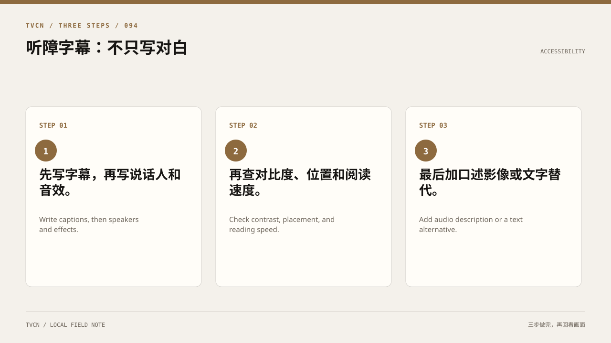

听障字幕要写清说话人、环境声和重要音效，不只抄对白。

<!-- DIAGRAM_START -->
<h2>图解</h2>
<figure>
  
  <figcaption>把三步按顺序做完，再回看画面或文件。</figcaption>
</figure>
<!-- DIAGRAM_END -->
<h2>现场</h2>

字幕里标说话人：男声、女声、电话；环境声写 [门响]、[雨声]，音乐写 [音乐]，别只抄对白。

<h2>怎么做</h2>

听障字幕要写清说话人、环境声和重要音效，不只抄对白。
<ol><li>字幕里标说话人：男声、女声、电话。</li><li>环境声写 [门响]、[雨声]，音乐写 [音乐]。</li><li>检查位置和阅读速度，字幕不挡嘴和手。</li></ol>
<h2>别踩</h2>

别把字幕放在嘴和手上；观众要看表演。

<h2>验收</h2>
<ul><li>每条字幕能看出谁在说，电话和画外音有区分。</li><li>门响、雨声、音乐等重要声音写进了字幕。</li><li>字幕不挡嘴和手，两行以内，阅读速度跟得上。</li></ul>
