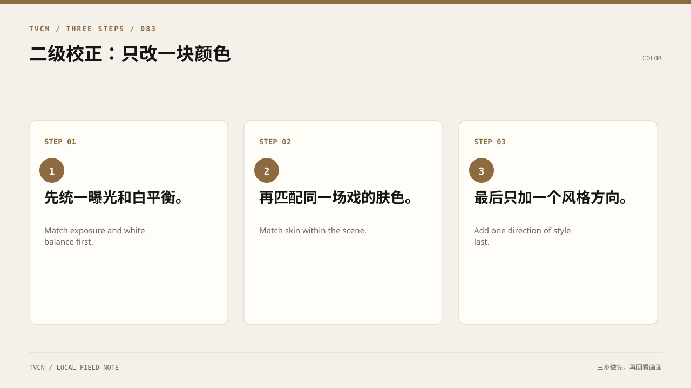

二级校正用蒙版、HSL 或限定器，只动一个范围：天空、肤色、衣服或背景。先做一级统一，再做二级；一级没统一，二级会把偏色锁死。

<!-- DIAGRAM_START -->
<h2>图解</h2>
<figure>
  
  <figcaption>看“只选一个区域：脸或天空”和“限定器羽化 10 到 20 像素，改…”两处，判断剪掉一个镜头后，节奏是更快还是更乱。</figcaption>
</figure>
<!-- DIAGRAM_END -->
<section><h2 id="section-1">二级只改“选中的区域”</h2>
每个节点只做一个目的，命名清楚；节点太多时，关掉全部再逐个开，找出真正起作用的那一个。
<h2 id="section-2">边界</h2>
二级不是“局部滤镜”。选区边缘要柔，运动镜头要跟踪；边缘硬、跟踪飘，观众第一眼就看到假。
</section><section><h2 id="section-3">现场</h2>
只选一个区域：脸或天空；限定器羽化 10 到 20 像素，改动控制在 5% 以内，关掉看是否自然。
</section><section><h2 id="section-4">怎么做</h2><ol><li>只选一个区域：脸或天空。</li><li>限定器羽化 10 到 20 像素，改动控制在 5% 以内。</li><li>关掉节点看一遍，边缘不能有光晕或色块。</li></ol></section><section><h2 id="section-5">别踩</h2>
别一次改五个区域；每个边缘都会留下痕迹。
</section><section><h2>判断</h2>
这一页的判断只看三条可观察的验收，不靠口号：
<ul><li><strong>1.</strong> 只动了一个区域，其他颜色没有被牵连。</li><li><strong>2.</strong> 边缘羽化自然，没有光晕、锯齿或色块。</li><li><strong>3.</strong> 关掉节点时，观众看不出哪一块被单独修过。</li></ul></section><section><h2>失败</h2>
下面任一条出现，先停，不要靠后期补：
<ul><li><strong>1.</strong> 只做到“只动了一个区域，其他颜色没有被牵连”的形式，换一个机位或场景就重现不了。</li><li><strong>2.</strong> 把“边缘羽化自然，没有光晕、锯齿或色块”留到后期或口头解释，现场没有留下能复查的记录。</li><li><strong>3.</strong> 别一次改五个区域；每个边缘都会留下痕迹。</li></ul></section><section><h2>延伸</h2>
<strong>10 分钟练习：</strong>拿一段 30 秒素材做 A/B，只改“只选一个区域：脸或天空”；记下一个时间码和一处差异，再决定是否保留。
</section>
<h2>验收</h2><ul><li>只动了一个区域，其他颜色没有被牵连。</li><li>边缘羽化自然，没有光晕、锯齿或色块。</li><li>关掉节点时，观众看不出哪一块被单独修过。</li></ul>

<!-- SOURCES_START -->
## 参考与延伸阅读

- [S30] [DaVinci Resolve 产品与文档](https://www.blackmagicdesign.com/products/davinciresolve) — 2026-11-26 访问。用于核对首段“二级校正只改一个区域：脸、天空、衣服；改得越多，越容易假。”中的术语与公开背景（剪辑、调色、Fusion 与交付的官方产品入口）；不替代现场测试。
- [S24] [ACESCentral：ACES：Academy Color Encoding System](https://acescentral.com/) — 2026-11-27 访问。用于核对首段“二级校正只改一个区域：脸、天空、衣服；改得越多，越容易假。”中的术语与公开背景（ACES 色彩编码、ACEScg 与交付/归档工作流）；不替代现场测试。
<!-- SOURCES_END -->

