<!-- DIAGRAM_START -->
<h2>图解</h2>
<figure>
  
  <figcaption>示意：每一层单独处理，最后才合并；把音乐先铺满，会掩盖对白问题。</figcaption>
</figure>
<!-- DIAGRAM_END -->
<h2>先判断：先修哪一层</h2>
先听一条不带音乐的片子：每句对白是否清楚、环境是否连续、切镜时有没有突然安静。对白不清，先修对白；环境断，先补房间底噪；效果抢，先降效果。音乐不是第一层，它是最后才进来的情绪。

把所有声音分轨：DX 对白、AMB 环境、SFX 效果、MX 音乐。分轨不是为了软件好看，是为了任何一层出问题都能单独替换。
<h2>对白：先保留呼吸，再降噪</h2>
对白清理只做三件事：去低频轰鸣、去明显齿音、修音量跳变。不要为了“干净”把呼吸和嘴部细节全压掉，那会让人听起来像配音。降噪分小段做，不要整条拉一个参数。

每句对白的目标不是一样大，而是同一场景内相对一致。两个人隔一米说话，不应该和隔十米一样响；观众需要听到空间。
<h2>环境与效果：先连续，再丰富</h2>
环境声先铺连续：每个场景至少 10 秒房间底噪，切镜时不要断。效果声只服务动作和信息：开门、脚步、衣服摩擦、手机震动。不要给每个动作都加一个夸张音效，观众会开始听音效而不是看故事。

效果声的方位要和画面一致；画外人声、门外脚步，不要放在正中间。立体声不是把声音铺满，是让观众知道东西在哪。
<h2>音乐与终混：最后进，最后走</h2>
音乐最后加，先在对白和效果都通过之后。音乐的第一条原则是不盖字：副歌再强，也不能让观众听不清一句关键台词。需要的时候把音乐降 3–6 dB，不要靠观众猜。

终混检查响度：对白为主的片子常用 -16 LUFS 左右，平台另有要求的按平台。检查手机外放、耳机、电视三种场景，不要只在监听音箱上听。
<h2>失败案例：音乐很满，对白全糊</h2>
一条品牌片在粗剪时就铺满音乐，客户觉得“有情绪”。等到终混，对白被音乐盖住，只能整体降音乐；降完片子又变得平。最后重新做对白清理和音乐分段，时间比一开始就分轨多一倍。

音乐不是遮羞布。对白不清，先修对白；环境不连续，先补底噪。把音乐留到最后，才有空间做真正的情绪。
<h2>成本与验收</h2>
低成本：对白清理 + 环境 + 一条音乐，¥2,000–6,000。中成本：完整分轨、效果、终混、响度，¥6,000–20,000。高成本：5.1/Atmos、配音、拟音、多版本，¥20,000–80,000+。
<h2>验收</h2><ul><li>对白不看字幕能听清。</li><li>每个场景环境声连续，切镜不断。</li><li>效果声方位与画面一致。</li><li>音乐不盖关键台词。</li><li>响度符合平台，三种设备试听。</li><li>DX/AMB/SFX/MX 分轨交付。</li></ul>

<!-- SOURCES_START -->
## 参考与延伸阅读

- [S27] [ITU-R：BS.1770 音频响度与真峰值测量](https://www.itu.int/rec/R-REC-BS.1770/en) — 2026-11-27 访问。用于核对首段“声音后期不是先找音乐。顺序是：对白能听清、环境不断、效果不抢、音乐最后进；每一步都有可检查的结果。”中的术语与公开背景（响度测量、真峰值与 EBU R128 所依据的 ITU 算法标准）；不替代现场测试。
- [S28] [Netflix 制作与交付帮助](https://partnerhelp.netflixstudios.com/) — 2026-11-26 访问。用于核对首段“声音后期不是先找音乐。顺序是：对白能听清、环境不断、效果不抢、音乐最后进；每一步都有可检查的结果。”中的术语与公开背景（平台交付规格、HDR/SDR 与 QC 要求的公开入口）；不替代现场测试。
- [S30] [DaVinci Resolve 产品与文档](https://www.blackmagicdesign.com/products/davinciresolve) — 2026-11-26 访问。用于核对首段“声音后期不是先找音乐。顺序是：对白能听清、环境不断、效果不抢、音乐最后进；每一步都有可检查的结果。”中的术语与公开背景（剪辑、调色、Fusion 与交付的官方产品入口）；不替代现场测试。
- [S34] [Adobe Premiere Pro 用户指南](https://helpx.adobe.com/premiere-pro/user-guide.html) — 2026-11-26 访问。用于核对首段“声音后期不是先找音乐。顺序是：对白能听清、环境不断、效果不抢、音乐最后进；每一步都有可检查的结果。”中的术语与公开背景（剪辑、代理、色彩与导出的官方文档）；不替代现场测试。
- [S35] [Avid 资源中心](https://www.avid.com/resource-center) — 2026-11-26 访问。用于核对首段“声音后期不是先找音乐。顺序是：对白能听清、环境不断、效果不抢、音乐最后进；每一步都有可检查的结果。”中的术语与公开背景（Media Composer、协作与交付的资源入口）；不替代现场测试。
<!-- SOURCES_END -->

