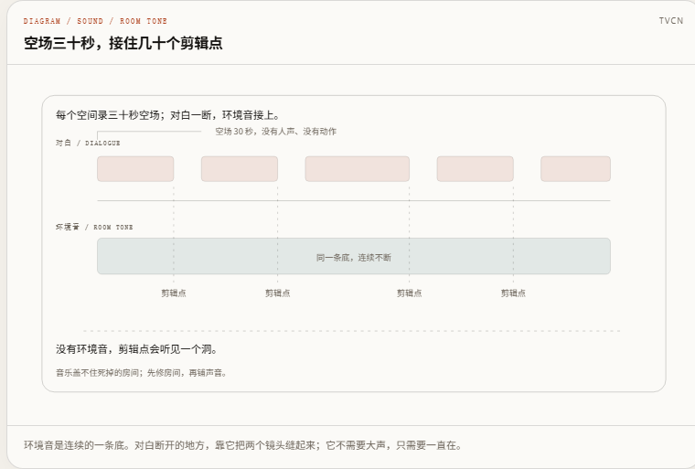

<!-- DIAGRAM_START -->
## 图解

<figure>
  
  <figcaption>环境音是连续的一条底。对白断开的地方，靠它把两个镜头缝起来；它不需要大声，只需要一直在。</figcaption>
</figure>
<!-- DIAGRAM_END -->

房间的声音不是噪声，是空间。每换一个地方，录三十秒空场；没有人声、没有动作，只有房间。对白一断，环境音接上，观众才不会觉得画面被剪断。

## 每换一个空间，录三十秒

录制前让所有人闭嘴，不要走、不要翻纸、不要调灯。麦克风放在刚才录对白的位置，录三十秒。文件名写清地点和日期，比如“厨房_1120_空场”。后期要找的时候，这三十秒比一段音乐值钱。

如果房间有冰箱、空调、日光灯，先录一版正常的，再录一版关掉的。不要擅自关掉现场的声音；观众听见的“安静”，其实包含这些底噪。

## 环境音是胶水

两个镜头之间对白断了，环境音铺进去，耳朵就不会听见一个洞。它不需要大声，只需要一直在。对白下面垫一层很低的房间声，观众不会注意，但拿掉就会觉得假。

不同场景的环境音要对得上。客厅和走廊是两种空间，不能拿一条通用底噪从头铺到尾。剪辑点前后，环境音要连续；否则画面还没切，声音已经先跳了。

## 别用音乐盖住空洞

房间本身的声音不对，先解决房间：关窗、关冰箱、把空调调低、把桌子挪开。音乐盖不住一个死掉的房间，只会让观众听见“这里想让我别注意”。

音乐可以有，但环境音是底。先铺房间，再加音乐；顺序反了，后期会一直在补洞。

## 检查

- 每个拍摄地点都录了三十秒空场，文件名能查到？
- 对白之间有没有环境音连续铺底，剪辑点不跳？
- 房间的空洞是先被修掉，还是被音乐盖住了？
