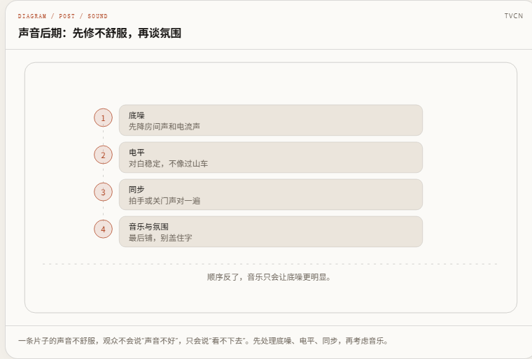

<!-- DIAGRAM_START -->
## 图解

<figure>
  
  <figcaption>一条片子的声音不舒服，观众不会说“声音不好”，只会说“看不下去”。先处理底噪、电平、同步，再考虑音乐。</figcaption>
</figure>
<!-- DIAGRAM_END -->

## 先听三遍，不动手

第一遍听整体，第二遍只听人声，第三遍关掉画面听环境。把问题写下来：底噪、爆音、回声、不同镜头的音量跳。不要一边听一边乱拉，拉完就忘了原声是什么样。

问题列清楚，再决定哪些能修、哪些要重录。重录一句，常常比修十分钟便宜。

## 降噪别下狠手

降噪拉太重，人声会变成塑料。先处理空调、冰箱、灯管这种持续噪声；风扇和交通这种一阵一阵的，优先换镜头或重录。保留一点底噪，耳朵才相信这个空间是真的。

如果一段话实在救不回来，就把它剪短。声音后期最有效的动作，常常是删掉，不是加上。

## 对白先站住，音乐最后进

对白峰值压在 -6 到 -3 dB，环境声比对白低 12 到 18 dB。音乐最后加，加完再关掉画面听一遍，确认人声没有被托住。被音乐盖住的句子，观众不会倒回去听，只会走。

同步不要靠眼睛。每条素材开头拍一下手，波形对起来最快；没有拍手，就找关门、放杯子、脚步这些明显的瞬态。

## 检查

- 问题清单里分别写了底噪、爆音、回声、音量跳。
- 对白峰值在 -6 到 -3 dB，环境声低 12 到 18 dB。
- 关掉画面听一遍，人声仍然清楚。

## 降噪的边界

降噪不是把噪声降到零，是把噪声压到观众不注意。压太狠，对白会变成塑料，齿音和呼吸先消失。

先确认噪声类型：稳态风扇用谱减，突发关门用剪辑或手动修。一种工具打天下，最后一定伤对白。

## 对白先站住

先修对白的电平、节奏和呼吸，再修音色。对白不清楚，加多少氛围都没用。

修完一条，和前后镜头并排听。单条好听不算，整场一致才算。

## 交付前听三遍

第一遍在剪辑软件里听，第二遍导出成平台格式听，第三遍用手机外放听。三遍听到的问题不一样。

手机外放最容易暴露低频过多和对白太轻。耳机最容易暴露齿音和底噪。

<!-- V11_DEEPEN -->

> 意图分工：本页负责「声音后期先修噪声，再谈氛围」的可执行细节；同集群先读 <a href="https://post.tvcn.org/article/loudness/">响度：平台目标与真峰值</a> 建立总判断，再回到本页。

<!-- INTENT_SCOPE -->

<!-- SOURCES_START -->
## 经验说明

经验说明：本页来自 4 个后期项目的操作复盘，条件为页面所列软件版本、素材格式与交付平台；只讨论「声音后期先修噪声，再谈氛围」的操作顺序，不含外部实验室测试；不适用于未列版本、影院母版、广播级安全认证或法律意见。
<!-- SOURCES_END -->

