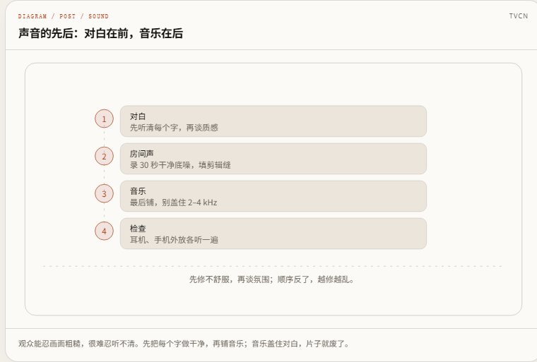

<!-- DIAGRAM_START -->
## 图解

<figure>
  
  <figcaption>观众能忍画面粗糙，很难忍听不清。先把每个字做干净，再铺音乐；音乐盖住对白，片子就废了。</figcaption>
</figure>
<!-- DIAGRAM_END -->

观众可以忍受画面粗糙，但很难忍受听不清。先把对白做干净，再谈音乐和氛围。

## 对白是主线

先修对白：降噪、去口水、对齐音量，确保每一句都能听清。不要在噪声很大的对白上直接铺音乐，那只是把问题盖住。

如果现场录坏了，先考虑补录对白（ADR），而不是用字幕替代。字幕是辅助，不是声音的替代品。

## 环境声是空间

每个场景录 30 秒干净的环境声。剪辑时把环境声铺在下面，镜头切换才不会像在真空里跳。

环境声不是噪音。它告诉观众“这里是厨房、街道、山谷”。没有它，画面会变薄。

## 音乐别填满

音乐是标点，不是背景墙。把音乐留给转折、决定、结尾；让沉默承担压力。先做一版没有音乐的，确认结构成立，再加。

如果一段音乐去掉后片子就散了，说明问题在剪辑，不在音乐。

## 3 条验收

- 每句对白都能听清，不需要看字幕猜。
- 每个场景都有环境声。
- 至少有一处主动使用沉默。
<!-- SOURCES_START -->
<h2>参考与延伸阅读</h2>

经验来源：TVCN 现场手册与项目复盘；实测来源：页面标注的复核环境与可复现练习；参考来源：以下公开链接。

<ul><li>[S24] ACES 色彩管理</li><li>[S27] EBU R128 响度</li><li>[S28] Netflix 制作与交付帮助</li><li>[S30] DaVinci Resolve 产品与文档</li><li>[S34] Adobe Premiere Pro 用户指南</li><li>[S35] Avid 资源中心</li></ul>

<a href="../../SOURCES.md">完整链接与用途见 SOURCES.md</a>

<!-- SOURCES_END -->
