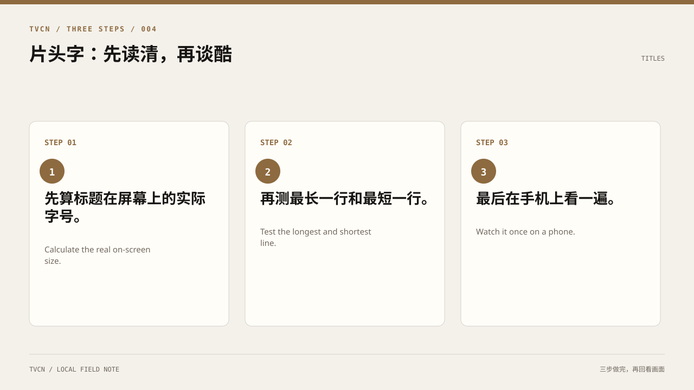

片头字先保证读得清，再谈风格；观众连片名都没看清，设计就白做了。

<!-- DIAGRAM_START -->
<h2>图解</h2>
<figure>
  
  <figcaption>把三步按顺序做完，再回看画面或文件。</figcaption>
</figure>
<!-- DIAGRAM_END -->
<h2>现场</h2>

片名用 2 到 3 个字一行，按手机宽度测最长一行；先做纯白字黑底，读清后再加风格，别先上细体。

<h2>怎么做</h2>

片头字先保证读得清，再谈风格；观众连片名都没看清，设计就白做。
<ol><li>片名每行 2 到 3 个字，按手机宽度测最长一行。</li><li>先做纯白字黑底，读清后再加字体、材质和动效。</li><li>在手机上不放大看一遍，确认没有溢出安全区。</li></ol>
<h2>别踩</h2>

别用细字体配复杂背景；读不清就是失败。

<h2>验收</h2>
<ul><li>手机竖屏不放大也能读清片名，最长一行没有出画。</li><li>纯白字黑底版本先成立，风格版本没有牺牲字号。</li><li>三版截图和一张字号表能看出最小字号与安全区。</li></ul>
