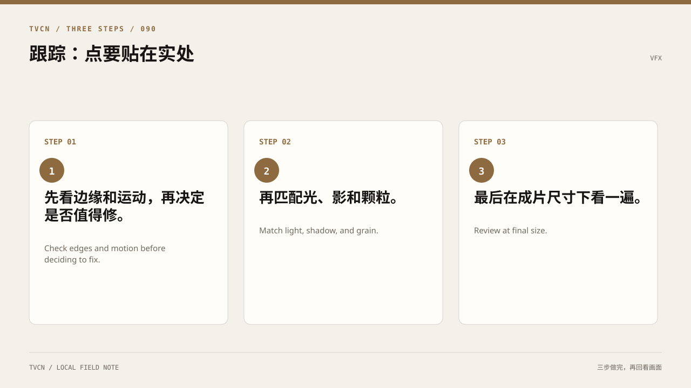

别把点贴在纯色墙或反光面；跟踪器没有信息可抓。

<!-- DIAGRAM_START -->
<h2>图解</h2>
<figure>
  
  <figcaption>看“贴三个跟踪点：一个有纹理的角、一个高…”和“点被挡就切手动关键帧”两处，判断剪掉一个镜头后，节奏是更快还是更乱。</figcaption>
</figure>
<!-- DIAGRAM_END -->
<section><h2 id="section-1">现场</h2>
贴三个跟踪点：一个有纹理的角、一个高对比标记、一个备用；点被挡就切手动关键帧。
</section><section><h2 id="section-2">怎么做</h2>
把这件事拆成现场能检查的动作。
<ol><li>贴三个跟踪点：一个有纹理的角、一个高对比标记、一个备用。</li><li>点被挡就切手动关键帧。</li><li>回放整段，检查有没有漂移或滑步。</li></ol></section><section><h2 id="section-3">别踩</h2></section><section><h2 id="section-4">点怎么选</h2>
优先选有纹理、对比高、形状不重复的位置：墙角、标签、螺丝、地面纹理。不要贴在纯色墙、反光面、快速运动的手或会被头发遮住的耳朵上。

平面跟踪至少三个点，3D 跟踪至少六个点并分布在不同深度。点不是越多越好，能被遮挡后恢复的点才有用。
</section><section><h2 id="section-5">解算顺序</h2><ol><li>先定原点和比例，再解算；不要一边解算一边改镜头畸变。</li><li>先解平移/旋转/缩放，再解透视；误差大就退回手动关键帧。</li><li>解算完看 reprojection：把测试网格贴回画面，边缘不能滑。</li></ol>
有运动模糊的镜头，先做运动模糊补偿或手动 key；不要硬让跟踪器猜。
</section><section><h2 id="section-6">跟踪失败</h2><ol><li>纯色墙：没有纹理，跟踪器只能漂；加临时标记或手工 key。</li><li>反光/透明面：点在移动，解算会缩放；换到旁边的真实纹理。</li><li>卷帘快门：快速横摇时画面变形；先做去畸变或换镜头。</li><li>遮挡：点被挡后没有恢复；提前布备用点，遮挡段切手动。</li></ol></section><section><h2 id="section-7">解算验收记录</h2><ul><li>reprojection 误差在成片尺寸下不超过 1–2 像素；放大到 200% 仍不滑。</li><li>整段回放，跟踪面没有缩放漂移、滑步或突然跳点。</li><li>遮挡段有手动关键帧，过渡没有硬切。</li><li>记录跟踪软件、版本、镜头、焦距、解算误差和手动 key 帧数。</li></ul></section><section><h2 id="section-8">解算记录</h2>
记镜头、焦距、跟踪软件版本、解算误差、手动 key 帧数、遮挡段落。误差变大时先回看这些字段，不要直接重解整段。
</section><section><h2 id="section-9">误差变大先查什么</h2>
先查镜头畸变标定和焦距是否变了，再查点是否被遮挡；不要一上来重解整段。重解前保存原解算，失败可回退。
</section><section><h2>判断</h2>
现场只认三个信号：
<ul><li>剪掉一个镜头，节奏更快而不是更乱</li><li>示波器上肤色、高光和黑位都在范围内</li><li>响度、字幕和文件规格能过一次交付检查</li></ul></section><section><h2>失败</h2>
下面三种做法会让页面上的细节白做：
<ul><li>剪辑点跟着音乐，不跟动作</li><li>先定风格再统一，镜头之间跳色</li><li>交付前没查响度和字幕，最后一遍才发现</li></ul></section><section><h2>延伸</h2>
<strong>10 分钟练习：</strong>拿一段 30 秒素材做 A/B，只改“贴三个跟踪点：一个有纹理的角、一个高…”；记下一个时间码和一处差异，再决定是否保留。
</section>
<h2>验收</h2><ul><li>三个点中至少两个在整段里可见、有纹理。</li><li>遮挡发生时已经切到手动关键帧，没有硬跳。</li><li>回放整段，跟踪面没有滑移或缩放漂移。</li></ul>
