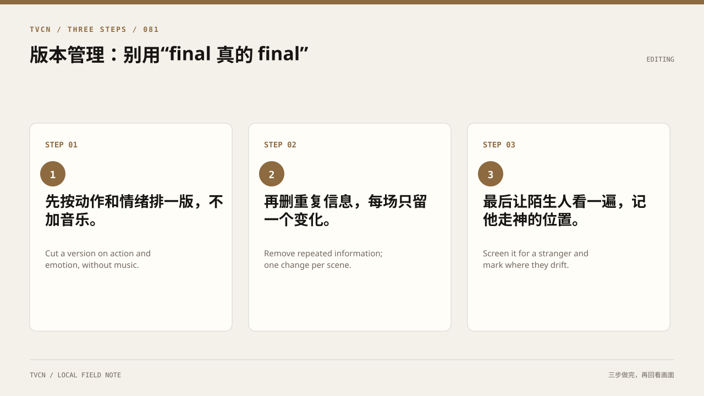

文件名用 v001、v002，不用“最终”“最终2”。每次输出写一行变更：改了哪一场、哪个镜头、为什么。没有变更说明，版本号只是数字。

<!-- DIAGRAM_START -->
<h2>图解</h2>
<figure>
  
  <figcaption>看“文件名用日期_平台_时长_v3，例如…”和“改动写进版本表：改了什么、为什么、谁…”两处，判断剪掉一个镜头后，节奏是更快还是更乱。</figcaption>
</figure>
<!-- DIAGRAM_END -->
<section><h2 id="section-1">版本号只增不减，说明写“改了什么”</h2>
只保留当前版和上一版在工作目录，旧版归档；交付时明确哪一版是母版，避免客户打开错文件。
<h2 id="section-2">边界</h2>
版本不是越多越好。每次改一个目的，改完立刻命名；一天出十个版本，等于没有版本。
</section><section><h2 id="section-3">现场</h2>
文件名用日期_平台_时长_v3，改动写进版本表：改了什么、为什么、谁批准。
</section><section><h2 id="section-4">怎么做</h2><ol><li>文件名用日期_平台_时长_v3，例如 20261122_web_60s_v3。</li><li>改动写进版本表：改了什么、为什么、谁批准。</li><li>只保留一个当前交付版，旧版进归档，别靠记忆。</li></ol></section><section><h2 id="section-5">别踩</h2>
别用“最新版”当文件名；三个月后没人知道它最新在哪。
</section><section><h2>判断</h2>
这一页的判断只看三条可观察的验收，不靠口号：
<ul><li><strong>1.</strong> 文件名包含日期、平台、时长和版本号，能直接排序。</li><li><strong>2.</strong> 版本表能查出每次改动的原因和批准人。</li><li><strong>3.</strong> 随机拿一个旧版，能说出它和当前版的差别。</li></ul></section><section><h2>失败</h2>
下面任一条出现，先停，不要靠后期补：
<ul><li><strong>1.</strong> 只做到“文件名包含日期、平台、时长和版本号，能直接排序”的形式，换一个机位或场景就重现不了。</li><li><strong>2.</strong> 把“版本表能查出每次改动的原因和批准人”留到后期或口头解释，现场没有留下能复查的记录。</li><li><strong>3.</strong> 别用“最新版”当文件名；三个月后没人知道它最新在哪。</li></ul></section><section><h2>延伸</h2>
<strong>10 分钟练习：</strong>拿一段 30 秒素材做 A/B，只改“文件名用日期_平台_时长_v3，例如…”；记下一个时间码和一处差异，再决定是否保留。
</section>
<h2>验收</h2><ul><li>文件名包含日期、平台、时长和版本号，能直接排序。</li><li>版本表能查出每次改动的原因和批准人。</li><li>随机拿一个旧版，能说出它和当前版的差别。</li></ul>

<!-- DEEP_DIVE_START -->
## 深读

<strong>约 5 分钟。</strong> 版本管理不是多存几个文件，是让三个月后还知道哪个能交、哪个只是草稿。

### 命名先定规则

项目名_日期_版本_状态：tvcn_20261121_v03_review。不要用 final、final2、真的final，这些词最后都会说谎。

同一天多个版本用字母，v03a、v03b，别覆盖。覆盖之后，客户说的“上一版”就永远找不回来。

### 锁定和变更

画面锁定后，任何改动进变更表：谁要、改什么、影响哪些镜头。口头改动到了后期，往往变成三倍工作量。

客户确认写进邮件或文档，不要只口头。确认记录不是不信任，是让所有人对同一版负责。

### 交付包

交付包含母版、无字幕版、字幕、封面、工程归档。少一样，下次就要重做；重做的成本永远比归档高。

归档前打开一次工程，确认素材没有离线。文件在，链接断了，等于没存。

### 变更表怎么写

五列：日期、提出人、内容、影响镜头、完成状态。每条一行，不写散文。

变更表放在项目根目录，所有人看同一份。微信里的“改一下”不算记录。

### 归档的目录

归档分素材、工程、输出、文档。每类一个文件夹，不嵌套超过三层。

根目录放一个 README，写软件版本、插件、恢复步骤。三个月后你会需要它。

### 交付前，版本十项检查
<ul><li>文件名含项目、日期、版本、状态</li><li>禁止 final 和 final2</li><li>同一天版本用字母</li><li>画面已锁定</li><li>变更写进变更表</li><li>客户确认留文字</li><li>交付包有清单</li><li>母版、无字幕、字幕齐全</li><li>工程已归档</li><li>归档前打开检查素材</li></ul>
版本管理做到位，交付就不是碰运气，是打开对的文件夹。

### 只剩五分钟时
<ul><li>文件名写项目、日期、版本、状态</li><li>禁止 final 和 final2</li><li>画面锁定再交付</li><li>变更写进变更表</li><li>交付包有清单</li><li>归档前打开检查</li></ul>
版本管理不是为了好看，是为了让“上一版”真的找得到。

<!-- DEEP_DIVE_END -->

<!-- SOURCES_START -->
## 参考与延伸阅读

- [S34] [Adobe：Premiere Pro 官方指南](https://helpx.adobe.com/premiere-pro/user-guide.html) — 2026-11-26 访问。用于核对「版本号只增不减，说明写“改了什么”」一节的术语/方法/规则（Premiere Pro 官方指南，不是工作流优劣结论）；不核对其中由本页经验得出的数字、型号与现场结论，也不替代测试。
- [S60] [Apple：Final Cut Pro 官方指南](https://support.apple.com/guide/final-cut-pro/welcome/mac) — 2026-11-26 访问。用于核对「现场」一节的术语/方法/规则（Final Cut Pro 官方指南，不是工作流优劣结论）；不核对其中由本页经验得出的数字、型号与现场结论，也不替代测试。
- [S30] [DaVinci Resolve：官方文档](https://www.blackmagicdesign.com/products/davinciresolve) — 2026-11-26 访问。用于核对「怎么做」一节的术语/方法/规则（Resolve 官方产品/文档入口，不是第三方教程）；不核对其中由本页经验得出的数字、型号与现场结论，也不替代测试。
<!-- SOURCES_END -->

