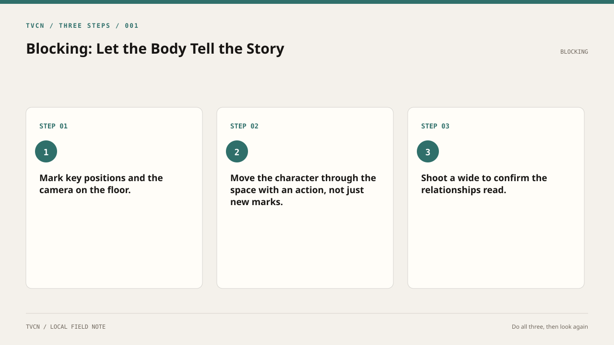

Blocking is not pretty placement; it makes relationships visible in space: who approaches, who retreats, who blocks whom.

<!-- DIAGRAM_START -->
<h2>Diagram</h2>
<figure>
  
  <figcaption>Do the three steps in order, then look again at the image or file.</figcaption>
</figure>
<!-- DIAGRAM_END -->
<h2>On set</h2>

Tape the door, the chair, and the camera on the floor. Walk the actor from the door to the chair, stopping two seconds in front of the camera. Shoot one wide and check who blocks whom.

<h2>Do this</h2>

Blocking is not pretty placement; it makes relationships visible in space: who approaches, who retreats, who blocks whom. Mark the positions, move the actor through the space with one action, then check the relationship in a wide.
<ol><li>Tape the door, chair, and camera positions on the floor.</li><li>Walk the actor from the door to the chair, stopping two seconds in frame, without lines.</li><li>Shoot a wide first and review who blocks whom and whether the distance reads.</li></ol>
<h2>Avoid</h2>

Do not pose people like a poster; a false body makes a false relationship.

<h2>Check</h2>
<ul><li>In the wide, you can see who approaches, who retreats, and who blocks whom without dialogue.</li><li>The actor takes an action path, not a pose; start, turn, and end are visible in frame.</li><li>A blocking diagram or phone video lets another person walk the same path.</li></ul>

<!-- DEEP_DIVE_START -->
## Deep dive

<strong>About 6 minutes.</strong> Blocking lets the body speak first and the camera record second. Put an actor in the wrong place and no lens can save it.

### Block first, place the camera second

Walk the actors through the space without lines, only action. Tape the turn, the stop, the prop touch.

Find the camera from the blocking; do not lay track first and squeeze the actors into it. Track serves blocking that already works, it does not force performance.

### Distance is relationship

Stand two people close and the audience feels intimacy or pressure; put a table between them and the relationship cools. Height speaks too: a low camera gives power, a high camera diminishes.

A doorframe, table edge, or corridor as foreground creates space better than a filter. Foreground is not decoration; it says “we are watching from outside.”

### Change blocking and camera together

If blocking hides a face, change the lens or move the camera; do not ask the actor to twist. An uncomfortable body makes false dialogue.

Shoot a wide during rehearsal, play it back to see who is blocked and who leaves frame, then set the final camera. The wide is not for the film; it is a blocking check.

### Draw a blocking diagram

Draw the room from above: doors, windows, tables, actor starts and ends. Arrows for direction, numbers for order.

The diagram need not be beautiful, only readable to script and camera. On the next setup, the diagram is more reliable than memory.

### Blocking a group scene

In a group scene, assign roles: who decides, who resists, who only watches. Give each person an action instead of letting them stand and wait for lines.

Use triangular positions instead of a straight line. Shoot from one side and the foreground and background separate naturally.

### Ten blocking checks
<ul><li>Walk the scene without lines first</li><li>Tape start, end, and turn points</li><li>Find the camera from blocking, do not lay track first</li><li>Distance matches the relationship</li><li>Height matches the power dynamic</li><li>Use a doorframe or table edge as foreground</li><li>Shoot a rehearsal wide and play it back</li><li>If blocked, change lens or move camera first</li><li>Keep one main blocking pattern per scene</li><li>Photograph the blocking diagram for the file</li></ul>
Blocking is not arranging actors to look nice; it lets space speak before the audience understands.

### When you have five minutes
<ul><li>Walk it once without lines</li><li>Mark start, end, and turns</li><li>Test sitting and standing</li><li>Confirm the key light does not hide the face</li><li>Give every group actor one action</li><li>Photograph the blocking diagram</li></ul>
Right blocking gives dialogue a place to land; wrong blocking makes actors carry it with their faces.

<!-- DEEP_DIVE_END -->
