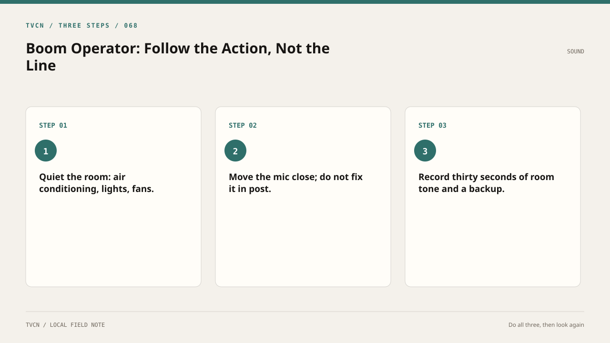

It is not holding the pole high. Listen to breath and footsteps, anticipate the next line and action; the tip follows action, not dialogue. When the actor stops, the pole stops; when they turn, go around the outside.

<!-- DIAGRAM_START -->
<h2>Diagram</h2>
<figure>
  
  <figcaption>Watch “Follow the actor&#x27;s hands and footsteps instead of” and “Stop when the actor stops and keep the”; judge whether highlights, skin and sound survive together.</figcaption>
</figure>
<!-- DIAGRAM_END -->
<section><h2 id="section-1">Boom operating is listening before lifting</h2>
Record ten seconds of room tone and a boom test each scene; confirm no lamp hit, shadow or cloth rub.
<h2 id="section-2">Limits</h2>
Longer is not better. A long pole hits walls and tires arms in tight spaces; use the shortest that works. Protect the line over the pose.
</section><section><h2 id="section-3">On set</h2>
Follow the actor's hands and steps, not the lines. Stop when they stop; when they turn, keep the tip above and outside the frame.
</section><section><h2 id="section-4">Do this</h2>
The boom follows action, not lines; lines stop, bodies do not. Keep the tip above frame.
<ol><li>Follow the actor's hands and footsteps instead of swinging on every line.</li><li>Stop when the actor stops and keep the tip above the head through turns.</li><li>Review for the boom entering frame and dialogue masked by cloth or breath.</li></ol></section><section><h2 id="section-5">Avoid</h2>
Do not swing the boom on every line; the tip will enter frame and the sound will shift.
</section><section><h2>Judge</h2>
This page passes on three observable checks, not slogans:
<ul><li><strong>1.</strong> The boom tip never enters frame and casts no edge shadow.</li><li><strong>2.</strong> Dialogue level stays stable as the actor walks and turns.</li><li><strong>3.</strong> The pole does not pump on every line and the voice does not shift direction.</li></ul></section><section><h2>Failures</h2>
Any one of these means stop and fix it before post:
<ul><li><strong>1.</strong> Check 1 is only staged (“The boom tip never enters frame and casts no e…”); another camera position or location exposes it.</li><li><strong>2.</strong> Check 2 is left to post or a verbal explanation (“Dialogue level stays stable as the actor walks…”); nothing on set can be rechecked.</li><li><strong>3.</strong> Do not swing the boom on every line; the tip will enter frame and the sound will shift.</li></ul></section><section><h2>Extend</h2>
<strong>10-minute exercise:</strong> Shoot three 10-second takes by the same window, changing only “Follow the actor's hands and footsteps instead of”. Compare highlights, skin and background; keep the one that is editable.
</section>
<h2>Check</h2><ul><li>The boom tip never enters frame and casts no edge shadow.</li><li>Dialogue level stays stable as the actor walks and turns.</li><li>The pole does not pump on every line and the voice does not shift direction.</li></ul>

<!-- SOURCES_START -->
## References and further reading

- [S27] [ITU-R BS.1770: Loudness and True Peak](https://www.itu.int/rec/R-REC-BS.1770/en) — Accessed 2026-11-26. Used to check the terminology/method/rule in the “Boom operating is listening before lifting” section against BS.1770 loudness measurement, not microphone buying advice; it does not verify numbers, model choices or on-set conclusions derived from this page, and is not a substitute for a test.
- [S23] [SMPTE: Standards](https://www.smpte.org/standards) — Accessed 2026-11-26. Used to check the terminology/method/rule in the “Limits” section against SMPTE standards portal, not specific camera specs; it does not verify numbers, model choices or on-set conclusions derived from this page, and is not a substitute for a test.
<!-- SOURCES_END -->

