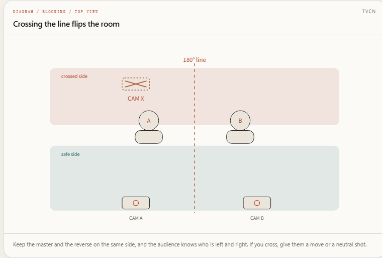

<!-- DIAGRAM_START -->
## Diagram

<figure>
  
  <figcaption>Keep the master and the reverse on the same side, and the audience knows who is left and right. If you cross, give them a move or a neutral shot.</figcaption>
</figure>
<!-- DIAGRAM_END -->

## Draw the line first

Two people face each other. Treat the line between them as a border. Keep the main shot on one side and the reverse shot on the same side, and the audience knows who is left and who is right. The rule is not magic; it protects the map of the room in their head.

Before rolling, take a wide shot on your phone and look at it. A is on the left, B is on the right. Check every later setup against that frame instead of trusting your memory on set.

## When crossing is allowed

If someone walks across the room, if the camera follows them through, or if you insert a neutral shot, the audience can accept the change. A neutral shot can be hands, a glass of water, a doorway. It just cannot belong to either side.

The hard cut with no reason is the problem. A is left, then A is right, and the audience spends two seconds relocating. Whatever was said in those two seconds is gone.

## Shoot clean singles

With one camera, shoot a clean single of A, then a clean single of B, then pick up hands and objects. Clean singles let you reorder the scene in the edit without using a line cross for “cinematic” texture.

Refocus and re-white-balance every time you move. Dialogue scenes usually fail on matching color between two setups, not on the acting.

## Three checks

- The wide shot makes left and right obvious.
- Every line cross has a walk, a move, or a neutral shot to justify it.
- The two reverse angles match in color temperature and exposure.

<!-- V11_DEEPEN -->

<!-- SOURCES_START -->
## References and further reading

- [S31] [ARRI: Cine Systems](https://www.arri.com/en/cine-systems) — Accessed 2026-11-26. Used to check the terminology/method/rule in the “Draw the line first” section against ARRI camera, lens and lighting documentation, not a general shooting tutorial; it does not verify numbers, model choices or on-set conclusions derived from this page, and is not a substitute for a test.
- [S52] [ARRI: ALEXA 35](https://www.arri.com/en/camera-systems/cameras/legacy-camera-systems/alexa-35) — Accessed 2026-11-26. Used to check the terminology/method/rule in the “When crossing is allowed” section against ALEXA 35 official specs, not independent testing; it does not verify numbers, model choices or on-set conclusions derived from this page, and is not a substitute for a test.
- [S53] [Sony: FX6](https://pro.sony/ue_US/products/handheld-camcorders/ilme-fx6v) — Accessed 2026-11-26. Used to check the terminology/method/rule in the “Shoot clean singles” section against FX6 official specs, not independent testing; it does not verify numbers, model choices or on-set conclusions derived from this page, and is not a substitute for a test.
<!-- SOURCES_END -->

