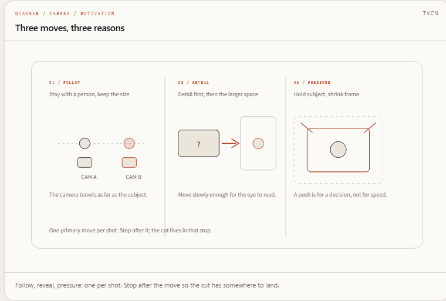

<!-- DIAGRAM_START -->
## Diagram

<figure>
  
  <figcaption>Follow, reveal, pressure: one per shot. Stop after the move so the cut has somewhere to land.</figcaption>
</figure>
<!-- DIAGRAM_END -->

## Write the reason on the shot list

Next to every moving shot, write one sentence: why does the camera move? To follow someone, to reveal what they cannot see, or to make them feel cornered. If you cannot write the reason, lock the camera off first.

Movement is not a story. Motivation is. The audience will not care that the dolly runs smooth; they forget the machine only when they are being taken somewhere.

## Three moves, one per shot

- **Follow.** Keep the subject at roughly the same size in frame and let the audience walk with them. Good for travel, presence, and long takes. Match the operator’s pace to the subject’s; do not let the stabilizer arrive first.
- **Reveal.** Start on a detail, then pan or boom out to the larger space. Good for information gaps: a hand first, then the knife on the table. Move slowly enough for the eye to read.
- **Pressure.** Push in slowly, or hold the subject still and let the background recede. Good for the seconds before a decision. Push fast and the scene becomes a thriller.

Pick one primary move per shot. Follow and pan and push in the same shot, and the audience stops knowing where to look.

## Stop after the move

Most shots do not need more movement. They need stillness. When the camera reaches its new position, hold on the face or on the empty space and let the audience digest what they just saw.

The cut often lives in that stop. If you never settle, the edit has to cut from a frame that is still moving.

## Checks

- Every moving shot has a written reason.
- One primary movement per shot.
- The move ends with a hold long enough to read.

<!-- V11_DEEPEN -->

> Intent split: this page covers the practical details of “Camera Movement: Ask Why Before How”; start with <a href="https://shoot.tvcn.org/article/stabilizer/">Stabilizer: Walk Like You Mean It</a> for the cluster-level judgement, then return here.

<!-- INTENT_SCOPE -->

<!-- SOURCES_START -->
## Experience note

Experience note: this page draws on 5 on-set shoot and playback review reviews under one camera, available light or one key light; it discusses “Camera Movement: Ask Why Before How”; no external laboratory test was run, and the conclusion may not transfer when conditions change.
<!-- SOURCES_END -->

