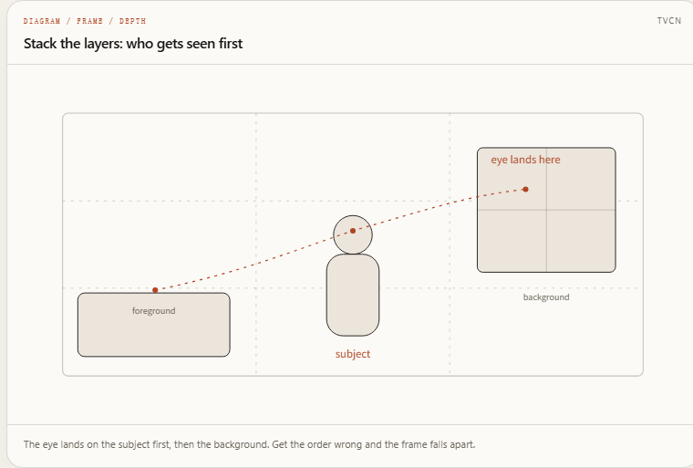

<!-- DIAGRAM_START -->
## Diagram

<figure>
  
  <figcaption>The eye lands on the subject first, then the background. Get the order wrong and the frame falls apart.</figcaption>
</figure>
<!-- DIAGRAM_END -->

## One frame, one subject

The eye lands in one place first. Use the brightest, sharpest, most central element to say who matters; everything else supports it.

If the face and the background fight, darken the background, move the clutter, or step closer. Composition is subtraction first.

## Foreground, middle, background

Foreground sets space, middle ground holds the person, background carries information. All three layers give depth; if all three compete, the frame becomes noise.

With no foreground, find a leaf, a door frame, a shoulder. It does not need to matter; it only needs to separate the space.

## Leave room for gaze and movement

If the person looks right, leave space on the right; if they walk left, leave a path on the left. Negative space is not waste; it lets the audience anticipate the next second.

Landscape and vertical need different lead room. In vertical, keep the face in the safe area first, then talk about side space.

## Three checks

- Pause the frame; you can name the subject in three seconds.
- The frame has at least two layers of space.
- There is lead room in the direction of the gaze.

<!-- V11_DEEPEN -->

> Intent split: this page covers the practical details of “Composition: Tell the Eye Where to Look”; start with <a href="https://shoot.tvcn.org/article/camera-height/">Camera Height: Lower Before You Change Lenses</a> for the cluster-level judgement, then return here.

<!-- INTENT_SCOPE -->

<!-- SOURCES_START -->
## References and further reading

- [S23] [SMPTE Standards](https://www.smpte.org/standards) — Accessed 2026-11-26. Used to check the terminology and public context in the opening paragraph (“Who should the eye hit first, and where does it go second? C”) against Entry point for timecode, color, cinema and signal-chain standards; not a substitute for an on-set test.
- [S31] [ARRI Cine Systems](https://www.arri.com/en/cine-systems) — Accessed 2026-11-26. Used to check the terminology and public context in the opening paragraph (“Who should the eye hit first, and where does it go second? C”) against Technical documentation for cameras, lenses and lighting; not a substitute for an on-set test.
- [S32] [Sony Pro Support](https://pro.sony/ue_US/support) — Accessed 2026-11-26. Used to check the terminology and public context in the opening paragraph (“Who should the eye hit first, and where does it go second? C”) against Support, firmware and documents for pro cameras and lenses; not a substitute for an on-set test.
- [S33] [Canon Support](https://www.usa.canon.com/support) — Accessed 2026-11-26. Used to check the terminology and public context in the opening paragraph (“Who should the eye hit first, and where does it go second? C”) against Official support for cameras, lenses and firmware; not a substitute for an on-set test.
- [S52] [ARRI: ALEXA 35](https://www.arri.com/en/camera-systems/cameras/legacy-camera-systems/alexa-35) — Accessed 2026-11-26. Used to check the terminology and public context in the opening paragraph (“Who should the eye hit first, and where does it go second? C”) against Camera specifications, Log-C and colour workflow; not a substitute for an on-set test.
<!-- SOURCES_END -->

