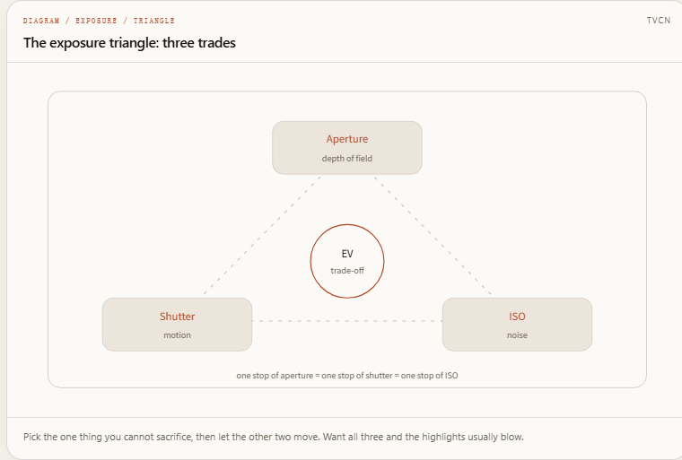

<!-- DIAGRAM_START -->
## Diagram

<figure>
  
  <figcaption>Pick the one thing you cannot sacrifice, then let the other two move. Want all three and the highlights usually blow.</figcaption>
</figure>
<!-- DIAGRAM_END -->

Shutter, aperture, and ISO are not three equal knobs. Set motion first, depth second, and use ISO last.

## Set the shutter first

At 24fps, set the shutter to 1/48 or 1/50 second for natural motion. For 60fps slow motion, raise it to around 1/120, or every frame will smear.

The shutter is the language of motion. Decide whether you want normal motion or crisp slow motion before touching the other two settings.

## Expose for the highlights

Once digital highlights clip, the detail is gone; shadows can often be recovered. Watch the waveform or zebras and keep the brightest faces, windows, and practicals from clipping.

Do not use “the whole image looks bright” as your standard. Face brightness and overall image brightness are two different things.

## ISO is the last resort

Use shutter and aperture to get the look, then consider ISO. Most cameras have a native ISO with the cleanest image; above that, noise and shadow color degrade.

If the lens is wide open and the shutter cannot go slower, add ND or a light instead of maxing out ISO.

## Three checks

- You can name the shutter for 24fps and 60fps.
- You check highlights with a waveform or zebras.
- ISO is not the first setting you touch.
