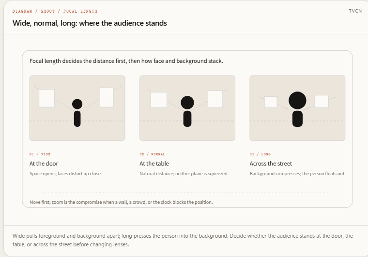

<!-- DIAGRAM_START -->
## Diagram

<figure>
  
  <figcaption>Wide pulls foreground and background apart; long presses the person into the background. Decide whether the audience stands at the door, the table, or across the street before changing lenses.</figcaption>
</figure>
<!-- DIAGRAM_END -->

Focal length is not “wide” versus “far.” It first decides where the audience stands to look at the person, then how the face and background stack.

## Wide opens the room and pushes the person away

A wide lens fits the whole room and pulls foreground and background apart. Put it close to a face and the nose grows, the background drops back, and the viewer feels shoved in front of the subject. It is right for corridors, cars, tight rooms, or making two people look far apart.

Do not open the zoom to its widest just to “get it all in.” Ask first: in this room, does the audience stand at the door or sit at the table? At the door, go wide. At the table, step back and use something longer.

## Long presses the person into the background

A long lens pulls the far thing closer and flattens the person against the background. The subject floats out of the room. It is right for watching, for looking without being seen, for finding one face in a crowd. The viewer stands across the street, not disturbing anything, but seeing clearly.

Press too hard and the space becomes a sheet of paper; the viewer no longer knows where anyone is. Keep a piece of foreground: a railing, a shoulder, leaves. Let them know what they are standing behind.

## Pick the distance before the lens

If you can move, move. Two steps forward or one step back is cheaper than a lens and faster. Zoom is a compromise: the wall, the crowd, or the clock has blocked the position.

Do not change focal length in a scene just to make it “rich.” Wide establishes the relationship; long delivers a judgment. Between the two, the audience's position has to make sense.

## Checks

- When the wide lens is close to a face, is the distortion what you want?
- Has the long lens flattened the space into paper? Does the viewer still know where the person is?
- Before changing lenses, did you try the position your feet can reach?
