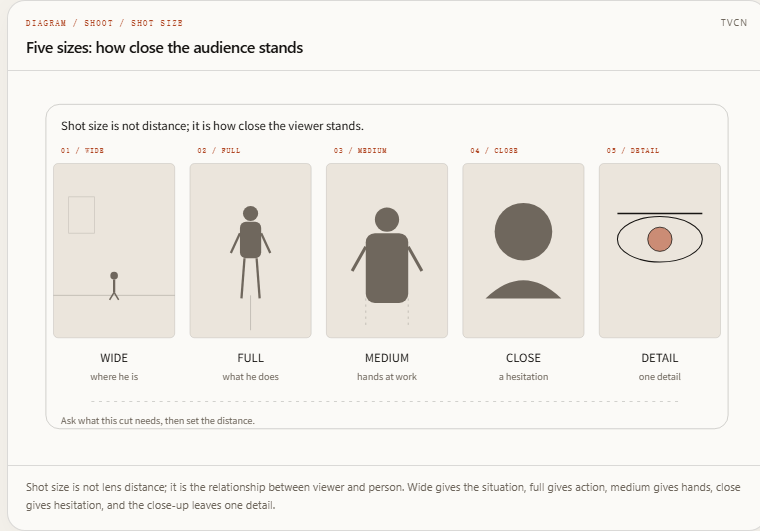

<!-- DIAGRAM_START -->
## Diagram

<figure>
  
  <figcaption>Shot size is not lens distance; it is the relationship between viewer and person. Wide gives the situation, full gives action, medium gives hands, close gives hesitation, and the close-up leaves one detail.</figcaption>
</figure>
<!-- DIAGRAM_END -->

## Wide: show where he is

In a wide shot the person is small and the place is large. The audience sees the door, the road, the wall, the awning, then the person. It is not a landscape photograph; it describes the relationship between a person and a situation: how big the place is, how far the exit, whether anyone else is near.

If the person is too small to recognize, the audience sees only a place, not a person. A wide shot can open or close a scene, but three wides in a row and the viewer loses a handhold.

## Full and medium: action and relationship

A full shot shows the whole body: what he is doing, where he stands, how far he is from the next person. A medium shot cuts at the waist, so the hands can still work and the face still reads. For dialogue, medium is the workhorse: both people are in frame, and a step forward is visible.

Do not stay in medium for the sake of “cinematic.” The audience forgets the room and where the character came from. Medium is a working size, not a default aesthetic.

## Close and detail: one piece of information

A close shot cuts at the chest; the face starts to matter. A close-up on the face, an eye, or a hand leaves one piece of information. It is a promise: something will happen next. Do not spend a close-up on a throwaway line, and do not ask the viewer to watch the eyes, the background, and the subtitle at once.

Do not change size just for variety. Too many jumps in one scene and the viewer tires. Hold one main size to establish the relationship, then change once on the action that matters.

## Checks

- Does this size show the one thing this cut needs?
- In the wide, is the person still recognizable? In the medium, does the room still exist?
- After the close-up, does something happen that deserves the size?
