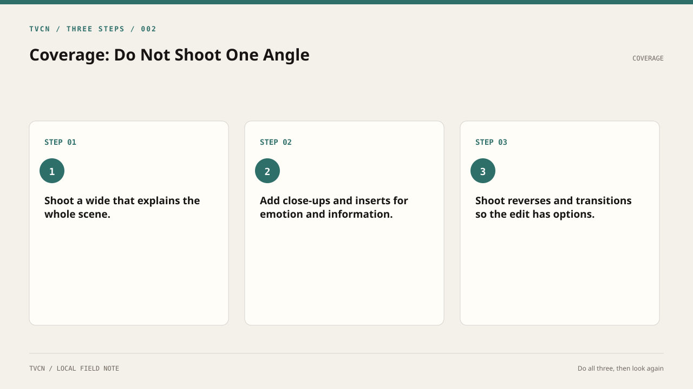

Coverage is not more takes; it gives the edit different information: wide, close, insert, reverse.

<!-- DIAGRAM_START -->
<h2>Diagram</h2>
<figure>
  
  <figcaption>Do the three steps in order, then look again at the image or file.</figcaption>
</figure>
<!-- DIAGRAM_END -->
<h2>On set</h2>

Shoot four pieces of one scene: a wide for space, a medium for relationships, a close for reaction, and a hand insert for information. Get at least two takes of each and play them in order on the monitor.

<h2>Do this</h2>

Coverage is not shooting one angle ten times; it gives the edit different information: a wide for space, a medium for relationship, a close-up for reaction, an insert for detail.
<ol><li>Shoot a wide that explains the whole scene, at least two takes.</li><li>Add medium, close-up, and hand inserts, at least two takes per size.</li><li>Shoot reverse angles and transitions, then review in order to confirm every beat has an alternative.</li></ol>
<h2>Avoid</h2>

Do not shoot the whole scene in one size; that is repetition, not coverage.

<h2>Check</h2>
<ul><li>Wide, medium, close-up, and insert all have at least one usable take.</li><li>The hand or prop insert carries a story beat without voice-over.</li><li>Every information beat has two usable sizes on the timeline; a missing one triggers a pickup.</li></ul>

<!-- DEEP_DIVE_START -->
## Deep dive

<strong>About 6 minutes.</strong> Coverage is not shooting every angle. It is giving the edit a choice at the decisive moment. Miss the reverse and the scene becomes a radio play.

### Protect the full action, then add angles

Let the master cover the scene from entrance to sitting. The emotional floor is there; every other angle is lifted out of it.

If there is time for only two passes, protect the master and the reverse. A reverse is not the whole shot-reverse-shot, but without it dialogue can only cut one way.

### Four shot sizes, four jobs

A wide establishes space and relationships, a medium protects performance, a close protects emotion, an insert protects the cut. Get at least two of each so panic has an alternative.

Do not use movement as coverage. Movement looks good but leaves no still point; the audience tires and the editor has nowhere to cut.

### When you can shoot less

A ten-second short does not need eight angles. One main view, one detail, one reverse is enough to land a single idea.

Long dialogue needs reverses and reactions. Ask who the scene wants the audience to watch, then assign cameras; not every character needs equal coverage.

### Coverage has a priority order

With limited time and money, the order is full master, reverse, key insert, atmosphere. The first three protect the story; the last protects texture.

Do not shoot beauty plates first. A beautiful plate that cannot cut into dialogue is wasted; a missing master leaves the scene broken.

### The cost of one missing angle

On set you think “we will pick it up later,” but later the wardrobe changed, the light moved, the set is gone. A pickup costs three times a set shot.

Go through the sheet before wrap and get the missing reverse and insert now. Half an hour late is better than a reshoot three months later.

### Ten checks after coverage
<ul><li>Master covers the whole action</li><li>Every group has wide, medium, close, insert</li><li>At least two takes per angle</li><li>Reverse and reaction shots listed separately</li><li>Movement did not replace coverage</li><li>Check whether actors are blocked by foreground</li><li>Log actual takes per shot</li><li>Pick up missing inserts before wrap</li><li>Photograph the sheet and send it to edit</li><li>Confirm backup before formatting cards</li></ul>
Coverage is not shooting more; it is shooting complete. The take the edit needs is often one angle you skipped.

<!-- DEEP_DIVE_END -->
