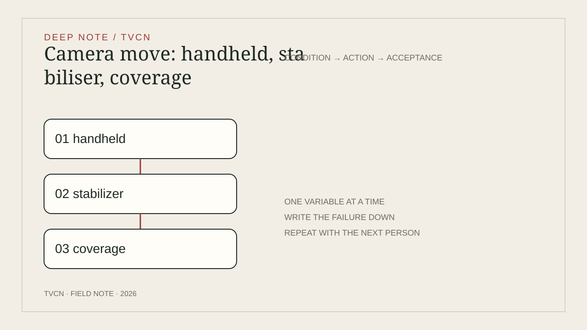

Camera movement is not motion for its own sake; it serves blocking, coverage and the cut. One page of &amp;quot;Handheld: Let Breathing Into the Frame&amp;quot; solves one local problem; joining &amp;quot;Handheld: Let Breathing Into the Frame&amp;quot;, &amp;quot;Stabilizer: Walk Like You Mean It&amp;quot; and &amp;quot;Coverage: Do Not Shoot One Angle&amp;quot; exposes the real failure: conditions are missing, too many variables move, and the result cannot be reproduced.

<!-- DEEP_DIVE_START -->
<!-- DIAGRAM_START -->
<h2>图解</h2>
<figure>
  
  <figcaption>Read &quot;Handheld: Let Breathing Into the Frame&quot; and &quot;Stabilizer: Walk Like You Mean It&quot;: write the condition first, then check whether the failure can be recorded.</figcaption>
</figure>
<!-- DIAGRAM_END -->

<section><h2 id="section-1">Problem</h2>
The problem is not a lack of methods; each step works alone, but together they fail because the condition was not written, too many variables moved and the result cannot be reproduced.

The order is condition, judgement, one variable and evidence. A step is complete only when the next person can repeat it.
</section>
<section><h2 id="section-2">Judgement</h2><ul><li>First gate in &quot;Handheld: Let Breathing Into the Frame&quot;: Three steps in ten seconds stays even with no sudden vertical jump.</li><li>Second gate in &quot;Stabilizer: Walk Like You Mean It&quot;: The breath comes from the body, not from arm shaking.</li><li>Third gate in &quot;Coverage: Do Not Shoot One Angle&quot;: The horizon and the actor&#x27;s head do not drift continuously.</li></ul>
If one gate fails, return to its single page; do not hide an unsolved point inside a longer chain.
</section>
<section><h2 id="section-3">Method</h2><ol><li>Write the condition first: turn &quot;Stand feet shoulder-width apart and keep elbows against the ribs; breathe betwee…&quot; from &quot;Handheld: Let Breathing Into the Frame&quot; into three rows: material, environment, acceptance.</li><li>Run one minimal action: follow &quot;Handheld: Let Breathing Into the Frame&quot; for 30 seconds and do not add the second page yet.</li><li>Attach the second page: Walk three steps in ten seconds and let the body carry the camera, not the arms..</li><li>Use the third page as a control: Review: it should feel like breathing, not an earthquake..</li><li>Change one variable at a time; write the other conditions down instead of remembering them.</li><li>Film the failure too: put failure and success side by side to see which step cannot be skipped.</li><li>Ask the next person to reproduce from the record; if they cannot, the record is not finished.</li></ol></section>
<section><h2 id="section-4">Field test</h2>
A reproducible test, not a client case: take 30 seconds of material, make version A using &quot;Three steps in ten seconds stays even with no sudden vertical jum…&quot; from &quot;Handheld: Let Breathing Into the Frame&quot;, then version B using &quot;The breath comes from the body, not from arm shaking.&quot; from &quot;Stabilizer: Walk Like You Mean It&quot;; only one variable may differ. Put them side by side and record what breaks first in &quot;Coverage: Do Not Shoot One Angle&quot;: condition, action or acceptance. If it works on the first try, add one real constraint and run it again.
</section>
<section><h2 id="section-5">Failure table</h2>
<table class="data-table"><thead><tr><th>Symptom</th><th>Cause</th><th>Replacement action</th></tr></thead><tbody><tr><td>Do not shake for style; movement without reason steals the perfor…</td><td>Condition was not written</td><td>Return to page one and rewrite the three rows</td></tr><tr><td>Do not take tiny steps or twist the waist; a gimbal smooths micro…</td><td>Condition was not written</td><td>Return to page one and rewrite the three rows</td></tr><tr><td>Do not shoot the whole scene in one size; that is repetition, not…</td><td>Condition was not written</td><td>Return to page one and rewrite the three rows</td></tr></tbody></table>
</section>
<section><h2 id="section-6">Acceptance</h2><ul><li>Three steps in ten seconds stays even with no sudden vertical jump.</li><li>The breath comes from the body, not from arm shaking.</li><li>The horizon and the actor&#x27;s head do not drift continuously.</li><li>Wide, medium, close-up, and insert all have at least one usable take.</li><li>The hand or prop insert carries a story beat without voice-over.</li><li>Every information beat has two usable sizes on the timeline; a missing one triggers a pickup.</li><li>Master covers the whole action</li><li>Every group has wide, medium, close, insert</li><li>At least two takes per angle</li><li>Reverse and reaction shots listed separately</li></ul></section>
<section><h2 id="section-7">Alternatives</h2><ul><li>For a single-point problem in "Handheld: Let Breathing Into the Frame", go back to <a href="https://shoot.tvcn.org/en/article/handheld/">Handheld: Let Breathing Into the Frame</a>; do not use the whole chain.</li><li>To compare two actions, read <a href="https://shoot.tvcn.org/en/article/stabilizer/">Stabilizer: Walk Like You Mean It</a> and leave the third page alone.</li><li>For acceptance only, use <a href="https://shoot.tvcn.org/en/article/coverage/">Coverage: Do Not Shoot One Angle</a> as a self-test sheet.</li></ul></section>
