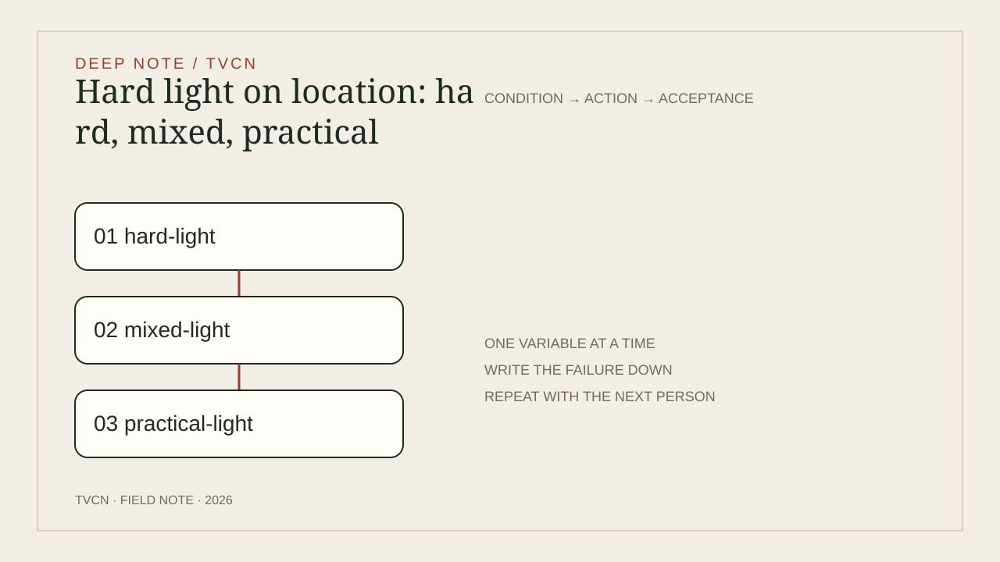

Hard light is not a defect; the question is whether hard, practical and colour are arranged on the same face. One page of &amp;quot;Hard Light: The Shadow Is the Shape&amp;quot; solves one local problem; joining &amp;quot;Hard Light: The Shadow Is the Shape&amp;quot;, &amp;quot;Mixed Light: Keep the Two Temperatures&amp;quot; and &amp;quot;Practical Light: Use the Lamp in the Frame&amp;quot; exposes the real failure: conditions are missing, too many variables move, and the result cannot be reproduced.

<!-- DEEP_DIVE_START -->
<!-- DIAGRAM_START -->
<h2>图解</h2>
<figure>
  
  <figcaption>Read &quot;Hard Light: The Shadow Is the Shape&quot; and &quot;Mixed Light: Keep the Two Temperatures&quot;: write the condition first, then check whether the failure can be recorded.</figcaption>
</figure>
<!-- DIAGRAM_END -->

<section><h2 id="section-1">Problem</h2>
The problem is not a lack of methods; each step works alone, but together they fail because the condition was not written, too many variables moved and the result cannot be reproduced.

The order is condition, judgement, one variable and evidence. A step is complete only when the next person can repeat it.
</section>
<section><h2 id="section-2">Judgement</h2><ul><li>First gate in &quot;Hard Light: The Shadow Is the Shape&quot;: The shadow falls on the background or wall and becomes part of the composition.</li><li>Second gate in &quot;Mixed Light: Keep the Two Temperatures&quot;: Eyes and mouth are not cut by shadow and features remain readable.</li><li>Third gate in &quot;Practical Light: Use the Lamp in the Frame&quot;: The fix moved the lamp or actor ten centimeters instead of swapping in a softbox.</li></ul>
If one gate fails, return to its single page; do not hide an unsolved point inside a longer chain.
</section>
<section><h2 id="section-3">Method</h2><ol><li>Write the condition first: turn &quot;Place the hard source to the side so the shadow falls on the wall or background.&quot; from &quot;Hard Light: The Shadow Is the Shape&quot; into three rows: material, environment, acceptance.</li><li>Run one minimal action: follow &quot;Hard Light: The Shadow Is the Shape&quot; for 30 seconds and do not add the second page yet.</li><li>Attach the second page: Watch whether the shadow cuts across an eye or the mouth..</li><li>Use the third page as a control: If it hits a feature, move the lamp or actor ten centimeters and shoot again..</li><li>Change one variable at a time; write the other conditions down instead of remembering them.</li><li>Film the failure too: put failure and success side by side to see which step cannot be skipped.</li><li>Ask the next person to reproduce from the record; if they cannot, the record is not finished.</li></ol></section>
<section><h2 id="section-4">Field test</h2>
A reproducible test, not a client case: take 30 seconds of material, make version A using &quot;The shadow falls on the background or wall and becomes part of th…&quot; from &quot;Hard Light: The Shadow Is the Shape&quot;, then version B using &quot;Eyes and mouth are not cut by shadow and features remain readable…&quot; from &quot;Mixed Light: Keep the Two Temperatures&quot;; only one variable may differ. Put them side by side and record what breaks first in &quot;Practical Light: Use the Lamp in the Frame&quot;: condition, action or acceptance. If it works on the first try, add one real constraint and run it again.
</section>
<section><h2 id="section-5">Failure table</h2>
<table class="data-table"><thead><tr><th>Symptom</th><th>Cause</th><th>Replacement action</th></tr></thead><tbody><tr><td>Do not fire hard light straight into the face; the shadow becomes…</td><td>Condition was not written</td><td>Return to page one and rewrite the three rows</td></tr><tr><td>Do not white-balance every source to white; fighting temperatures…</td><td>Condition was not written</td><td>Return to page one and rewrite the three rows</td></tr><tr><td>Do not make the visible bulb the only key; it cannot light the fa…</td><td>Condition was not written</td><td>Return to page one and rewrite the three rows</td></tr></tbody></table>
</section>
<section><h2 id="section-6">Acceptance</h2><ul><li>The shadow falls on the background or wall and becomes part of the composition.</li><li>Eyes and mouth are not cut by shadow and features remain readable.</li><li>The fix moved the lamp or actor ten centimeters instead of swapping in a softbox.</li><li>The frame shows a cool window and a warm bulb as an intentional contrast.</li><li>Skin stays neutral without a green or yellow cast on one side.</li><li>One white balance was not used to erase both sources into one color.</li><li>The practical is visibly on without clipping into a white block.</li><li>A separate lamp shapes the face while the practical motivates the background.</li><li>Turn the practical off and the face is still supported by its key.</li><li>The condition from Hard Light: The Shadow Is the Shape fits on one line and can be repeated by someone else.</li></ul></section>
<section><h2 id="section-7">Alternatives</h2><ul><li>For a single-point problem in "Hard Light: The Shadow Is the Shape", go back to <a href="https://shoot.tvcn.org/en/article/hard-light/">Hard Light: The Shadow Is the Shape</a>; do not use the whole chain.</li><li>To compare two actions, read <a href="https://shoot.tvcn.org/en/article/mixed-light/">Mixed Light: Keep the Two Temperatures</a> and leave the third page alone.</li><li>For acceptance only, use <a href="https://shoot.tvcn.org/en/article/practical-light/">Practical Light: Use the Lamp in the Frame</a> as a self-test sheet.</li></ul></section>
