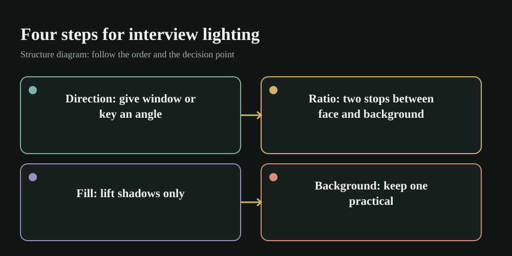

The most common interview lighting mistake is two lamps hitting the face from both sides. The face is bright, but flat, the eyes have no catchlight, and the edit has no reactions. An interview is not a portrait; the subject has to talk, and the light has to let them.

<!-- DIAGRAM_START -->
<h2 id="diagram">Diagram</h2>
<figure class="diagram">
  
  <figcaption>Check direction, ratio, fill and background. If the face and background are equally bright and there is no catchlight, the subject becomes a passport photo.</figcaption>
</figure>
<!-- DIAGRAM_END -->

<section><h2 id="section-1">On location</h2>
A small room at three in the afternoon, one west-facing window, one subject, two cameras. The window light moves from side-front to side-back, the background is a white wall. The director wants “natural, as if no light was used”, but the interview will run ninety minutes and cannot stop.
</section>
<section><h2 id="section-2">What to look for</h2><ul><li><strong>Catchlight:</strong> there is a stable point of light in the eyes; without it, the subject looks lifeless.</li><li><strong>Face-to-background ratio:</strong> the face is 1.5–2 stops brighter than the background; equal brightness flattens the person against the wall.</li><li><strong>Mixed colour temperature:</strong> daylight at 5600K and room lamps at 3200K; if half the face is cool and half warm, post cannot fully fix it.</li></ul></section>
<section><h2 id="section-3">What to do</h2><ol><li>Set direction: place the window or key 30–45 degrees to the subject, not straight on; turn the subject slightly toward the light, not square to camera.</li><li>Set ratio: shoot ten seconds with window only and compare face to background. If it is too flat, use a reflector on the shadow side before adding a second lamp.</li><li>Add one soft key: put it on the same side as the window, match colour temperature. The key stabilises the light; it does not make everything brighter.</li><li>Keep one practical in the background: a table lamp, wall lamp or screen. The background gets depth but stays below the face and does not compete with the eyes.</li><li>Take five minutes before the interview: seat the subject, check eyes, forehead highlight and background on monitor, and confirm the light will not shift during ninety minutes.</li></ol></section>
<section><h2 id="section-4">Failure modes</h2><ul><li><strong>Two lamps flat:</strong> one on each side removes shadows; nose and cheeks merge, and the face looks unreal.</li><li><strong>Mixed colour:</strong> cool window and warm table lamp split the face blue and yellow; fixing one side breaks the other.</li><li><strong>Background brighter than the face:</strong> a white wall or window pulls the eye away; the audience watches the wall while the subject talks.</li></ul></section>
<section><h2 id="section-5">Limits</h2>
This setup suits single-subject interviews, two-person conversations and small documentaries. It is not for dramatic scenes that need theatrical shadow, and it does not replace sound. In an interview, sound ruins a film faster than light: fix the lav and room tone before chasing a catchlight.
</section>
<section><h2 id="section-6">Check</h2><ul><li>There is a stable catchlight in the eyes that does not disappear over ninety minutes.</li><li>The face is 1.5–2 stops above the background, and the background still has detail.</li><li>Skin highlights are not clipped; forehead and nose are not pure white.</li><li>The subject says they look like themselves, not like someone on television.</li></ul></section>
<!-- DEEP_DIVE_START -->
## Deep dive

<strong>About 8 minutes.</strong> This section places the same judgement in two different conditions, then gives a counterexample and a reusable model. It does not repeat the page; it decides when to change the method.

### Condition A: one window only

With one window, the window is the key; do not add a lamp to “even it out”. Seat the subject where the window hits the bridge of the nose and one cheek, then lift the shadow side half a stop with a white reflector. Closer reflector, softer light; farther away, more contrast. Shoot ten seconds and compare until skin texture is still visible.

Window light changes. Morning is cooler, afternoon warmer, overcast softer. If the interview runs over an hour, shoot a fixed reference: the subject's hand on the knee, record colour and exposure. When the light shifts, match the key to the same reading instead of trusting the eye.

### Condition B: two-person conversation

Do not give two people two complete lighting setups, or the cut looks like two different shows. Set one shared direction: window or key from the side-back of both, so both faces get light from the same angle; then fill the nearer side with a reflector. Keep the brightness difference within half a stop so they feel in the same room.

If their skin tones differ a lot, do not use two lamps to “match” them. Use one source and let the difference remain. The audience believes skin difference, not two faces graded to the same brightness. For separation, use a background lamp or shot size, not colour temperature.

### Counterexample: the window changed and nobody matched it

A seventy-minute interview starts with window light on the left cheek. At minute forty the sun moves, the left cheek goes dark and the right lights up. The camera operator misses it because the monitor is small; post brightens the whole section, overexposing the first half and adding noise to the second. The subject looks like a different person.

The fix is not post. Every twenty minutes, shoot the same hand reference and compare with the opening. Half a stop off, nudge the key; a full stop off, stop and reset. An interview can be cut; light cannot be cut.

### Reusable model

<strong>Direction → ratio → fill → background.</strong> Direction gives the face dimension; ratio separates the person from the wall; fill keeps shadow detail; background keeps attention on the subject. Do them in order and do not start by buying a lamp.

Change one variable at a time and review ten seconds. Direction first, then ratio, then fill. Change three at once and the review cannot tell which one worked. The goal is not a beautiful frame; it is a subject who keeps talking.

<!-- DEEP_DIVE_END -->
<!-- SOURCES_START -->
## Further reading

- [S31] [ARRI Cine Systems: ARRI Cine Systems](https://www.arri.com/en/cine-systems) — accessed 2026-11-26. Used to check the terms, method or rule in the “What to look for” section; not the page's field numbers, gear models or conclusions, and not a substitute for a test or contract.
- [S52] [ARRI: ALEXA 35](https://www.arri.com/en/camera-systems/cameras/legacy-camera-systems/alexa-35) — accessed 2026-11-26. Used to check the terms, method or rule in the “Limits” section; not the page's field numbers, gear models or conclusions, and not a substitute for a test or contract.
<!-- SOURCES_END -->
