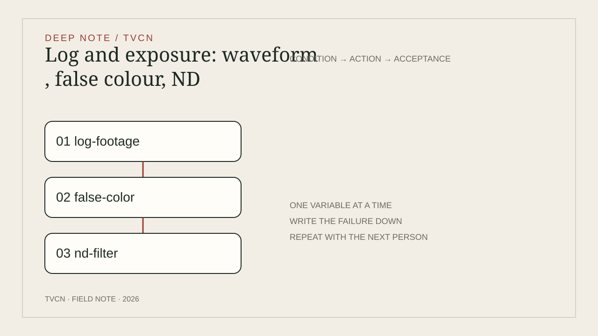

Log is not magic; exposure, ND and false colour must be decided together or post gets flat grey. One page of &amp;quot;Log Footage: Shoot for the Grade&amp;quot; solves one local problem; joining &amp;quot;Log Footage: Shoot for the Grade&amp;quot;, &amp;quot;False Color: Find the Clip at a Glance&amp;quot; and &amp;quot;ND Filter: Wide Open in Daylight&amp;quot; exposes the real failure: conditions are missing, too many variables move, and the result cannot be reproduced.

<!-- DEEP_DIVE_START -->
<!-- DIAGRAM_START -->
<h2>图解</h2>
<figure>
  
  <figcaption>Read &quot;Log Footage: Shoot for the Grade&quot; and &quot;False Color: Find the Clip at a Glance&quot;: write the condition first, then check whether the failure can be recorded.</figcaption>
</figure>
<!-- DIAGRAM_END -->

<section><h2 id="section-1">Problem</h2>
The problem is not a lack of methods; each step works alone, but together they fail because the condition was not written, too many variables moved and the result cannot be reproduced.

The order is condition, judgement, one variable and evidence. A step is complete only when the next person can repeat it.
</section>
<section><h2 id="section-2">Judgement</h2><ul><li>First gate in &quot;Log Footage: Shoot for the Grade&quot;: Skin sits slightly above middle gray, shadows are not crushed, and highlights are unclippe…</li><li>Second gate in &quot;False Color: Find the Clip at a Glance&quot;: A color chart was shot for every setup and post can apply one transform.</li><li>Third gate in &quot;ND Filter: Wide Open in Daylight&quot;: You can state the exposure intent of the Log take instead of “we&#x27;ll fix it later.”</li></ul>
If one gate fails, return to its single page; do not hide an unsolved point inside a longer chain.
</section>
<section><h2 id="section-3">Method</h2><ol><li>Write the condition first: turn &quot;Expose the face slightly above middle gray and confirm on the waveform.&quot; from &quot;Log Footage: Shoot for the Grade&quot; into three rows: material, environment, acceptance.</li><li>Run one minimal action: follow &quot;Log Footage: Shoot for the Grade&quot; for 30 seconds and do not add the second page yet.</li><li>Attach the second page: Keep highlights below the ceiling; do not blow the sky for a brighter face..</li><li>Use the third page as a control: Shoot a color chart before rolling to give post a transform reference..</li><li>Change one variable at a time; write the other conditions down instead of remembering them.</li><li>Film the failure too: put failure and success side by side to see which step cannot be skipped.</li><li>Ask the next person to reproduce from the record; if they cannot, the record is not finished.</li></ol></section>
<section><h2 id="section-4">Field test</h2>
A reproducible test, not a client case: take 30 seconds of material, make version A using &quot;Skin sits slightly above middle gray, shadows are not crushed, an…&quot; from &quot;Log Footage: Shoot for the Grade&quot;, then version B using &quot;A color chart was shot for every setup and post can apply one tra…&quot; from &quot;False Color: Find the Clip at a Glance&quot;; only one variable may differ. Put them side by side and record what breaks first in &quot;ND Filter: Wide Open in Daylight&quot;: condition, action or acceptance. If it works on the first try, add one real constraint and run it again.
</section>
<section><h2 id="section-5">Failure table</h2>
<table class="data-table"><thead><tr><th>Symptom</th><th>Cause</th><th>Replacement action</th></tr></thead><tbody><tr><td>Do not treat a flat image as a style; without correct exposure an…</td><td>Condition was not written</td><td>Return to page one and rewrite the three rows</td></tr><tr><td>Do not treat false color as a look; red is a warning, not a style…</td><td>Condition was not written</td><td>Return to page one and rewrite the three rows</td></tr><tr><td>Do not add ND and leave aperture or shutter uncorrected; do not c…</td><td>Condition was not written</td><td>Return to page one and rewrite the three rows</td></tr></tbody></table>
</section>
<section><h2 id="section-6">Acceptance</h2><ul><li>Skin sits slightly above middle gray, shadows are not crushed, and highlights are unclipped.</li><li>A color chart was shot for every setup and post can apply one transform.</li><li>You can state the exposure intent of the Log take instead of “we&#x27;ll fix it later.”</li><li>The face sits in the skin zone with no red patch.</li><li>Sky and windows are not red and highlights retain gradation.</li><li>The fix came from light or ND, not from pushing ISO.</li><li>The condition from Log Footage: Shoot for the Grade fits on one line and can be repeated by someone else.</li><li>Only one variable changes and the other page&#x27;s result still reproduces.</li><li>A failure is recorded as condition, action and result, not a feeling.</li><li>A colleague can reproduce the same version without asking you.</li></ul></section>
<section><h2 id="section-7">Alternatives</h2><ul><li>For a single-point problem in "Log Footage: Shoot for the Grade", go back to <a href="https://shoot.tvcn.org/en/article/log-footage/">Log Footage: Shoot for the Grade</a>; do not use the whole chain.</li><li>To compare two actions, read <a href="https://shoot.tvcn.org/en/article/false-color/">False Color: Find the Clip at a Glance</a> and leave the third page alone.</li><li>For acceptance only, use <a href="https://shoot.tvcn.org/en/article/nd-filter/">ND Filter: Wide Open in Daylight</a> as a self-test sheet.</li></ul></section>

<!-- SOURCES_START -->
## References and further reading

- [S16] [BBC Editorial Guidelines](https://www.bbc.co.uk/editorialguidelines/) — Accessed 2026-11-26. Used to check the terminology and public context in the opening paragraph (“Log is not magic; exposure, ND and false colour must be deci”) against Editorial standards on accuracy, fairness, privacy and secret recording; not a substitute for an on-set test.
- [S23] [SMPTE Standards](https://www.smpte.org/standards) — Accessed 2026-11-26. Used to check the terminology and public context in the opening paragraph (“Log is not magic; exposure, ND and false colour must be deci”) against Entry point for timecode, color, cinema and signal-chain standards; not a substitute for an on-set test.
- [S31] [ARRI Cine Systems](https://www.arri.com/en/cine-systems) — Accessed 2026-11-26. Used to check the terminology and public context in the opening paragraph (“Log is not magic; exposure, ND and false colour must be deci”) against Technical documentation for cameras, lenses and lighting; not a substitute for an on-set test.
- [S52] [ARRI: ALEXA 35](https://www.arri.com/en/camera-systems/cameras/legacy-camera-systems/alexa-35) — Accessed 2026-11-26. Used to check the terminology and public context in the opening paragraph (“Log is not magic; exposure, ND and false colour must be deci”) against Camera specifications, Log-C and colour workflow; not a substitute for an on-set test.
- [S53] [Sony: FX6](https://pro.sony/ue_US/products/handheld-camcorders/ilme-fx6v) — Accessed 2026-11-26. Used to check the terminology and public context in the opening paragraph (“Log is not magic; exposure, ND and false colour must be deci”) against Body specifications, recording formats and interfaces; not a substitute for an on-set test.
<!-- SOURCES_END -->

