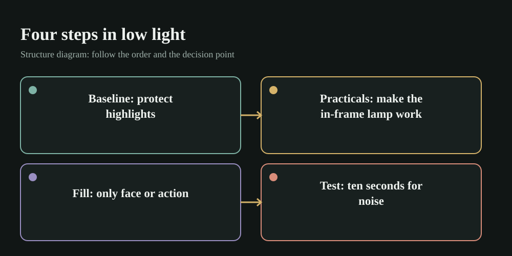

Low-light shooting easily becomes a loop: the image is dark, raise ISO; noise appears, denoise; detail disappears, sharpen; the frame ends up dirty and fake. The problem is not the camera; nobody decided before the shot which blacks needed to be visible.

<!-- DIAGRAM_START -->
<h2 id="diagram">Diagram</h2>
<figure class="diagram">
  
  <figcaption>Check baseline, practicals, fill and test. A night scene carried by ISO alone turns blacks into mush and leaves the subject without direction.</figcaption>
</figure>
<!-- DIAGRAM_END -->

<section><h2 id="section-1">On location</h2>
Ten at night, two people talk on a street corner. The only sources are a sodium lamp and a closed shop's light box. The director does not want a big lamp and asks for “real”. The camera is at ISO 3200, shutter 1/50; highlights hold, but faces are noisy and the shop sign clips.
</section>
<section><h2 id="section-2">What to look for</h2><ul><li><strong>Highlights:</strong> signs, car windows and street lamps should not clip; once they do, post cannot bring them back.</li><li><strong>Where noise sits:</strong> noise in the deep shadows is tolerable; noise on faces and clothing makes people look dirty.</li><li><strong>Shutter smear:</strong> hands and feet blur when people walk, which means the shutter is too slow, not the ISO too high.</li><li><strong>Colour temperature:</strong> sodium orange, light-box green and phone blue split the face into three colours.</li></ul></section>
<section><h2 id="section-3">What to do</h2><ol><li>Set a baseline: use waveform or false colour to protect highlights and let shadows fall to 10–20 IRE; do not brighten the whole frame first.</li><li>Make practicals work: change bulbs, adjust the light box, turn a phone screen toward the subject. In-frame sources are more believable than an added lamp.</li><li>Add one face light: a small LED or reflector lifts the eye socket and nose bridge half a stop; do not light the whole background.</li><li>Use shutter for motion: keep 1/50 when people walk; static dialogue can go to 1/40, but not below 1/30.</li><li>Shoot a ten-second test: review face, shadows, highlights and motion. Noise cannot be fixed in post; change the angle or add a practical first.</li></ol></section>
<section><h2 id="section-4">Failure modes</h2><ul><li><strong>Max ISO:</strong> pushing to 12800 brightens the face but breaks colour and detail; denoise turns skin into plastic.</li><li><strong>Slow shutter:</strong> dropping to 1/25 for brightness smears hands and feet as soon as anyone moves.</li><li><strong>Street lamp as key:</strong> the lamp is overhead and the eye sockets go black; the audience cannot see who the character is looking at.</li></ul></section>
<section><h2 id="section-5">Limits</h2>
This works for documentary, street and night dialogue. It is not for commercials that need clean commercial images, and it does not replace lighting. Low light is not “the darker the better”: if the audience cannot see what the character is doing, dark is a failure. Safety counts too: check the route, power and exit before a night shoot.
</section>
<section><h2 id="section-6">Check</h2><ul><li>Highlights have detail; signs and car windows are not clipped.</li><li>Face noise is acceptable and shadow noise does not pull attention.</li><li>Hands and feet do not smear when people walk.</li><li>At least one practical carries direction; the scene does not depend entirely on an added lamp.</li></ul></section>
<!-- DEEP_DIVE_START -->
## Deep dive

<strong>About 8 minutes.</strong> This section places the same judgement in two different conditions, then gives a counterexample and a reusable model. It does not repeat the page; it decides when to change the method.

### Condition A: documentary night

The first rule of documentary night is “get it, then get it good”. Put the camera at the lowest ISO that holds highlights and let shadows fall. Do not light the whole street for cleanliness; the audience will know you are shooting. The face only needs half a stop over the background for the viewer to follow; practicals and sound carry the rest.

Documentary can accept noise, but it cannot accept unreadable action. If the character opens a door, pays or checks a phone in the dark, give that action a local source: a door gap, a register, a phone screen. The light does not need to be big, only enough to read the action. Review action before image quality.

### Condition B: commercial or narrative night

Commercial and narrative night can be designed, but not faked. Set the black level first: the background must be dark enough to separate the subject, but not a single black mass; use a background practical or backlight to draw the outline. Then set the face level: bright enough to see skin, not so bright that night disappears. Calculate the two separately; do not solve both with one big lamp.

These scenes need cleaner shadows, so light is worth more than ISO. Instead of pushing to 6400, add a 60W lamp just off-frame and give the face a direction. Fewer lamps make a truer night; more lamps make a studio.

### Counterexample: denoising removes the detail

A night scene is shot at ISO 12800. Faces are bright, noise is heavy. Post applies strong denoise; noise disappears, skin becomes a smooth patch, hair edges smear. The director says it looks like a game; the audience says it looks like a mannequin.

The problem is not denoise; the problem is leaving noise for post. The order is: change the angle so a practical enters the frame, add half a stop of face light, and only then raise ISO. At each stop, shoot ten seconds and check face and hair edges; when edges smear, stop.

### Reusable model

<strong>Baseline → practicals → fill → test.</strong> Baseline protects highlights, practicals make the scene believable, fill makes the subject readable, and the test keeps you honest. Do all four before the take, not halfway through.

Before a night shoot, write three lines: which blacks must be visible, which highlights must hold, and what action must be readable. If you cannot write the three, the night scene has not been designed; it is just dark.

<!-- DEEP_DIVE_END -->
<!-- SOURCES_START -->
## Further reading

- [S52] [ARRI: ALEXA 35](https://www.arri.com/en/camera-systems/cameras/legacy-camera-systems/alexa-35) — accessed 2026-11-26. Used to check the terms, method or rule in the “What to look for” section; not the page's field numbers, gear models or conclusions, and not a substitute for a test or contract.
- [S53] [Sony: FX6](https://pro.sony/ue_US/products/handheld-camcorders/ilme-fx6v) — accessed 2026-11-26. Used to check the terms, method or rule in the “Limits” section; not the page's field numbers, gear models or conclusions, and not a substitute for a test or contract.
<!-- SOURCES_END -->
