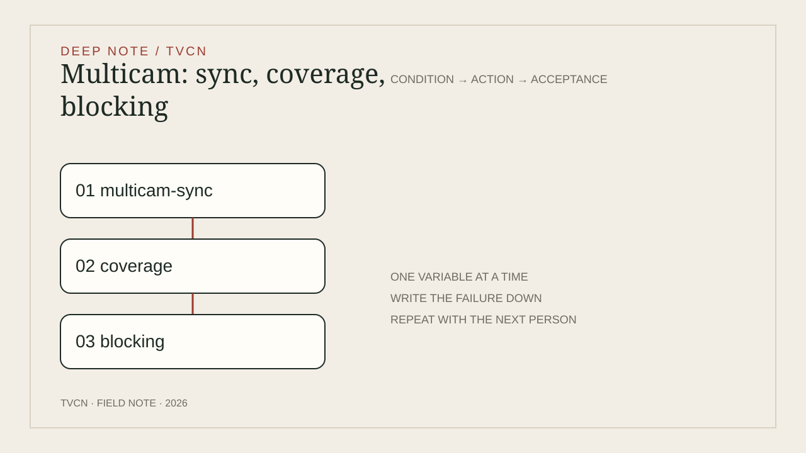

Multicam is not more cameras; sync, shot-size division and repeatable blocking make it editable. One page of &amp;quot;Multicam Sync: Timecode and a Camera Map&amp;quot; solves one local problem; joining &amp;quot;Multicam Sync: Timecode and a Camera Map&amp;quot;, &amp;quot;Coverage: Do Not Shoot One Angle&amp;quot; and &amp;quot;Blocking: Let the Body Tell the Story&amp;quot; exposes the real failure: conditions are missing, too many variables move, and the result cannot be reproduced.

<!-- DEEP_DIVE_START -->
<!-- DIAGRAM_START -->
<h2>图解</h2>
<figure>
  
  <figcaption>Read &quot;Multicam Sync: Timecode and a Camera Map&quot; and &quot;Coverage: Do Not Shoot One Angle&quot;: write the condition first, then check whether the failure can be recorded.</figcaption>
</figure>
<!-- DIAGRAM_END -->

<section><h2 id="section-1">Problem</h2>
The problem is not a lack of methods; each step works alone, but together they fail because the condition was not written, too many variables moved and the result cannot be reproduced.

The order is condition, judgement, one variable and evidence. A step is complete only when the next person can repeat it.
</section>
<section><h2 id="section-2">Judgement</h2><ul><li>First gate in &quot;Multicam Sync: Timecode and a Camera Map&quot;: The map shows what A, B, and C each cover with no duplicate size.</li><li>Second gate in &quot;Coverage: Do Not Shoot One Angle&quot;: All three angles align frame-accurately on the timeline.</li><li>Third gate in &quot;Blocking: Let the Body Tell the Story&quot;: Each angle offers different information, so cuts have a reason.</li></ul>
If one gate fails, return to its single page; do not hide an unsolved point inside a longer chain.
</section>
<section><h2 id="section-3">Method</h2><ol><li>Write the condition first: turn &quot;Draw a top-down map and label what size A, B, and C shoot.&quot; from &quot;Multicam Sync: Timecode and a Camera Map&quot; into three rows: material, environment, acceptance.</li><li>Run one minimal action: follow &quot;Multicam Sync: Timecode and a Camera Map&quot; for 30 seconds and do not add the second page yet.</li><li>Attach the second page: Sync by timecode or clap and confirm all three angles align..</li><li>Use the third page as a control: Check that each camera contributes different information, not the same size..</li><li>Change one variable at a time; write the other conditions down instead of remembering them.</li><li>Film the failure too: put failure and success side by side to see which step cannot be skipped.</li><li>Ask the next person to reproduce from the record; if they cannot, the record is not finished.</li></ol></section>
<section><h2 id="section-4">Field test</h2>
A reproducible test, not a client case: take 30 seconds of material, make version A using &quot;The map shows what A, B, and C each cover with no duplicate size.&quot; from &quot;Multicam Sync: Timecode and a Camera Map&quot;, then version B using &quot;All three angles align frame-accurately on the timeline.&quot; from &quot;Coverage: Do Not Shoot One Angle&quot;; only one variable may differ. Put them side by side and record what breaks first in &quot;Blocking: Let the Body Tell the Story&quot;: condition, action or acceptance. If it works on the first try, add one real constraint and run it again.
</section>
<section><h2 id="section-5">Failure table</h2>
<table class="data-table"><thead><tr><th>Symptom</th><th>Cause</th><th>Replacement action</th></tr></thead><tbody><tr><td>Do not put two cameras on the same size; multicam is not duplicat…</td><td>Condition was not written</td><td>Return to page one and rewrite the three rows</td></tr><tr><td>Do not shoot the whole scene in one size; that is repetition, not…</td><td>Condition was not written</td><td>Return to page one and rewrite the three rows</td></tr><tr><td>Do not pose people like a poster; a false body makes a false rela…</td><td>Condition was not written</td><td>Return to page one and rewrite the three rows</td></tr></tbody></table>
</section>
<section><h2 id="section-6">Acceptance</h2><ul><li>The map shows what A, B, and C each cover with no duplicate size.</li><li>All three angles align frame-accurately on the timeline.</li><li>Each angle offers different information, so cuts have a reason.</li><li>Wide, medium, close-up, and insert all have at least one usable take.</li><li>The hand or prop insert carries a story beat without voice-over.</li><li>Every information beat has two usable sizes on the timeline; a missing one triggers a pickup.</li><li>Master covers the whole action</li><li>Every group has wide, medium, close, insert</li><li>At least two takes per angle</li><li>Reverse and reaction shots listed separately</li></ul></section>
<section><h2 id="section-7">Alternatives</h2><ul><li>For a single-point problem in "Multicam Sync: Timecode and a Camera Map", go back to <a href="https://shoot.tvcn.org/en/article/multicam-sync/">Multicam Sync: Timecode and a Camera Map</a>; do not use the whole chain.</li><li>To compare two actions, read <a href="https://shoot.tvcn.org/en/article/coverage/">Coverage: Do Not Shoot One Angle</a> and leave the third page alone.</li><li>For acceptance only, use <a href="https://shoot.tvcn.org/en/article/blocking/">Blocking: Let the Body Tell the Story</a> as a self-test sheet.</li></ul></section>

<!-- SOURCES_START -->
## References and further reading

- [S17] [Reuters Trust Principles](https://reutersagency.com/about/our-trust-principles/) — Accessed 2026-11-26. Used to check the terminology and public context in the opening paragraph (“Multicam is not more cameras; sync, shot-size division and r”) against The agency's public commitment to independence, accuracy and freedom from bias; not a substitute for an on-set test.
- [S23] [SMPTE Standards](https://www.smpte.org/standards) — Accessed 2026-11-26. Used to check the terminology and public context in the opening paragraph (“Multicam is not more cameras; sync, shot-size division and r”) against Entry point for timecode, color, cinema and signal-chain standards; not a substitute for an on-set test.
- [S31] [ARRI Cine Systems](https://www.arri.com/en/cine-systems) — Accessed 2026-11-26. Used to check the terminology and public context in the opening paragraph (“Multicam is not more cameras; sync, shot-size division and r”) against Technical documentation for cameras, lenses and lighting; not a substitute for an on-set test.
- [S52] [ARRI: ALEXA 35](https://www.arri.com/en/camera-systems/cameras/legacy-camera-systems/alexa-35) — Accessed 2026-11-26. Used to check the terminology and public context in the opening paragraph (“Multicam is not more cameras; sync, shot-size division and r”) against Camera specifications, Log-C and colour workflow; not a substitute for an on-set test.
- [S53] [Sony: FX6](https://pro.sony/ue_US/products/handheld-camcorders/ilme-fx6v) — Accessed 2026-11-26. Used to check the terminology and public context in the opening paragraph (“Multicam is not more cameras; sync, shot-size division and r”) against Body specifications, recording formats and interfaces; not a substitute for an on-set test.
<!-- SOURCES_END -->

