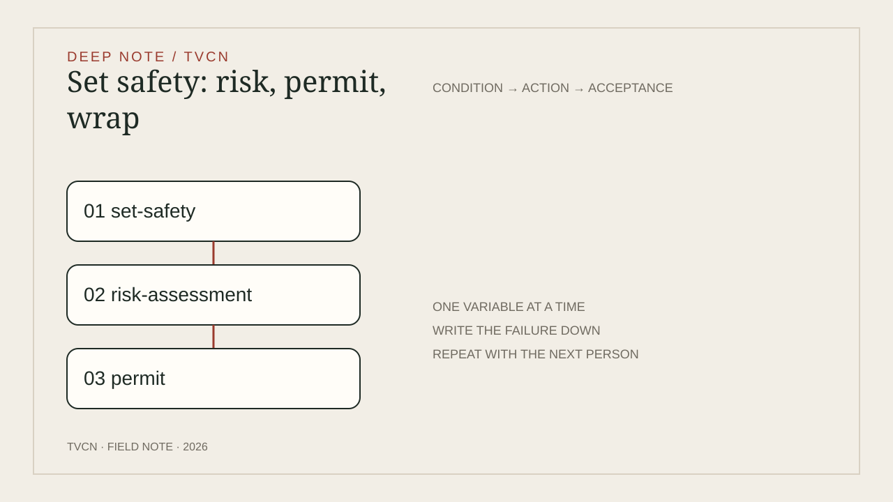

Set safety is not a signature; risk, permit and wrap checks must reach every moving person. One page of &amp;quot;Set Safety: Cables, Heights, Roads&amp;quot; solves one local problem; joining &amp;quot;Set Safety: Cables, Heights, Roads&amp;quot;, &amp;quot;Risk Assessment: Fill One Page Before You Roll&amp;quot; and &amp;quot;Permits: Parks, Transit, Shops&amp;quot; exposes the real failure: conditions are missing, too many variables move, and the result cannot be reproduced.

<!-- DEEP_DIVE_START -->
<!-- DIAGRAM_START -->
<h2>图解</h2>
<figure>
  
  <figcaption>Read &quot;Set Safety: Cables, Heights, Roads&quot; and &quot;Risk Assessment: Fill One Page Before You Roll&quot;: write the condition first, then check whether the failure can be recorded.</figcaption>
</figure>
<!-- DIAGRAM_END -->

<section><h2 id="section-1">Problem</h2>
The problem is not a lack of methods; each step works alone, but together they fail because the condition was not written, too many variables moved and the result cannot be reproduced.

The order is condition, judgement, one variable and evidence. A step is complete only when the next person can repeat it.
</section>
<section><h2 id="section-2">Judgement</h2><ul><li>First gate in &quot;Set Safety: Cables, Heights, Roads&quot;: No cable crosses a walkway untaped and every stand is sandbagged.</li><li>Second gate in &quot;Risk Assessment: Fill One Page Before You Roll&quot;: High stands have a spotter and everyone near the road wears hi-vis.</li><li>Third gate in &quot;Permits: Parks, Transit, Shops&quot;: Any crew member can name the nearest hospital, assembly point, and on-set contact.</li></ul>
If one gate fails, return to its single page; do not hide an unsolved point inside a longer chain.
</section>
<section><h2 id="section-3">Method</h2><ol><li>Write the condition first: turn &quot;Tape cables flat across walkways and sandbag every light stand.&quot; from &quot;Set Safety: Cables, Heights, Roads&quot; into three rows: material, environment, acceptance.</li><li>Run one minimal action: follow &quot;Set Safety: Cables, Heights, Roads&quot; for 30 seconds and do not add the second page yet.</li><li>Attach the second page: Put a person on high stands and wear hi-vis near roads..</li><li>Use the third page as a control: Put the nearest hospital, assembly point, and contact in the call sheet and read….</li><li>Change one variable at a time; write the other conditions down instead of remembering them.</li><li>Film the failure too: put failure and success side by side to see which step cannot be skipped.</li><li>Ask the next person to reproduce from the record; if they cannot, the record is not finished.</li></ol></section>
<section><h2 id="section-4">Field test</h2>
A reproducible test, not a client case: take 30 seconds of material, make version A using &quot;No cable crosses a walkway untaped and every stand is sandbagged.&quot; from &quot;Set Safety: Cables, Heights, Roads&quot;, then version B using &quot;High stands have a spotter and everyone near the road wears hi-vi…&quot; from &quot;Risk Assessment: Fill One Page Before You Roll&quot;; only one variable may differ. Put them side by side and record what breaks first in &quot;Permits: Parks, Transit, Shops&quot;: condition, action or acceptance. If it works on the first try, add one real constraint and run it again.
</section>
<section><h2 id="section-5">Failure table</h2>
<table class="data-table"><thead><tr><th>Symptom</th><th>Cause</th><th>Replacement action</th></tr></thead><tbody><tr><td>Do not let one person carry a light stand; if it falls, nobody ca…</td><td>Condition was not written</td><td>Return to page one and rewrite the three rows</td></tr><tr><td>Do not fill the form and lock it in a drawer; if nobody heard it…</td><td>Condition was not written</td><td>Return to page one and rewrite the three rows</td></tr><tr><td>Do not treat “we&#x27;ll shoot quickly and leave” as permission; secur…</td><td>Condition was not written</td><td>Return to page one and rewrite the three rows</td></tr></tbody></table>
</section>
<section><h2 id="section-6">Acceptance</h2><ul><li>No cable crosses a walkway untaped and every stand is sandbagged.</li><li>High stands have a spotter and everyone near the road wears hi-vis.</li><li>Any crew member can name the nearest hospital, assembly point, and on-set contact.</li><li>Tape every cable</li><li>Keep the walkway clear</li><li>No chairs as stands</li><li>Do not overload power strips</li><li>Someone holds the ladder</li><li>All four boxes contain specifics, not “be careful.”</li><li>Every risk has a named owner and crew can state their own item.</li></ul></section>
<section><h2 id="section-7">Alternatives</h2><ul><li>For a single-point problem in "Set Safety: Cables, Heights, Roads", go back to <a href="https://shoot.tvcn.org/en/article/set-safety/">Set Safety: Cables, Heights, Roads</a>; do not use the whole chain.</li><li>To compare two actions, read <a href="https://shoot.tvcn.org/en/article/risk-assessment/">Risk Assessment: Fill One Page Before You Roll</a> and leave the third page alone.</li><li>For acceptance only, use <a href="https://shoot.tvcn.org/en/article/permit/">Permits: Parks, Transit, Shops</a> as a self-test sheet.</li></ul></section>

<!-- SOURCES_START -->
## References and further reading

- [S17] [Reuters Trust Principles](https://reutersagency.com/about/our-trust-principles/) — Accessed 2026-11-26. Used to check the terminology and public context in the opening paragraph (“Set safety is not a signature; risk, permit and wrap checks ”) against The agency's public commitment to independence, accuracy and freedom from bias; not a substitute for an on-set test.
- [S23] [SMPTE Standards](https://www.smpte.org/standards) — Accessed 2026-11-26. Used to check the terminology and public context in the opening paragraph (“Set safety is not a signature; risk, permit and wrap checks ”) against Entry point for timecode, color, cinema and signal-chain standards; not a substitute for an on-set test.
- [S31] [ARRI Cine Systems](https://www.arri.com/en/cine-systems) — Accessed 2026-11-26. Used to check the terminology and public context in the opening paragraph (“Set safety is not a signature; risk, permit and wrap checks ”) against Technical documentation for cameras, lenses and lighting; not a substitute for an on-set test.
- [S52] [ARRI: ALEXA 35](https://www.arri.com/en/camera-systems/cameras/legacy-camera-systems/alexa-35) — Accessed 2026-11-26. Used to check the terminology and public context in the opening paragraph (“Set safety is not a signature; risk, permit and wrap checks ”) against Camera specifications, Log-C and colour workflow; not a substitute for an on-set test.
- [S53] [Sony: FX6](https://pro.sony/ue_US/products/handheld-camcorders/ilme-fx6v) — Accessed 2026-11-26. Used to check the terminology and public context in the opening paragraph (“Set safety is not a signature; risk, permit and wrap checks ”) against Body specifications, recording formats and interfaces; not a substitute for an on-set test.
<!-- SOURCES_END -->

